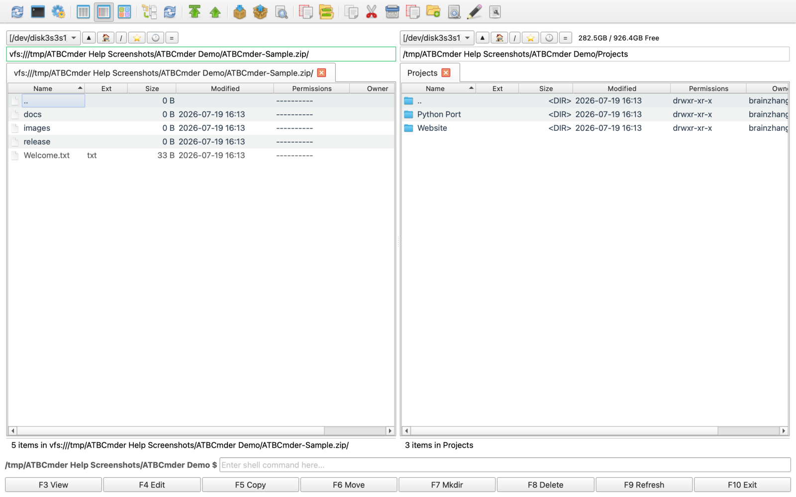

# Kapitel 6: Virtuelle Dateisysteme & Netzwerk

Modernes Dateimanagement endet selten an der Grenze einer einzelnen physischen Festplatte. Softwareentwickler verwalten Remote-Staging-Umgebungen über SFTP; Systemadministratoren verwalten Unternehmensdateifreigaben über SMB/CIFS; Inhaltsersteller greifen über WebDAV auf Cloud-Speicher und Medienserver zu; und Power-User prüfen, bearbeiten und verpacken routinemäßig komprimierte Archive im Gigabyte-Bereich. 

Herkömmliche Desktop-Umgebungen zwingen Benutzer dazu, mit getrennten Anwendungen zu jonglieren: ein eigenständiges Archivierungsdienstprogramm zum Entpacken und erneuten Komprimieren von ZIP-Archiven, ein externer FTP/SFTP-Client zum Verwalten von Serverressourcen und Betriebssystem-Mount-Dialoge, die Remote-Volumes über getrennte Finder-Fenster verteilen. 

ATBCmder beseitigt diese Fragmentierung durch seine **Virtual File System (VFS)**-Engine. ATBCmder basiert auf einer einheitlichen URI-Abstraktionsschicht `vfs://` und behandelt Remote-Server und komprimierte Archive genau wie lokale Standardordner. Sie können in ein `.tar.gz`-Archiv navigieren, Codedateien mit `F3` in der Vorschau anzeigen, eine verschachtelte Konfigurationsdatei mit `F4` bearbeiten (mit automatischem Live-Neupacken beim Speichern) und Assets mithilfe des Standardschlüssels `F5` direkt über eine sichere SFTP-Sitzung auf ein SMB-NAS vor Ort kopieren – alles ohne Extrahieren von Zwischendateien auf die Festplatte oder das Umschalten zwischen separaten Tools. 

---

## 1. Visueller Schnellstart: Die VFS-Architektur und Befehlsmatrix

ATBCmder leitet den gesamten Dateisystemzugriff über eine einheitliche Abstraktionsschicht. Unabhängig davon, ob ein Pfad auf eine Apple APFS SSD-Partition, ein Mitglied in einem verschachtelten `.zip`-Archiv oder ein Remote-Verzeichnis verweist, das auf einem Linux-SFTP-Server am anderen Ende der Welt gehostet wird, bietet die Dual-Panel-Schnittstelle ein identisches Betriebsmodell. 

```
┌────────────────────────────────────────────────────────────────────────────────────────┐
│                              ATBCMDER DUAL-PANEL GUI                                   │
│            Left Panel (Active)                  Right Panel (Inactive / Target)        │
├────────────────────────────────────────────────────────────────────────────────────────┤
│                                          │                                             │
│  [1] Local File System                   │  [2] Archive Virtual File System (VFS)      │
│      file:///Users/brain/projects/       │      vfs:///Users/brain/backup.tar.gz/src/  │
│      Direct POSIX / APFS access          │      In-place browse, F3 view, F4 live edit │
│                                          │                                             │
│  [3] Remote Network VFS (SFTP/SSH)       │  [4] Remote Storage VFS (SMB / WebDAV)      │
│      vfs://sftp://deploy@aws.prod/app/   │      vfs://smb://admin@truenas/Pool/Media/  │
│      Paramiko / SSH Keys / Keychain      │      Kernel mount_smbfs / WebDAVClient3     │
│                                          │                                             │
├────────────────────────────────────────────────────────────────────────────────────────┤
│                          UNIFIED VFS DISPATCH ENGINE (vfs://)                          │
│     FileSystemModel ➔ VFSManager ➔ SessionCache ➔ StreamCopyWorker / RepackWorker      │
└────────────────────────────────────────────────────────────────────────────────────────┘
```

### Dual-Matrix-VFS- und Netzwerk-Spickzettel

| Aktion | macOS-Verknüpfung | Klassische Commander-Taste | Befehls-ID | Beschreibung | 
| :--- | :--- | :--- | :--- | :--- | 
| **Dateien ins Archiv packen** | `Alt+F5` / `⌥F5` | `Alt+F5` | `cm_PackFiles` | Öffnet das Dialogfeld „Archive Pack“ mit Format-, Komprimierungs- und Kennwortoptionen. | 
| **Dateien aus dem Archiv extrahieren** | `Alt+F9` / `⌥F9` | `Alt+F9` | `cm_ExtractFiles` | Entpackt ausgewählte Archive mit Kollisionsauflösung. | 
| **Schnelle Netzwerkverbindung** | Menü: Netzwerk | `cm_NetworkConnect` | `cm_NetworkConnect` | Öffnet den Dialog für die schnelle Ad-hoc-Verbindung. | 
| **Verbindungsmanager** | Menü: Netzwerk | `cm_ManageConnections`| `cm_ManageConnections`| Öffnet den vollständigen CRUD-Netzwerkmanager mit gespeicherten Verbindungsprofilen. | 
| **FTP-Verbindung** | `Ctrl+S` / `⌃S` | `Ctrl+S` | `cm_FTPConnect` | Schnelle Verknüpfung zum Auslösen einer FTP-Verbindungssitzung. | 
| **Archiv/Ordner eingeben** | `Enter` / `⏎` | `Enter` | `cm_Open` | Navigiert direkt innerhalb eines `.zip`, `.tar`, `.7z` oder Remote-Verzeichnisses. | 
| **Aufsteigen zum übergeordneten Ordner** | `Backspace` / `⌫` | `Backspace` | `cm_GoToParent` | Steigt aus dem Archiv oder Remote-Verzeichnis zurück auf die übergeordnete Ebene. | 
| **Virtuelle/Remote-Datei anzeigen**| `F3` / `Fn+F3` | `F3` | `cm_View` | Streamt Remote- oder Archivdateien in Universal Lister. | 
| **Virtuelle/Remote-Datei bearbeiten**| `F4` / `Fn+F4` | `F4` | `cm_Edit` | Öffnet die Datei im Editor; Wird beim Speichern automatisch neu gepackt oder hochgeladen. | 
| **Panelübergreifend kopieren / VFS** | `F5` / `Fn+F5` | `F5` | `cm_Copy` | Kopiert ausgewählte Elemente über lokale, Archiv- oder Netzwerkendpunkte. | 
| **Hintergrund-Bedienfeld**| Menü: Anzeigen | `cm_OperationsPanel` | `cm_OperationsPanel` | Überwacht Hintergrundübertragungswarteschlangen, Geschwindigkeiten und aktive Threads. | 

---

## 2. Die einheitliche `vfs://` URI-Abstraktion

Herkömmliche Dateimanager behandeln Remote-Server und -Archive als Bürger zweiter Klasse und erfordern externe Bereitstellungsprogramme, temporäre Extraktionsordner oder Übertragungsclients von Drittanbietern. ATBCmder vereint jede Dateiquelle unter einer einzigen, klar definierten URI-Spezifikation: 

```
vfs://[protocol]://[user]@[host]:[port]/[remote_path]
```

### 2.1 Anatomie virtueller Pfade

Abhängig von der Betriebsdomäne nehmen `vfs://`-URIs eine von zwei Standardformen an: 

1. **Virtuelle Pfade archivieren**: 
   ```
   vfs:///Users/brain/Documents/release_v1.7.zip/src/main.py
   ```
 

- **Äußeres Präfix**: `vfs://` weist `FileSystemModel` an, die Pfaddurchquerung abzufangen. 
- **Containerpfad**: `/Users/brain/Documents/release_v1.7.zip` identifiziert das physische Containerarchiv im lokalen Speicher. 
- **Internes Mitglied**: `src/main.py` lokalisiert die im Archiv verschachtelte virtuelle Ressource. 

2. **Netzwerkserverpfade**: 
   ```
   vfs://sftp://developer@staging.internal.net:2222/var/www/html/index.php
   vfs://smb://admin@192.168.1.50/StoragePool/Backups/2026/
   vfs://webdavs://user@cloud.mycompany.com:443/remote.php/dav/files/user/
   ```
 

- **Schema Specifier**: Identifiziert den Transporttreiber (`sftp`, `ftp`, `ftps`, `smb`, `webdav`, `webdavs`, `gdrive`, `dropbox`). 
- **Authentifizierung**: Kodiert Benutzeranmeldeinformationen und Zielport. 
- **Remote-Ziel**: Löst absolute Verzeichnis- und Dateipfade auf dem Remote-Host auf. 

```
┌────────────────────────────────────────────────────────────────────────────────────────┐
│                              VFS URI ROUTING IN ACTION                                 │
├────────────────────────────────────────────────────────────────────────────────────────┤
│                                                                                        │
│   Input URI: vfs://sftp://deploy@aws.infra:22/var/log/nginx/access.log                 │
│                 │      │        │        │   └────────────────────► Remote Path        │
│                 │      │        │        └────────────────────────► Port (Default 22)  │
│                 │      │        └─────────────────────────────────► Host / Server      │
│                 │      └──────────────────────────────────────────► Username           │
│                 └─────────────────────────────────────────────────► Protocol Scheme    │
│                                                                                        │
│   Input URI: vfs:///Volumes/Data/Archive.zip/docs/manual.pdf                           │
│                 │                      │        └─────────────────► Archive Member     │
│                 │                      └──────────────────────────► Physical Archive   │
│                 └─────────────────────────────────────────────────► Virtual Scheme     │
└────────────────────────────────────────────────────────────────────────────────────────┘
```

### 2.2 Nahtlose Dual-Panel-Integration

Da virtuelle Pfade den Standardverzeichnisstrukturen in ATBCmder entsprechen, genießen Sie volle Dual-Panel-Parität: 

- **Virtuelle Arbeitsbereiche mit Registerkarten**: Öffnen Sie einen Remote-SFTP-Ordner in Tab 1, ein verschlüsseltes lokales ZIP-Archiv in Tab 2 und Ihren lokalen Ordner `~/Downloads` in Tab 3. 
- **Directional Copying (`F5`)**: Wählen Sie Dateien in Ihrem lokalen aktiven Bereich aus und drücken Sie `F5`, um sie direkt auf den Remote-Server oder das komprimierte Archiv hochzuladen, das im inaktiven Bereich angezeigt wird. 
- **Drag-and-Drop-Interoperabilität**: Ziehen Sie Elemente ohne Zwischenspeicherung über Panels zwischen lokalen Festplatten, Netzwerkfreigaben und Archivhierarchien. 
- **Interaktive Breadcrumb-Leiste**: Die Breadcrumb-Pfadleiste analysiert virtuelle URIs in anklickbare Segmente. Klicken Sie auf einen beliebigen übergeordneten Ordner oder das Root-Server-Badge, um sofort in der Baumstruktur nach oben zu springen. 

---

## 3. Archiv-VFS: In-Place-Navigation und -Inspektion

Das Öffnen eines Archivs in ATBCmder erfordert keine manuelle Extraktion oder ein Dekomprimierungstool eines Drittanbieters. Markieren Sie einfach ein unterstütztes Archiv und drücken Sie **`Enter`** (oder doppelklicken Sie). ATBCmder mountet das Archiv direkt und verwandelt das Panel in einen Hochgeschwindigkeits-Browser für virtuelle Verzeichnisse. 

 
*Abbildung 6.1: Navigieren in einem mehrfach verschachtelten komprimierten Archiv als virtueller Ordner mit unkomprimierten Größen, Zeitstempeln und Unterverzeichnissen.*

### 3.1 Unterstützte Archivformate

ATBCmder verfügt über integrierte Treiber für alle branchenüblichen Archiv- und Komprimierungsformate: 

| Formatieren | Dateierweiterungen | Lesen Sie Support | Schreiben / Packen | Verschlüsselungsunterstützung | 
| :--- | :--- | :---: | :---: | :--- | 
| **PLZ** | `.zip` | Ja | Ja | Standard & AES-256 (`pyzipper`) | 
| **GZip-Tarball** | `.tar.gz`, `.tgz` | Ja | Ja | POSIX-Standard-Tar-Streaming | 
| **BZip2-Tarball**| `.tar.bz2`, `.tbz2` | Ja | Ja | Bzip2-Blockkomprimierung mit hohem Verhältnis | 
| **XZ-Tarball** | `.tar.xz`, `.txz` | Ja | Ja | Hocheffiziente LZMA2-Komprimierung | 
| **Einfacher TAR** | `.tar` | Ja | Ja | Unkomprimiertes UNIX-Bandarchiv | 
| **7-Zip** | `.7z` | Ja | Ja (über `py7zr`)| LZMA / LZMA2 solide Komprimierung |

### 3.2 Workflows für die In-Place-Navigation

Beim Durchsuchen eines Archivs: 

1. **Unterverzeichnisse eingeben**: Drücken Sie `Enter` in einem beliebigen Ordner im Archiv, um verschachtelte Bäume zu erkunden. 
2. **Aufsteigen zum übergeordneten Element (`..`)**: Drücken Sie `Backspace` (`⌫`) oder doppelklicken Sie auf den Eintrag `.. [Parent Directory]`, um aufzusteigen. Sobald Sie das Stammverzeichnis des Archivs erreicht haben, gelangen Sie durch Drücken von `Backspace` direkt zum physischen Verzeichnis zurück, das die Archivdatei enthält. 
3. **Sofortige Vorschau (`F3` / `Fn+F3`)**: Markieren Sie ein beliebiges Dokument, Bild oder eine Quelldatei im Archiv und drücken Sie `F3`. ATBCmder extrahiert die Zieldatei automatisch in eine sichere temporäre Sandbox und rendert sie im Universal Lister. 
4. **Selektives Kopieren (`F5` / `Fn+F5`)**: Anstatt ein ganzes Multi-Gigabyte-Archiv zu entpacken, nur um eine oder zwei Dateien abzurufen, wählen Sie die spezifischen Mitglieder aus, die Sie benötigen, und drücken Sie `F5`. ATBCmder entpackt nur die ausgewählten Elemente direkt in das inaktive Panel. 

> [!NOTE] 
> Bei der Vorschau oder dem Kopieren einzelner Dateien aus einem Archiv streamt ATBCmder nur die angeforderten Dateibytes direkt aus dem Container-Stream. Das Entpacken nicht ausgewählter Geschwisterdateien verschwendet weder Speicherplatz noch Zeit. 

---

## 4. Live-Umpacken: Direktbearbeitung in Archiven

Einer der leistungsstärksten Workflows in ATBCmder ist **Live Repacking**. In der Vergangenheit erforderte das Ändern einer einzelnen Datei, die in einem komprimierten Archiv verschachtelt war, eine langwierige Abfolge von sechs Schritten: Extrahieren des gesamten Archivs, Suchen der Zieldatei, Bearbeiten und Speichern, erneutes Komprimieren des Verzeichnisses in ein neues Archiv, Löschen des Originalarchivs und Bereinigen temporärer Ordner. 

ATBCmder macht das Bearbeiten von Dateien in Archiven genauso mühelos wie das Bearbeiten lokaler Standarddateien. 

```
┌────────────────────────────────────────────────────────────────────────────────────────┐
│                              LIVE REPACKING LIFECYCLE                                  │
├────────────────────────────────────────────────────────────────────────────────────────┤
│                                                                                        │
│  1. User presses F4 on "config.json" inside "package.zip"                              │
│     │                                                                                  │
│     ├──► ATBCmder extracts "config.json" to sandbox: /tmp/dc_repack_xyz/config.json    │
│     └──► Opens internal EditorDialog with window title: "config.json — Editor"         │
│                                                                                        │
│  2. User modifies file and presses Cmd+S (Save)                                        │
│     │                                                                                  │
│     ├──► Editor emits file_saved signal                                                │
│     └──► RepackWorker checks original archive size vs ArchiveRepackWarningMB threshold │
│                                                                                        │
│  3. Atomic Repack Execution                                                            │
│     │                                                                                  │
│     ├──► Writes modified stream to staging archive: /tmp/package.zip.tmp               │
│     ├──► Validates container integrity via archive driver                              │
│     ├──► Atomic swap: os.replace("/tmp/package.zip.tmp", "/original/package.zip")      │
│     └──► Refreshes active file panel and cleans up sandbox /tmp/dc_repack_xyz/         │
│                                                                                        │
└────────────────────────────────────────────────────────────────────────────────────────┘
```

### 4.1 Schritt-für-Schritt: Bearbeiten einer archivierten Konfigurationsdatei

1. Navigieren Sie in das Archiv (z. B. `application_bundle.zip`), indem Sie `Enter` drücken. 
2. Suchen Sie die Datei, die Sie ändern möchten (z. B. `settings.yaml`). 
3. Drücken Sie **`F4`** (`Fn+F4`). ATBCmder extrahiert die Datei in einen temporären Cache und startet den integrierten Editor. 
4. Nehmen Sie Ihre Änderungen im Editor vor. 
5. Drücken Sie zum Speichern **`Cmd+S`** (`⌘S`). 
6. Schließen Sie den Editor mit `Cmd+W` (`⌘W`) oder `Esc`. 
7. `RepackWorker` von ATBCmder aktualisiert automatisch das interne Mitglied, komprimiert die aktualisierte Struktur in eine temporäre Datei, ersetzt atomar das Originalarchiv und aktualisiert die Panelansicht. 

> [!CAUTION] 
> **Großer Archivschutz (`ArchiveRepackWarningMB`)** 
> Das Neupacken eines komprimierten Archivs erfordert das Dekomprimieren und Neukodieren von Container-Streams. Das Ändern einer 10-KB-Datei in einem 20-GB-Videoarchiv `.tar.gz` würde den Computer dazu zwingen, alle 20 GB an Daten neu zu schreiben. 
> 
> Um ein versehentliches Einfrieren der Festplatte zu verhindern, enthält ATBCmder einen schützenden Sicherheitsschwellenwert (`ArchiveRepackWarningMB`, Standard: **100 MB** in `atbcmder.xml`). Wenn Sie versuchen, eine Datei in einem Archiv zu bearbeiten oder zu löschen, das diesen Grenzwert überschreitet, zeigt ATBCmder eine Bestätigungsaufforderung an: 
> *„Um dieses Archiv zu ändern, muss die gesamte Datei neu gepackt werden, was lange dauern kann. Möchten Sie fortfahren?“* 

---

## 5. Archive erstellen und extrahieren (`Alt+F5` / `Alt+F9`)

ATBCmder stellt dedizierte Hintergrundarbeiter zum Erstellen und Extrahieren von Archiven bereit und stellt sicher, dass Ihre Dateibereiche auch bei lang andauernden Komprimierungsaufträgen reaktionsfähig bleiben. 

 
*Abbildung 6.2: Das Dialogfeld „Archivparameter“ (Alt+F5 / cm_PackFiles) zeigt Zielpfad, Formatauswahl, Komprimierungsstufen und Passwortverschlüsselung.*

### 5.1 Dateien komprimieren (`Alt+F5` / `⌥F5` / `cm_PackFiles`)

So erstellen Sie ein neues Archiv: 

1. Wählen Sie im aktiven Bereich die Dateien oder Verzeichnisse aus, die Sie bündeln möchten. 
2. Drücken Sie **`Alt+F5`** (`⌥F5`) oder wählen Sie **Dateien ➔ Packen...** aus der Menüleiste. 
3. Das Dialogfeld **Dateien packen** erscheint: 
- **Archivdatei erstellen**: Zieldateipfad. Standardmäßig schlägt ATBCmder vor, das Archiv im Verzeichnis des inaktiven Panels abzulegen, das nach dem fokussierten Element benannt ist. 
- **Archivformat**: Wählen Sie zwischen `ZIP`, `TAR`, `TAR.GZ`, `TAR.BZ2`, `TAR.XZ` oder `7Z`. 
- **Komprimierungsstufe**: 
- `Store`: Keine Komprimierung; Sofortverpackung für vorkomprimierte Medien (MP4, JPEG). 
- `Fast`: Geringer CPU-Overhead; Ideal für schnelle Transfers. 
- `Normal (Deflated)`: Ausgewogenes Geschwindigkeits- und Komprimierungsverhältnis (empfohlen für den allgemeinen Gebrauch). 
- `Maximum`: Komprimierung mit höchster Dichte (verwendet ggf. LZMA/Bzip2). 
- **Passwort (nur ZIP)**: Geben Sie eine geheime Passphrase ein, um das Archiv zu verschlüsseln. 
4. Klicken Sie auf **Start** (oder drücken Sie `Enter`). Der Vorgang wird in einem nicht blockierenden Hintergrundthread mit einem Fortschrittsbalken und einer Datei-für-Datei-Statusanzeige ausgeführt.

#### AES-256-Passwortverschlüsselung nach Militärstandard

Die Standard-ZIP-Verschlüsselung (älteres ZipCrypto) ist kryptografisch fehlerhaft und anfällig für Klartext-Wörterbuchangriffe. Wenn Sie ein Passwort für ein ZIP-Archiv angeben, verwendet ATBCmder die **AES-256-Verschlüsselung** mit `pyzipper` (`pyzipper.AESZipFile` mit `WZ_AES`-Standard). Dies stellt die Kompatibilität mit macOS, WinZip und 7-Zip sicher und schützt gleichzeitig sensible Daten vor Brute-Force-Entschlüsselung.

#### Aufteilen riesiger Archive auf Sets mit mehreren Bänden

Wenn Sie ein Archiv über E-Mail-Anhänge, FAT32-Laufwerke oder Cloud-Upload-Grenzen mit Dateigrößenbeschränkungen verteilen müssen: 

1. Bündeln Sie Ihre Dateien mit `Alt+F5` (`cm_PackFiles`). 
2. Markieren Sie das resultierende Archiv `.zip` oder `.tar` und lösen Sie den Dateisplitter über **`Alt+F6`** (`cm_FileSpliter`) aus. 
3. Wählen Sie eine voreingestellte Teilungsgröße (z. B. `100 MB`, `4.7 GB DVD`, `CD 700 MB` oder eine benutzerdefinierte Bytegröße). 
4. ATBCmder generiert nummerierte Teilstücke (`archive.zip.001`, `archive.zip.002` usw.) zusammen mit einem CRC32-Verifizierungsmanifest. Empfänger können den ursprünglichen Container jederzeit mit **`cm_FileLinker`** (`cm_Combine`) wieder zusammensetzen. 

---

### 5.2 Archive extrahieren (`Alt+F9` / `⌥F9` / `cm_ExtractFiles`)

So extrahieren Sie Archive auf die Festplatte: 

1. Markieren Sie ein oder mehrere Archive im aktiven Bereich. 
2. Drücken Sie **`Alt+F9`** (`⌥F9`) oder wählen Sie **Dateien ➔ Extrahieren...** aus der Menüleiste. 
3. Das Dialogfeld **Dateien extrahieren** wird angezeigt: 
- **Zu extrahierendes Archiv**: Ausgewählter Container-Quellpfad. 
- **In Verzeichnis extrahieren**: Zielverzeichnis (standardmäßig das inaktive Panel). 
- **Vorschau des Inhalts**: Ein interaktives Listenfeld, das Archiv-Eintrager in Echtzeit lädt. 
- **Passwort**: Eingabefeld für passwortgeschützte Archive. 
4. Klicken Sie auf **Start**. Wenn im Zielordner bereits eine Zieldatei vorhanden ist, hält ATBCmder den Worker an und zeigt einen interaktiven Kollisionsdialog an: 
- **Überschreiben**: Ersetzt die in Konflikt stehende Zieldatei. 
- **Überspringen**: Lässt die vorhandene Datei unberührt und fährt mit dem nächsten Element fort. 
- **Alle überschreiben**: Überschreibt stillschweigend alle nachfolgenden Konflikte. 
- **Alle überspringen**: Alle vorhandenen Zieldateien werden automatisch umgangen. 
- **Abbrechen**: Stoppt den Extraktionsprozess sicher. 

---

## 6. Remote-Netzwerk-VFS: Protokolle und Remote-Speicher

ATBCmder umfasst eine Multiprotokoll-Netzwerk-Client-Engine, mit der Remote-Server direkt im Dual-Panel-Arbeitsbereich bereitgestellt, durchsucht und manipuliert werden können. 

 
*Abbildung 6.3: Durchsuchen von Remote-Linux-Serververzeichnissen über sicheres SFTP mit Live-Dateiattributen, Besitzberechtigungen und Dual-Panel-Übertragung.* 

 
*Abbildung 6.4: Unterstützte Netzwerkverbindungstypen: FTP/FTPS, sicheres SFTP, WebDAV-Cloud-Speicher und SMB-Netzwerkfreigaben.*

### 6.1 Unterstützte Netzwerkprotokolle

| Protokollschema | Standardport | Transportschicht | Authentifizierungsmodi | Am besten geeignet für | 
| :--- | :---: | :--- | :--- | :--- | 
| **`sftp://`** | `22` | SSH-2 (Paramiko) | Passwort, SSH-Schlüssel (`id_rsa`, `id_ed25519`) | Linux-Server, Cloud-Instanzen, Staging-Hosts | 
| **`ftp://`** | `21` | Einfach RFC 959 | Anonym, Klartext-Benutzername und Passwort | Legacy-Webhosting, lokale Laborgeräte | 
| **`ftps://`** | `990` | TLS-verschlüsseltes FTP | Benutzername und Passwort mit SSL/TLS | Sichere kommerzielle FTP-Server | 
| **`smb://`** | `445` | CIFS / SMB3 | Windows NT / Kerberos / Lokales Konto | Windows-Freigaben, NAS-Appliances, Samba-Server | 
| **`webdav://`** | `80` | HTTP-WebDAV | Basic, Digest-Authentifizierung | Webserver, lokaler Netzwerkspeicher | 
| **`webdavs://`** | `443` | HTTPS-WebDAV | SSL-verschlüsselte Basic/Digest-Authentifizierung | Nextcloud, ownCloud, kommerzieller Cloud-Speicher | 
| **`gdrive://`** | `443` | Google Drive-API | OAuth2-Token-Autorisierung | Cloud-Laufwerke und freigegebene Ordner von Google Drive |
| **`dropbox://`** | `443` | Dropbox API v2 | OAuth2-Token-Autorisierung | Cloud-Laufwerke und freigegebene Ordner von Dropbox | 

---

### 6.2 Protokollfunktionen und tiefer Einblick

#### SFTP (SSH File Transfer Protocol)

Unterstützt durch die branchenübliche SSH-Engine `paramiko` baut der SFTP-Treiber von ATBCmder verschlüsselte Tunnel über Port 22 auf: 

- **Host-Schlüsselsicherheit (`WarningPolicy`)**: In Übereinstimmung mit strengen Sicherheitsanforderungen konsultiert ATBCmder automatisch Ihre lokale Datei `~/.ssh/known_hosts`. Beim Herstellen einer Verbindung zu einem bekannten Host werden die Hostschlüssel kryptografisch überprüft. Wenn ein unbekannter Server gefunden wird, gibt ATBCmder eine Sicherheitswarnung aus, anstatt unerwarteten öffentlichen Schlüsseln stillschweigend zu vertrauen. 
- **SSH-Schlüsselauthentifizierung**: Zusätzlich zur Standard-Passwortauthentifizierung unterstützt ATBCmder private SSH-Schlüsseldateien (`~/.ssh/id_rsa`, `~/.ssh/id_ed25519`). 
- **UNIX-Attributzuordnung**: Behält Remote-Oktaldateimodi (`chmod`), Benutzer-/Gruppenbesitzzeichenfolgen und genaue POSIX-Änderungszeitstempel bei.

#### FTP & FTPS (Explizites / Implizites SSL)

Angetrieben durch Pythons `ftplib` unterstützt der FTP-Treiber:

 - **Passiver Modus (PASV)**: Standardmäßig aktiviert, um zuverlässige Verbindungen über restriktive NAT-Router und Consumer-Firewalls sicherzustellen. 
- **Konfigurierbare Kodierungen**: Behebt Anzeigeprobleme bei Nicht-ASCII-Dateinamen, indem Sie zwischen den Zeichensätzen `UTF-8`, `ISO-8859-1`, `GB18030` und `Windows-1252` wechseln können.

#### SMB / Samba (Windows-Freigaben und NAS-Geräte)

Im Gegensatz zu naiven Userspace-Python-SMB-Bibliotheken, die unter langsamen Übertragungsgeschwindigkeiten leiden, verwendet ATBCmder eine Hybridarchitektur: 

- **macOS Native Kernel Acceleration (`mount_smbfs`)**: Unter macOS nutzt ATBCmders `SambaMounter` das native `/sbin/mount_smbfs`-Subsystem von Apple. Es mountet die Remote-Freigabe direkt in den macOS VFS-Baum (`/Volumes/` oder ein isoliertes Mount-Verzeichnis) und ermöglicht so den vollen hardwarebeschleunigten SMB3-Lese-/Schreibdurchsatz. 
- **Vorhandene Mount-Erkennung**: Wenn macOS Finder oder ein Systemskript die Ziel-SMB-Freigabe bereits gemountet hat, erkennt ATBCmder automatisch den aktiven Mountpunkt aus der OS-Tabelle `mount` und navigiert sofort zu ihm, wodurch redundante Netzwerkverbindungen vermieden werden. 

> [!IMPORTANT] 
> **SMB-Freigabenamenanforderung** 
> Ein SMB-Server kann nicht auf der Ebene des reinen Hostnamens durchsucht werden. Ein SMB-URI **muss** den Zielfreigabe- oder Exportnamen im Pfad enthalten: 
> 
> - ❌ Ungültig: `vfs://smb://nas.local/` 
> - ✅ Gültig: `vfs://smb://nas.local/StoragePool` oder `vfs://smb://192.168.1.100/Media`

#### WebDAV & WebDAVS (Nextcloud / Cloud Storage)

Dieser Treiber basiert auf `webdavclient3` und bietet bidirektionale Dateisynchronisierung mit modernen Cloud-Speicherlösungen: 

- **SSL-Zertifikatsüberprüfung**: Unterstützt die strikte SSL-Zertifikatsvalidierung für öffentliche WebDAVS-Hosts, mit einem Override-Schalter für selbstsignierte Zertifikate in privaten Homelab-Setups. 
- **Rekursive Verzeichniserstellung (`makedirs`)**: Erstellt bei Massen-Upload-Vorgängen automatisch fehlende verschachtelte Remote-Verzeichnispfade. 

---

---

### 6.3 Google Drive Cloud-Speicher: Leicht verständliche Einrichtungsanleitung

Die Verwaltung von Google Drive über einen Webbrowser fühlt sich beim Hochladen großer Dateien oder beim Organisieren verschachtelter Ordner oft träge an. Darüber hinaus versucht die offizielle Google Drive-Desktop-App normalerweise, ganze Ordnerstrukturen mit Ihrer lokalen Mac-SSD zu synchronisieren, was wertvollen Speicherplatz belegt.

ATBCmder löst dieses Problem, indem es **Google Drive als aktives virtuelles Laufwerk (`gdrive://`)** einbindet. Sie können Ihre Remote-Google Drive-Ordner direkt in der Zwei-Fenster-Oberfläche durchsuchen, Cloud-Dateien mit `F3` sofort in der Vorschau anzeigen und Dateien mit `F5` zwischen Ihrem Mac und Google Drive kopieren – **ohne Ihren gesamten Cloud-Speicher auf Ihren Computer herunterladen zu müssen**.

  
*Abbildung 6.5: Verbindung mit Google Drive über den Verbindungsmanager mit OAuth2-Client-Anmeldeinformationen und Durchsuchen von Cloud-Dateien neben lokalen Ordnern in der Zwei-Fenster-Ansicht.*

#### Warum benötige ich eine „Client-ID“ und ein „Client-Secret“?

Um Ihre Privatsphäre und Sicherheit zu schützen, gestattet Google Drittanbieter-Desktop-Apps nicht, direkt nach Ihrem Google-Kontopasswort zu fragen. Stattdessen verwendet Google die **OAuth 2.0-Autorisierung**.

Indem Sie Ihre eigenen kostenlosen OAuth-Anmeldeinformationen in der Google Cloud Console erstellen:

- **100 % privat & direkt**: Ihre Daten fließen direkt zwischen Ihrem Mac und den offiziellen Google-Servern. Kein Drittanbieter oder Zwischenserver sieht jemals Ihre Dateien oder Anmeldeinformationen.
- **Dedizierte Geschwindigkeit & Kontingente**: Sie erhalten Ihre eigene private API-Bandbreite, ohne Ratenbegrenzungen mit Tausenden anderer Benutzer zu teilen.
- **Jederzeit widerrufbar**: Sie behalten die volle Kontrolle. Sie können den Zugriff von ATBCmder jederzeit mit einem einzigen Klick im Sicherheits-Dashboard Ihres Google-Kontos widerrufen.

Die Einrichtung dauert **weniger als 3 Minuten** und muss nur ein einziges Mal durchgeführt werden!

---

#### Schritt 1: Kostenlose Anmeldeinformationen in Google Cloud erstellen (Dauert 2 Minuten)

1. Öffnen Sie die [Google Cloud Console – Anmeldedaten](https://console.cloud.google.com/apis/credentials) in Ihrem Webbrowser und melden Sie sich mit Ihrem Google-Konto an.
2. **Projekt auswählen oder erstellen**:
   - Klicken Sie oben auf der Seite auf das Dropdown-Menü für Organisation / Projekt.
   - *(Tipp für Organisationen: Wenn Sie eine Google Workspace- oder Cloud Identity-Organisation wie `aitobox.com` besitzen, wählen Sie diese im Dropdown-Menü aus, damit das Projekt unter Ihrer Unternehmensdomäne erstellt wird)*.
   - Wenn Sie noch kein Projekt haben, klicken Sie auf **Neues Projekt**, vergeben Sie einen beliebigen Namen (z. B. `ATBCmder`) und klicken Sie auf **Erstellen**.
3. **Google Drive-API aktivieren**:
   - Gehen Sie in der linken Seitenleiste oder über die obere Suchleiste zu **Aktivierte APIs und Dienste** (oder klicken Sie auf **+ APIS UND DIENSTE AKTIVIEREN**).
   - Suchen Sie nach **Google Drive API**, klicken Sie darauf und dann auf die blaue Schaltfläche **Aktivieren**.
4. **OAuth-Zustimmungsbildschirm konfigurieren** *(falls aufgefordert)*:
   - Wenn Sie zum ersten Mal Anmeldedaten erstellen, fordert Google Sie möglicherweise auf, den Zustimmungsbildschirm zu konfigurieren:
     - Wählen Sie **Extern** und klicken Sie auf **Erstellen**.
     - Geben Sie einen **App-Namen** ein (z. B. `ATBCmder`) und tragen Sie Ihre E-Mail-Adresse für Support und Entwicklerkontakt ein.
     - Legen Sie unter **App-Domain** die **Anwendungs-Startseite** auf Ihre Website fest (z. B. `https://cmder.aitobox.com`).
     - Fügen Sie unter **Autorisierte Domänen** Ihre Root-Domain hinzu (z. B. `aitobox.com`).
     - Klicken Sie auf den folgenden Bildschirmen auf **Speichern und fortfahren**.
5. **Desktop-Anmeldeinformationen erstellen**:
   - Kehren Sie zu **APIs & Dienste ➔ Anmeldedaten** zurück.
   - Klicken Sie oben auf **+ Anmeldedaten erstellen** und wählen Sie **OAuth-Client-ID**.
   - Wählen Sie im Dropdown-Menü **Anwendungstyp** die Option **Desktop-App**.
   - Geben Sie in das Feld **Name** `ATBCmder Desktop` (oder einen beliebigen Namen) ein.
   - Klicken Sie auf **Erstellen**.
6. **Schlüssel kopieren**:
   - Es erscheint ein Dialogfeld mit Ihrer **Client-ID** (endet auf `.apps.googleusercontent.com`) und Ihrem **Client-Secret**.
   - Kopieren Sie beide Zeichenfolgen (oder lassen Sie den Browser-Tab geöffnet).

---

#### Benutzerdefiniertes Branding: „Zugriff gewährt für“ (Access Granted To) verstehen

Wenn Sie verbundene Drittanbieter-Apps im Sicherheits-Dashboard Ihres Google-Kontos ([myaccount.google.com/connections](https://myaccount.google.com/connections)) überprüfen, zeigt Google eine Detailkarte für ATBCmder an:

- **App-Name**: `ATBCmder`
- **Zugriff gewährt für (Access granted to)**: z. B. `aitobox.com` oder `oplist.org`
- **Homepage**: `https://cmder.aitobox.com`

##### Warum zeigt Google einen bestimmten Organisationsnamen an?

Die Zeile **„Zugriff gewährt für“ (Access granted to)** wird von Google automatisch basierend auf der **Google Cloud-Organisation** (oder dem Google Workspace-Konto) bestimmt, die Eigentümer des GCP-Projekts ist, in dem Ihre OAuth-Client-ID erstellt wurde:

- Wenn Ihre Client-ID in einem GCP-Projekt unter einer Drittorganisation (z. B. `oplist.org`) erstellt wurde, zeigt Google diese Domain an, um über die Eigentümerschaft des API-Clients zu informieren.
- Wenn das Projekt unter einem persönlichen Google-Konto erstellt wurde, zeigt Google Ihre Entwicklerkontakt-Identität an.

##### So setzen Sie die Organisation auf Ihre eigene Domain (z. B. `aitobox.com`)

Wenn das Google-Sicherheits-Dashboard Ihre eigene Unternehmensdomäne (z. B. `aitobox.com`) anzeigen soll:

1. **Projekt unter Ihrer Domain-Organisation erstellen**:
   - Melden Sie sich in der [Google Cloud Console](https://console.cloud.google.com/) mit einem Administratorkonto Ihrer Domain an (z. B. `admin@aitobox.com`).
   - Vergewissern Sie sich, dass im oberen Dropdown-Menü Ihre Domäne (z. B. `aitobox.com`) ausgewählt ist, bevor Sie das Projekt erstellen.
2. **App-Domain im OAuth-Zustimmungsbildschirm konfigurieren**:
   - Gehen Sie zu **APIs & Dienste ➔ OAuth-Zustimmungsbildschirm**.
   - Legen Sie die **Anwendungs-Startseite** auf Ihre offizielle Produktseite fest (z. B. `https://cmder.aitobox.com`).
   - Tragen Sie Ihre Stammdomäne unter **Autorisierte Domänen** ein (z. B. `aitobox.com`).
   - Hinterlegen Sie Ihre Support- und Entwickler-E-Mail-Adresse unter Ihrer Domäne.
3. **Neue Desktop-App-Client-ID generieren**:
   - Erstellen Sie unter **APIs & Dienste ➔ Anmeldedaten** eine neue **OAuth-Client-ID** vom Typ **Desktop-App**.
4. **Schlüssel in ATBCmder aktualisieren**:
   - Fügen Sie die neue Client-ID und das neue Client-Secret in den ATBCmder-Verbindungsmanager ein und klicken Sie auf **Erneut autorisieren...**.
   - Google zeigt nun Ihre Unternehmensdomäne (`aitobox.com`) als autorisierten Empfänger an!

---

#### Schritt 2: Google Drive in ATBCmder hinzufügen

Sobald Sie Ihre Schlüssel haben, sind in ATBCmder nur wenige Klicks erforderlich:

1. Öffnen Sie in ATBCmder in der Menüleiste **Netzwerk ➔ Verbindungen verwalten...** (oder drücken Sie `cm_ManageConnections`).
2. Klicken Sie unten links auf **`+ Neu`**, um ein neues Profil zu erstellen.
3. Im Formular **Verbindungsdetails** auf der rechten Seite:
   - **Bezeichnung**: Geben Sie einen einprägsamen Namen ein (z. B. `Mein Google Drive` oder `Arbeits-Drive`).
   - **Protokoll**: Wählen Sie **`gdrive`** aus dem Dropdown-Menü.
   - **Client-ID**: Fügen Sie die aus Google Cloud kopierte Client-ID ein.
   - **Client-Secret**: Fügen Sie das aus Google Cloud kopierte Client-Secret ein.
   - *(Tipp: Sie können auch direkt auf den blauen Link `Create OAuth 2.0 credentials in Google Cloud Console` unter dem Secret-Feld klicken)*.
4. Klicken Sie auf **Autorisieren** (oder **Erneut autorisieren...**):
   - ATBCmder öffnet automatisch Ihren Standard-Webbrowser mit der offiziellen Google-Anmeldeseite.
   - **Wichtiger Sicherheitshinweis (Völlig normal und erwartet)**:  
     Da Sie eine private Entwickler-Client-ID in Ihrem eigenen GCP-Projekt erstellt haben, zeigt Google den Warnhinweis *„Google hat diese App nicht überprüft“ / „Sicherheitsrisiko“* an.  
     **Dies ist völlig normal und absolut sicher.** Erweitern Sie im Browser die Optionen (klicken Sie auf **Erweitert / Advanced**) und wählen Sie unten **„Zu App wechseln (unsicher) / Trotzdem fortfahren“**.
   - Wählen Sie Ihr Google-Konto aus und bestätigen Sie die angeforderten Berechtigungen (Lese-/Schreibzugriff auf Google Drive).
   - Klicken Sie auf **Fortfahren / Zulassen**.
   - Nach erfolgreicher Genehmigung meldet der Browser den Erfolg. Kehren Sie zu ATBCmder zurück – der Status wechselt zu:  
     `✓ Authorized (your_account@gmail.com)`!

> [!NOTE]
> **Warum zeigt Google eine Warnung vor einer unbestätigten App an?**  
> Wenn die offizielle Autorisierungsseite im Browser aufgerufen wird, warnt Google, dass die Anwendung nicht verifiziert wurde. Dies ist der normale Branchenstandard für selbst erstellte OAuth-Entwickler-Anmeldedaten. Da Sie die Anmeldeinformationen selbst in Ihrer eigenen Google Cloud Console erstellt haben und nur Sie die Schlüssel besitzen, bleiben Ihr Konto und Ihre Daten 100 % sicher. Klicken Sie auf **Erweitert (Advanced)** und dann auf **„Trotzdem fortfahren“**, um die Autorisierung abzuschließen.

5. Klicken Sie auf **💾 Speichern**, um das Lesezeichen zu sichern, und anschließend auf **🔗 Verbinden** (oder doppelklicken Sie links auf den Eintrag).
6. Im aktiven Bereich öffnet sich sofort ein neuer Tab mit dem Pfad:
   ```
   vfs://gdrive://your_account@gmail.com//
   ```
   Alle Ihre Google Drive-Dateien und -Ordner liegen nun direkt vor Ihnen!

---

#### Schritt 3: Google Drive wie ein lokales Laufwerk nutzen

Nach dem Verbinden verhält sich Google Drive genau wie ein normaler lokaler Ordner:

- **Durchsuchen & Sofortvorschau**: Öffnen Sie Ordner per Doppelklick oder mit `Enter`. Wählen Sie ein Bild, eine PDF-Datei, Codedateien oder Dokumente aus und drücken Sie **`F3`**, um sie sofort im Universal Viewer zu prüfen, ohne sie vorher lokal zu speichern.
- **Hochladen (`F5`)**: Wählen Sie Dateien in Ihrem lokalen Bereich (z. B. im Ordner `Downloads`) aus und drücken Sie **`F5`**, um sie direkt in das Google Drive-Verzeichnis hochzuladen.
- **Herunterladen (`F5`)**: Markieren Sie Dateien im Google Drive-Bereich und drücken Sie **`F5`**, um sie in Ihren lokalen Zielordner herunterzuladen.
- **Drag & Drop**: Ziehen Sie Dateien und Ordner mit der Maus flexibel zwischen dem lokalen Bereich und dem Google Drive-Bereich hin und her.
- **Sofortige Aktualisierung (`F9` / `Ctrl+R`)**: Wenn Kollegen neue Dateien teilen oder Änderungen auf dem Smartphone vorgenommen wurden, drücken Sie einfach **`F9`**, um Cloud-Änderungen in Millisekunden abzurufen.
- **Echtzeit-Speicherkontingentanzeige**: Die Statuskapsel in der rechten oberen Symbolleiste zeigt Ihr verbleibendes Google Drive-Speichervolumen in Echtzeit an (z. B. `259.7 GB free of 994.7 GB`).
- **Verwaltung mehrerer Konten**: Sie können mehrere Google Drive-Profile im Verbindungsmanager hinterlegen (z. B. `Privates Drive` und `Geschäftliches Drive`) und sogar Dateien direkt zwischen zwei Konten in beiden Bereichen übertragen!
- **Hardware-Sicherheit über Secure Enclave**: Client-Secret und OAuth-Tokens werden direkt im **macOS-Systemschlüsselbund** (`ATBCmder_VFS`) mit Schutz durch Apples Secure Enclave verschlüsselt hinterlegt.

---

### 6.4 Dropbox Cloud-Speicher: Leicht verständliche Einrichtungsanleitung

Wie bei Google Drive bietet Ihnen der direkte Zugriff auf Dropbox in ATBCmder die Freiheit, Cloud-Dateien zu durchsuchen, hochzuladen und zu organisieren, ohne Hunderte von Gigabytes mit Ihrer lokalen Mac-SSD synchronisieren zu müssen.

ATBCmder bindet **Dropbox als aktives virtuelles Laufwerk (`dropbox://`)** ein, ermöglicht die Vorschau von Fotos und Dokumenten mit `F3`, unterstützt gestreamte segmentierte Übertragungen mit `F5` und überwacht Ihr Speicherkontingent in Echtzeit in der Symbolleiste.

#### Warum benötige ich einen „App Key“ und ein „App Secret“?

Um Ihre Privatsphäre und Kontosicherheit zu schützen, gestattet Dropbox Desktop-Tools von Drittanbietern nicht, nach Ihrem Dropbox-Passwort zu fragen. Stattdessen setzt Dropbox auf **OAuth 2.0-Autorisierung**.

Indem Sie Ihren eigenen kostenlosen Entwickler-App-Key und Ihr App-Secret in der Dropbox App Console anlegen:

- **100 % privat & direkt**: Ihre Daten fließen direkt zwischen Ihrem Mac und den offiziellen Dropbox-Servern. Kein Proxyserver sieht jemals Ihre Dateien oder Schlüssel.
- **Dedizierte Geschwindigkeit & Kontingente**: Sie erhalten Ihre eigene private API-Bandbreite ohne Ratenbegrenzungen durch andere Benutzer.
- **Jederzeit widerrufbar**: Sie behalten die volle Kontrolle und können die Zugriffsrechte in den Dropbox-Sicherheitseinstellungen jederzeit mit einem Klick entziehen.

Die Einrichtung dauert **weniger als 2 Minuten** und ist dauerhaft gültig!

---

#### Schritt 1: App in der Dropbox App Console erstellen

1. Öffnen Sie die [Dropbox App Console](https://www.dropbox.com/developers/apps) in Ihrem Webbrowser und melden Sie sich mit Ihrem Dropbox-Konto an.
2. Klicken Sie oben rechts auf die blaue Schaltfläche **Create app**.
3. Konfigurieren Sie Ihre App-Einstellungen wie im folgenden Screenshot gezeigt:

  
*Abbildung 6.6: Erstellen einer neuen App in der Dropbox App Console mit Scoped access und Full Dropbox-Zugriff.*

- **1. Choose an API**: Wählen Sie **Scoped access**.
- **2. Choose the type of access you need**: Wählen Sie **Full Dropbox** (Zugriff auf alle Dateien und Ordner in Ihrer Dropbox).  
  *(Hinweis: Wenn ATBCmder nur auf einen isolierten Sandbox-Ordner zugreifen soll, können Sie stattdessen „App folder“ wählen)*.
- **3. Name your app**: Geben Sie einen eindeutigen Namen für Ihre App ein (z. B. `ATBCmder` oder `ATBCmder-IhrName`).
- Aktivieren Sie das Kontrollkästchen **I agree to Dropbox API Terms and Conditions**.
- Klicken Sie unten rechts auf die blaue Schaltfläche **Create app**.

---

#### Schritt 2: Redirect-URI konfigurieren & Schlüssel kopieren (Registerkarte Settings)

Nach dem Erstellen werden Sie zum Dashboard weitergeleitet. Klicken Sie oben auf die Registerkarte **Settings**.

  
*Abbildung 6.7: Konfigurieren der lokalen Loopback-Redirect-URI (http://127.0.0.1:53682/callback) und Kopieren von App key und App secret.*

1. **OAuth 2-Redirect-URI einrichten**:
   - Scrollen Sie nach unten zum Abschnitt **OAuth 2**.
   - Suchen Sie das Eingabefeld **Redirect URIs**.
   - Fügen Sie die folgende exakte URL ein:
     ```
     http://127.0.0.1:53682/callback
     ```

   - Klicken Sie neben dem Eingabefeld auf die Schaltfläche **Add**.  
   *(Hintergrund: ATBCmder startet während der Autorisierung einen sicheren lokalen Loopback-Listener auf Port 53682. Durch die Registrierung dieser URI kann Dropbox die Autorisierung mit einem Klick sicher an ATBCmder zurückgeben)*.
2. **Öffentliche Clients zulassen (PKCE)**:
   - Stellen Sie sicher, dass das Dropdown-Menü für **Allow public clients (Implicit Grant & PKCE)** auf **Allow** (oder Standard) steht.
3. **App Key & App Secret kopieren**:
   - Suchen Sie oben auf der Registerkarte „Settings“ nach **App key** und kopieren Sie ihn.
   - Suchen Sie direkt darunter nach **App secret**, klicken Sie auf den Link **Show** und kopieren Sie den geheimen Schlüssel.  
   *(Lassen Sie das Browserfenster geöffnet oder sichern Sie die Schlüssel vorübergehend)*.

---

#### Schritt 3: Erforderliche Berechtigungen festlegen (Registerkarte Permissions)

Klicken Sie nun oben auf der Einstellungsseite auf die Registerkarte **Permissions**.

  
*Abbildung 6.8: Auswählen der erforderlichen Berechtigungen unter der Registerkarte Permissions, einschließlich files.metadata.read/write und files.content.read/write.*

1. Unter **Account Info**:
   - `account_info.read`: Grundlegende Informationen über Ihr Dropbox-Konto anzeigen (standardmäßig aktiviert, damit ATBCmder Ihre Konto-E-Mail automatisch anzeigen kann).
2. Stellen Sie unter **Files and folders** sicher, dass folgende Kontrollkästchen aktiviert sind:
   - `files.metadata.write`: Informationen zu Ihren Dropbox-Dateien und -Ordnern anzeigen und bearbeiten.
   - `files.content.write`: Inhalte Ihrer Dropbox-Dateien und -Ordner bearbeiten (Dateien hochladen und ändern).
   - `files.content.read`: Inhalte Ihrer Dropbox-Dateien und -Ordner anzeigen (Dateien herunterladen und betrachten).

> [!NOTE]
> **Warum ist `files.metadata.read` ausgegraut und nicht anklickbar?**  
> Im obigen Screenshot ist `files.metadata.read` mit einem hellgrauen Häkchen versehen und kann nicht manuell angeklickt werden.  
> **Dies ist völlig normal und erwartet!**  
> In der Berechtigungshierarchie von Dropbox setzen Schreibberechtigungen zwingend Leserechte voraus. Sobald Sie `files.metadata.write` oder `files.content.read/write` aktivieren, **aktiviert und sperrt Dropbox `files.metadata.read` automatisch für Sie**, damit es nicht versehentlich deaktiviert werden kann. Die Berechtigung ist bereits aktiv!

> [!IMPORTANT]
> **WICHTIG: Sie MÜSSEN unten auf der Seite auf „Submit“ klicken!**  
> Dropbox speichert Änderungen auf der Registerkarte „Permissions“ **nicht** automatisch!  
> **Scrollen Sie ganz nach unten auf der Seite „Permissions“ und klicken Sie auf die blaue Schaltfläche „Submit“.**  
> Wenn Sie den Tab schließen, ohne auf Submit zu klicken, werden Ihre Berechtigungsänderungen verworfen!

---

#### Schritt 4: Dropbox in ATBCmder hinzufügen & mit einem Klick autorisieren

Sobald Ihre Dropbox-App konfiguriert ist, sind in ATBCmder nur noch wenige Schritte nötig:

1. Öffnen Sie in ATBCmder in der oberen Menüleiste **Netzwerk ➔ Verbindungen verwalten...** (oder drücken Sie `cm_ManageConnections`).
2. Klicken Sie unten links auf die Schaltfläche **`+ Neu`**.
3. Im Formular **Verbindungsdetails** auf der rechten Seite:
   - **Bezeichnung**: Vergeben Sie einen Namen (z. B. `Mein Dropbox` oder `Team-Dropbox`).
   - **Protokoll**: Wählen Sie **`dropbox`** aus dem Dropdown-Menü.
   - **App Key**: Fügen Sie den kopierten App-Key ein.
   - **App Secret**: Fügen Sie das kopierte App-Secret ein.
   - *(Tipp: Sie können auch direkt auf den Hilfelink `Create app in Dropbox App Console` unter dem Secret-Feld klicken)*.
4. Klicken Sie auf **Im Browser anmelden...** (oder **Autorisieren**):
   - ATBCmder öffnet automatisch Ihren Standard-Webbrowser mit der offiziellen Dropbox-Zustimmungsseite.
   - Überprüfen Sie die Berechtigungen und klicken Sie auf **Zulassen (Allow)**.
   - Nach erfolgreicher Genehmigung bestätigt der Browser den Erfolg. In ATBCmder wechselt der Status zu:  
     `✓ Authorized (your_account@email.com)`!
5. Klicken Sie auf **💾 Speichern** und anschließend auf **🔗 Verbinden** (oder doppelklicken Sie in der linken Liste).
6. Im aktiven Bereich öffnet sich sofort ein neuer Tab mit dem Pfad:
   ```
   vfs://dropbox://your_account@email.com//
   ```
   Alle Ihre Dropbox-Dateien und -Ordner stehen Ihnen nun unmittelbar zur Verfügung!

---

#### Häufige Probleme & Fehlerbehebung

> [!WARNING]
> **Fehlerbehebung: „Your app is not permitted to access this endpoint because it does not have the required scope 'files.metadata.read'“**  
> Wenn die Verbindung erfolgreich hergestellt wurde, aber beim Laden eines Ordners dieser Fehler auftritt, finden Sie hier die Ursache und die 30-Sekunden-Lösung:  
> 
> 1. **Warum tritt das auf?**  
>    - **Haben Sie auf Submit geklickt?** Wenn Sie die Berechtigungen aktiviert haben, aber vergessen haben, ganz nach unten zu scrollen und auf die blaue Schaltfläche **Submit** zu klicken, hat Dropbox die Änderungen nicht gespeichert.  
>    - **Token-Snapshot-Verhalten**: Bei OAuth 2.0 erfasst ein Autorisierungstoken nur diejenigen Berechtigungen, die *im Moment der Autorisierung* vorhanden waren. Wenn Sie ATBCmder vor dem Speichern der Berechtigungen autorisiert haben, enthält Ihr Schlüsselbund-Token die neuen Scopes noch nicht.  
> 2. **So beheben Sie das Problem:**  
>    - Gehen Sie in der [Dropbox App Console](https://www.dropbox.com/developers/apps) auf die Registerkarte **Permissions**, vergewissern Sie sich, dass die Häkchen gesetzt sind, **scrollen Sie nach unten und klicken Sie auf Submit**.  
>    - Kehren Sie zu ATBCmder ➔ **Netzwerk ➔ Verbindungen verwalten...** zurück, wählen Sie Ihre Dropbox-Verbindung aus und klicken Sie auf **Erneut autorisieren...**.  
>    - Klicken Sie im Browser auf **Zulassen**, um ein frisches Token auszustellen.  
>    - Klicken Sie erneut auf **Verbinden** – fertig!

---

#### Schritt 5: Dropbox wie ein lokales Laufwerk nutzen

Einmal verbunden, verhält sich Dropbox wie ein extrem schnelles lokales Laufwerk:

- **Zwei-Fenster-Kopieren (`F5`)**: Wählen Sie Dateien in Ihrem lokalen Bereich (z. B. `Dokumente` oder `Downloads`) aus und drücken Sie **`F5`**, um sie direkt zu Dropbox hochzuladen. Oder wählen Sie Remote-Dateien aus und laden Sie sie mit **`F5`** herunter.
- **Segmentierte Streaming-Übertragungen**: Dateiübertragungen nutzen nicht blockierende Streaming-Sitzungen mit Fortschrittsanzeige in Echtzeit, um auch mehrere Gigabyte große Video- oder Archivdateien speicherschonend zu übertragen.
- **Sofortige Vorschau (`F3`)**: Wählen Sie ein beliebiges Bild, eine PDF-, Markdown- oder Textdatei auf Dropbox aus und drücken Sie **`F3`**, um sie sofort im Universal Viewer zu prüfen, ohne sie vorher auf die Festplatte zu schreiben.
- **Ordner erstellen (`F7`)**: Drücken Sie `F7`, um neue Remote-Verzeichnisse anzulegen. Fehlende übergeordnete Ordner werden automatisch rekursiv miterstellt.
- **Drag & Drop**: Ziehen Sie Dateien und Ordner mit der Maus frei zwischen dem lokalen Bereich und dem Dropbox-Bereich.
- **Echtzeit-Speicherkapazitätsanzeige**: Ihr verbleibender Dropbox-Speicherplatz wird oben rechts in der Symbolleiste in Echtzeit dargestellt (z. B. `1.8 GB free of 2.0 GB`).
- **Sofortige Aktualisierung (`F9` / `Ctrl+R`)**: Rufen Sie auf anderen Geräten vorgenommene Änderungen oder Speicherplatzänderungen mit einem einzigen Tastendruck ab.
- **Hardware-Sicherheit über Secure Enclave**: OAuth-Tokens und Anmeldedaten werden direkt im **macOS-Systemschlüsselbund** (`ATBCmder_VFS`) mit Schutz durch Apples Secure Enclave verschlüsselt gespeichert.

## 7. Quick Connect vs. Verbindungsmanager

ATBCmder bietet zwei flexible Mechanismen für die Verbindung zu Remote-Hosts: **Quick Connect** für schnelle, temporäre Sitzungen und **Connection Manager** für dauerhafte, kategorisierte Server-Lesezeichen.

### 7.1 Schnellverbindung (`cm_NetworkConnect`)

Wenn Sie schnell auf einen Server zugreifen müssen, ohne Ihre permanente Konfiguration zu überladen: 

1. Wählen Sie **Netzwerk ➔ Schnellverbindung...** (oder führen Sie den Befehl `cm_NetworkConnect` aus). 
2. Die Lightweight-Verbindungsaufforderung erscheint: 
- **Protokoll**: Wählen Sie `sftp`, `ftp`, `ftps`, `smb`, `webdav`, `webdavs`, `gdrive` oder `dropbox`. 
- **Host & Port**: Geben Sie die Serveradresse ein (der Port füllt automatisch die Standardwerte aus). 
- **Benutzername und Passwort**: Verbindungsanmeldeinformationen eingeben. 
- **Remote-Pfad**: Remote-Startverzeichnis (Standard: `/`). 
- **Passwort merken**: Für eine flüchtige Einzelsitzungsverbindung deaktiviert lassen. 
3. Klicken Sie auf **Verbindung testen**, um den Netzwerk-Handshake und die Anmeldeinformationen zu überprüfen, bevor Sie eine Verbindung herstellen. 
4. Klicken Sie auf **Verbinden**. ATBCmder öffnet sofort eine neue Registerkarte im aktiven Bereich, die auf den Remote-Server verweist. 

---

### 7.2 Verbindungsmanager (`cm_ManageConnections`)

Für Server, auf die Sie regelmäßig zugreifen, bietet der **Connection Manager** ein vollständiges Konfigurations-Dashboard: 

```
┌────────────────────────────────────────────────────────────────────────────────────────┐
│                              CONNECTION MANAGER DIALOG                                 │
├──────────────────────────────┬─────────────────────────────────────────────────────────┤
│  Saved Connections           │  Connection Details                                     │
│  ┌────────────────────────┐  │  Label:        [ Staging Web Server (AWS)             ] │
│  │ 🔐 AWS Staging Server  │  │  Protocol:     [ SFTP (port 22)                     ▼ ] │
│  │ 🖧 Synology Office NAS │  │  Host:         [ ec2-54-210-10-2.compute.amazonaws.com] │
│  │ 🌐 Nextcloud Personal  │  │  Port:         [ 22                                   ] │
│  │ 📂 Legacy Archive FTP  │  │  Username:     [ ubuntu                               ] │
│  │                        │  │  Password:     [ ••••••••••••••••••                   ] │
│  │                        │  │  Remote Path:  [ /var/www/production                  ] │
│  │                        │  │  [✓] Remember password in macOS Keychain                │
│  └────────────────────────┘  │                                                         │
│  [➕ New] [⧉ Dup] [🗑 Del]    │  [🔍 Test Connection]          [💾 Save]  [🔗 Connect] │
└──────────────────────────────┴─────────────────────────────────────────────────────────┘
```

#### Verwalten von Serverprofilen

- **Neu erstellen (`➕ New`)**: Löscht das rechte Formular, um eine neue Serverkonfiguration zu definieren. 
- **Duplikat (`⧉ Duplicate`)**: Klont das ausgewählte Verbindungsprofil. Ideal für die Verwaltung mehrerer Umgebungen (Entwicklung, Staging, Produktion) auf identischen Hostkonfigurationen. 
- **Löschen (`🗑 Delete`)**: Entfernt das Verbindungsprofil und löscht zugehörige Anmeldeinformationen aus dem Systemschlüsselbund. 
- **Verbindung testen (`🔍 Test Connection`)**: Entsendet einen Hintergrund-Worker (`ConnectionTestWorker`), um eine Verbindung herzustellen, sich zu authentifizieren und ordnungsgemäß zu trennen und so die Reaktionsfähigkeit des Servers zu überprüfen, ohne wegnavigieren zu müssen. 
- **Verbinden (`🔗 Connect`)**: Speichert alle ausstehenden Feldbearbeitungen, richtet die Remote-Sitzung ein und lädt das Remote-Verzeichnis in eine neue aktive Panel-Registerkarte.

#### Menü „Dynamische gespeicherte Verbindungen“.

Gespeicherte Verbindungen werden automatisch in die obere Menüleiste unter **Netzwerk ➔ Gespeicherte Verbindungen** integriert. Sie können jeden mit einem Lesezeichen versehenen Server mit einem einzigen Klick mounten: 

- `Network ➔ Saved Connections ➔ 🔐 AWS Staging Server` 
- `Network ➔ Saved Connections ➔ 🖧 Synology Office NAS` 

---

## 8. Sicherheit von Ausweisen und Schlüsselbundintegration

Konfigurationsdateien des Dateimanagers sind ein Hauptziel für Malware zum Sammeln von Anmeldeinformationen. Viele ältere Dateimanager speichern FTP/SFTP-Passwörter in Klartext-XML- oder INI-Konfigurationsdateien im Home-Verzeichnis des Benutzers. 

**ATBCmder garantiert keine Speicherung von Anmeldeinformationen im Klartext.**

### 8.1 Die Sicherheitsarchitektur

```
┌────────────────────────────────────────────────────────────────────────────────────────┐
│                           CREDENTIAL STORAGE ARCHITECTURE                              │
├────────────────────────────────────────────────────────────────────────────────────────┤
│                                                                                        │
│   Connection Configuration XML                    Apple System Keychain                │
│   (~/.config/atbcmder/atbcmder.xml)               (service: "ATBCmder_VFS")            │
│   ┌─────────────────────────────────────┐         ┌──────────────────────────────────┐ │
│   │ <connection>                        │         │ Label: "AWS Staging Server"      │ │
│   │   <label>AWS Staging</label>        │         │ Key:   Encrypted Secret          │ │
│   │   <scheme>sftp</scheme>             │         │ Access: Controlled by macOS      │ │
│   │   <host>aws.infra.net</host>        │         │         Hardware Security Enclave│ │
│   │   <user>deploy</user>               │         └──────────────────────────────────┘ │
│   │   <password></password>             │                           ▲                  │
│   │ </connection>                       │                           │                  │
│   └─────────────────────────────────────┘                           │                  │
│         ▲                                                           │                  │
│         │ Password stripped on save                                 │ Stored via       │
│         └─────────────────── ConnectionManager ─────────────────────┘ Python keyring   │
│                                                                                        │
└────────────────────────────────────────────────────────────────────────────────────────┘
```
 

1. **Klartext-XML-Scrubbing**: Immer wenn Verbindungsprofile auf die Festplatte serialisiert werden (`atbcmder.xml`), erzwingt die Routine `ConnectionManager.save()` explizit `d["password"] = ""` vor dem Schreiben. Selbst wenn eine unbefugte Partei Ihre Konfigurations-XML überprüft, werden niemals Serverkennwörter preisgegeben. 
2. **MacOS-System-Schlüsselbundverschlüsselung**: Wenn das Kontrollkästchen **Passwort speichern** aktiviert ist, werden Passwörter über die System-API `keyring` unter der sicheren Dienstkennung `ATBCmder_VFS` direkt im macOS-Schlüsselbund gespeichert. Schlüsselableitung und -speicherung werden durch Apples Hardware Secure Enclave geschützt. 
3. **Ephemere In-Memory-Sitzungen**: Wenn „Passwort speichern“ deaktiviert ist, werden Anmeldeinformationen während des aktuellen Anwendungslebenszyklus ausschließlich im dynamischen Speicher (`VFSSessionCache`) gespeichert und gelöscht, sobald ATBCmder beendet wird. 

---

## 9. ⚡ Profi-Tipps: Hochleistungs-Fernbedienung

### Tipp 1: Nicht blockierende Hintergrundübertragungswarteschlange (`cm_OperationsPanel`)

Beim Kopieren großer Verzeichnisse über Remote-Server oder beim Herunterladen von Multi-Gigabyte-ISOs über SFTP darf Ihr Arbeitsbereich niemals einfrieren. Alle Netzwerkdateivorgänge in ATBCmder werden automatisch in die **Hintergrundoperationswarteschlange** integriert: 

- Drücken Sie **`F5`**, um eine Übertragung zu starten, und klicken Sie dann auf **Hintergrund** (oder lassen Sie sie automatisch in die Warteschlange stellen). 
- Öffnen Sie das Bedienfeld über **Anzeigen ➔ Bedienfeld** (`cm_OperationsPanel`), um Live-Bandbreitendiagramme, Bytezahlen pro Datei und verbleibende Übertragungsschätzungen zu überwachen. 
- Sie können in der Warteschlange befindliche Netzwerkübertragungen anhalten, fortsetzen oder neu anordnen, während Sie in beiden Bereichen weiterhin lokale Dateien durchsuchen.

### Tipp 2: Streamen Sie das Kopieren über heterogene Protokolle hinweg

Die `stream_copy_file`-Engine von ATBCmder ermöglicht direktes **Server-zu-Server-Streaming**. Wenn Sie einen Ordner von einem SFTP-Server im linken Bereich auf eine SMB-Netzwerkfreigabe im rechten Bereich ziehen: 

- ATBCmder lädt **nicht** das gesamte Verzeichnis auf Ihre lokale Mac-Festplatte herunter, bevor es erneut hochgeladen wird. 
- Die Daten werden über einen speicherinternen Pufferring aufgeteilt, wobei Bytes vom Quell-Socket direkt in den Ziel-Socket gestreamt werden. Dies eliminiert den lokalen Festplattenverschleiß und ermöglicht Übertragungen, die größer sind als Ihre verfügbare lokale SSD-Kapazität.

### Tipp 3: Halten Sie das Netzwerk am Leben und verhindern Sie Verbindungsabbrüche

Zustandsbehaftete Netzwerk-Firewalls und NAT-Gateways trennen inaktive TCP-Verbindungen häufig nach 60 bis 300 Sekunden Inaktivität. So verhindern Sie getrennte Sitzungen beim Durchsuchen großer Remote-Bäume: 

– Die `BaseNetworkVFS`-Schicht von ATBCmder verwaltet automatisch Sitzungs-Heartbeats über inaktive Verbindungen. 

- Wenn es zu einem vorübergehenden Netzwerkausfall kommt, führt der interne `_retry()`-Mechanismus bis zu **3 Wiederholungsversuche** mit exponentiellem Backoff (`2^attempt` Sekundenintervalle) durch, bevor ein Verbindungsfehler gemeldet wird.

### Tipp 4: Remote-Dateien mit Auto-Upload-Lebenszyklus bearbeiten

Müssen Sie ein `nginx.conf` oder ein Python-Skript direkt auf einem Remote-Server bearbeiten? 

1. Markieren Sie die Remote-Datei in Ihrer SFTP- oder WebDAV-Panel-Ansicht. 
2. Drücken Sie **`F4`** (`Fn+F4`). 
3. ATBCmder lädt die Datei in eine isolierte temporäre Sandbox (`/tmp/`) herunter und öffnet sie im integrierten Editor. 
4. Jedes Mal, wenn Sie **`Cmd+S`** (`⌘S`) drücken, löst ATBCmder `_upload_vfs_temp()` aus, streamt die aktualisierte Datei asynchron zurück zum Remote-Server und zeigt eine Bestätigung in der Statusleiste an. 
5. Wenn Sie den Editor schließen, wird die Verknüpfung der temporären Datei mit `/tmp/` sicher aufgehoben. 

---

## 10. System- und Sicherheitswarnungen

> [!WARNING] 
> **Nichtübereinstimmung des SSH-Hostschlüssels** 
> Wenn ein SFTP-Server seine Hostschlüssel neu generiert (z. B. nach einer Neuinstallation des Betriebssystems) oder wenn versucht wird, ein Man-in-the-Middle-Netzwerk abzufangen, erkennt ATBCmder, dass der Serverschlüssel nicht mit dem in `~/.ssh/known_hosts` registrierten Fingerabdruck übereinstimmt. 
> Umgehen Sie niemals Hostschlüsselwarnungen in nicht vertrauenswürdigen öffentlichen Wi-Fi-Netzwerken, ohne den Fingerabdruck des öffentlichen Schlüssels des Servers unabhängig von Ihrem Systemadministrator zu überprüfen. 

> [!IMPORTANT] 
> **Temporärer Cache-Speicherplatz für große Remote-Dateien** 
> Beim Anzeigen (`F3`) oder Bearbeiten (`F4`) von Multi-Gigabyte-Dateien, die auf Remote-VFS-Servern gespeichert sind, streamt ATBCmder das Zielelement auf Ihr lokales `/tmp`-Volume. Stellen Sie sicher, dass der primäre APFS-Container Ihres Mac über ausreichend freien Speicherplatz verfügt, bevor Sie umfangreiche Remote-Video- oder Datenbankdateien öffnen. 

> [!CAUTION] 
> **Entfernte Netzwerkfreigaben aushängen** 
> Bei SMB-Freigaben, die über macOS `mount_smbfs` gemountet wurden, kann das Beenden der Netzwerkverbindung ohne Trennen der Verbindung dazu führen, dass veraltete Mount-Handles in `/Volumes/` zurückbleiben. Verwenden Sie immer das Bedienfeld-Laufwerksmenü oder die Trennaktion, bevor Sie Ihren Laptop schließen oder das Wi-Fi-Netzwerk wechseln. 

---

## 11. Referenztabelle für Master-Dual-Matrix-Tastaturen

| Kategorie | Aktionsbeschreibung | macOS-Verknüpfung | Klassische Commander-Taste | Befehls-ID | 
| :--- | :--- | :--- | :--- | :--- | 
| **Archivierungsvorgänge** | Ausgewählte Dateien/Ordner packen | `Alt+F5` / `⌥F5` | `Alt+F5` | `cm_PackFiles` | 
| **Archivierungsvorgänge** | Ausgewählte Archive extrahieren | `Alt+F9` / `⌥F9` | `Alt+F9` | `cm_ExtractFiles` | 
| **Archivierungsvorgänge** | Durchsuchen Sie den Archivcontainer| `Enter` / `⏎` | `Enter` | `cm_Open` | 
| **Archivierungsvorgänge** | Archiv zum übergeordneten Verzeichnis verlassen| `Backspace` / `⌫` | `Backspace` | `cm_ChangeDirToParent` | 
| **Archivierungsvorgänge** | Vorschau der Datei im Archiv | `F3` / `Fn+F3` | `F3` | `cm_View` | 
| **Archivierungsvorgänge** | Datei im Archiv bearbeiten (Live)| `F4` / `Fn+F4` | `F4` | `cm_Edit` | 
| **Archivierungsvorgänge** | Nur ausgewählte Elemente extrahieren | `F5` / `Fn+F5` | `F5` | `cm_Copy` | 
| **Archivierungsvorgänge** | Großes Archiv in Volumes aufteilen| `Alt+F6` / `⌥F6` | `Alt+F6` | `cm_FileSpliter` / `cm_Split` | 
| **Archivierungsvorgänge** | Geteilte Volumenteile wieder zusammensetzen | Menü: Dateien ➔ Dateien kombinieren | — | `cm_FileLinker` / `cm_Combine` | 
| **Netzwerkverbindungen**| Dialogfeld „Schnelle Netzwerkverbindung“ | Menü: Netzwerk | — | `cm_NetworkConnect` | 
| **Netzwerkverbindungen**| Netzwerkverbindungen verwalten | Menü: Netzwerk | — | `cm_ManageConnections` | 
| **Netzwerkverbindungen**| Schnellverbindung zum FTP-Server | `Ctrl+S` / `⌃S` | `Ctrl+S` | `cm_FTPConnect` | 
| **Netzwerkverbindungen**| Remote-Netzwerkfreigabe trennen| Menü: Netzwerk | — | `cm_NetworkDisconnect` | 
| **Transferverwaltung**| Offene Operationsübertragungswarteschlange | Menü: Anzeigen | — | `cm_OperationsPanel` | 
| **Transferverwaltung**| Aktive Warteschlange anhalten/fortsetzen | `Space` (in der Warteschlange)| `Space` | — |

--- 

<div align="center">
  <p>Bereit, Systemressourcen zu überwachen, Speicherplatz zu analysieren und Caches sicher zu leeren?</p>
  <p><strong><a href="system_tools.md">Weiter zu Kapitel 7: System-Tools & Wartung &rarr;</a></strong></p>
</div>