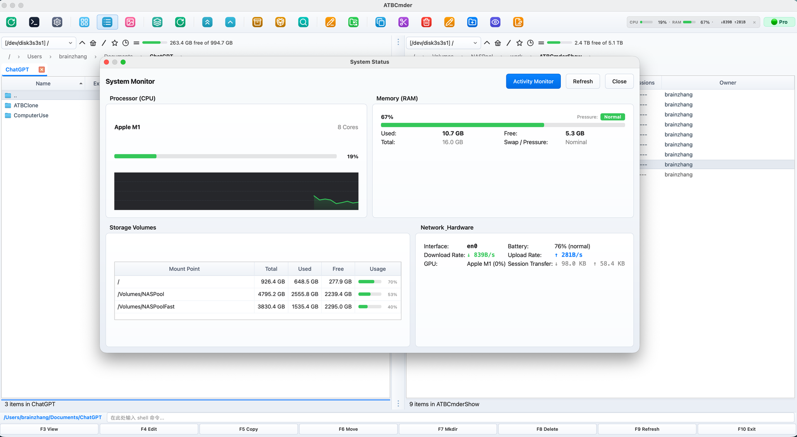
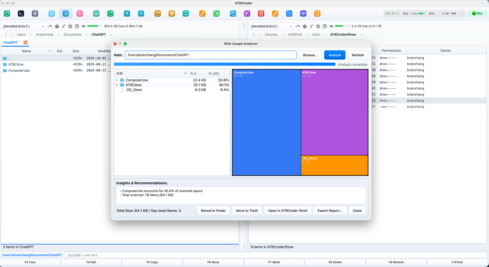
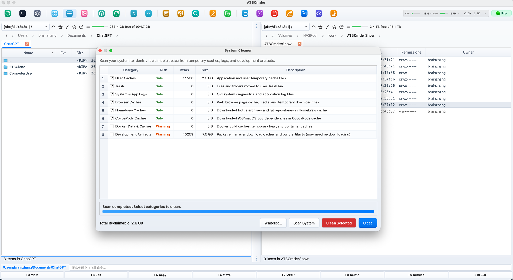
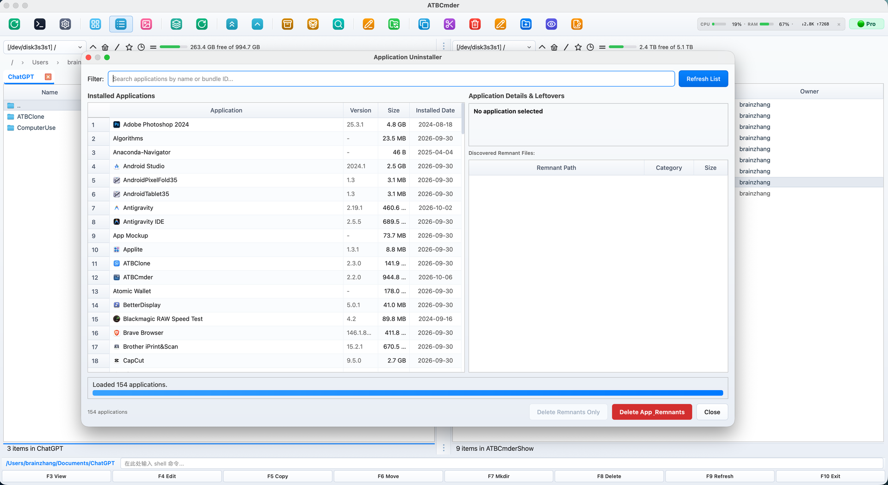

# Chapter 7: System Tools & Maintenance

A professional file manager does not operate in a vacuum—it is the central nerve center for your storage, memory, and operating system resources. While orthodox dual-panel file management excels at organizing, moving, and synchronizing directory hierarchies, power users, developers, and system administrators frequently face system-level challenges: pinpointing which hidden directory silently consumed 50 GB of disk space, identifying a runaway background process thrashing CPU cores, clearing gigabytes of abandoned developer caches and build artifacts, and completely uninstalling legacy macOS applications without leaving orphaned preference files, launch daemons, or application support folders scattered throughout `~/Library/`.

ATBCmder integrates five specialized system maintenance and diagnostic tools directly into the **Tools** menu. Powered by an asynchronous native monitoring daemon, these tools operate seamlessly alongside your file panels without locking the user interface or requiring heavy, ad-laden third-party utility applications.

---

## 1. Visual Quickstart: System Tools & Status HUD

ATBCmder divides system maintenance into five core operational instruments accompanied by an always-visible toolbar monitoring capsule:

```
┌────────────────────────────────────────────────────────────────────────────────────────────────────────┐
│                                       ATBCMDER SYSTEM TOOLS SUITE                                      │
├────────────────────────────────────────────────────────────────────────────────────────────────────────┤
│                                                                                                        │
│  [1] Status Capsule HUD & Popover       [2] System Status & Diagnostics (⌘⇧M)                         │
│      • Real-time CPU, RAM, and Network      • Per-core utilization bars & dual-tab sandbox view        │
│      • Top Processes (CPU & RAM ranked)     • Top Processes (CLI & apps) + Running Applications        │
│                                                                                                        │
│  [3] Disk Usage Analyzer                [4] Recent Changes (cm_RecentChanges)                          │
│      • Multi-threaded directory scanner     • Find recently modified files & folders by size/time      │
│      • Interactive squarified treemap       • Spotlight-seeded scan, live filter & Trash action        │
│                                                                                                        │
│  [5] System Cleaner (⌘⇧C)               [6] Application Uninstaller (⌘⇧U)                              │
│      • Group by Application or Category     • Complete removal of .app bundles and deep remnant files  │
│      • Real kept sizes & retention reasons  • Complete Uninstall vs. Remnants Only                     │
│                                                                                                        │
└────────────────────────────────────────────────────────────────────────────────────────────────────────┘
```

### Dual-Matrix System Tools Shortcut Matrix

| Tool / Action | macOS Shortcut | Classic Commander Key | Command ID | Menu Location |
| :--- | :--- | :--- | :--- | :--- |
| **System Status Panel** | `Cmd+Shift+M` / `⌘⇧M` | `Ctrl+Shift+M` | `cm_SystemStatus` | **Tools ➔ System Status...** |
| **Disk Usage Analyzer** | *Menu: Tools* | — | `cm_DiskUsageAnalyzer` | **Tools ➔ Disk Usage Analyzer...** |
| **Recent Changes** | *Menu: Tools* | — | `cm_RecentChanges` | **Tools ➔ View Recently Modified Files/Folders...** |
| **System Cleaner** | `Cmd+Shift+C` / `⌘⇧C` | `Ctrl+Shift+C` | `cm_CleanSystem` | **Tools ➔ System Cleaner...** |
| **Application Uninstaller** | `Cmd+Shift+U` / `⌘⇧U` | `Ctrl+Shift+U` | `cm_UninstallApp` | **Tools ➔ Uninstall Application...** |
| **Toggle Status Capsule** | Preferences ➔ General | — | *(Settings)* | **Configuration ➔ Options ➔ General** |

---

## 2. Toolbar Status Capsule HUD & Live Popover

ATBCmder features an integrated **System Status Capsule** embedded directly on the right side of the Main Toolbar. This provides immediate, peripheral awareness of system health without requiring you to switch to Activity Monitor or open a separate terminal.

```
┌────────────────────────────────────────────────────────────────────────────────────────┐
│ [Left Panel Tabs]                   [Right Panel Tabs]          [ CPU 18% | RAM 44% | ↓1.2M ↑340K ]│
└───────────────────────────────────────────────────────────────────────────┬────────────┘
                                                                            │ Click Capsule
                                                                            ▼
                                                ┌───────────────────────────────────────┐
                                                │ SYSTEM METRICS SUMMARY                │
                                                ├───────────────────────────────────────┤
                                                │ CPU Usage:     [████░░░░░░░░░░]   18% │
                                                │ Memory:        [████████░░░░░░]   44% │
                                                │ GPU Load:      [██░░░░░░░░░░░░]   12% │
                                                │ Battery:       [████████████░░]   88% │
                                                ├───────────────────────────────────────┤
                                                │ Storage:                              │
                                                │  Macintosh HD:  312.4 GB / 994.6 GB   │
                                                │  External SSD:  842.1 GB / 2.0 TB     │
                                                ├───────────────────────────────────────┤
                                                │ Top Processes:                        │
                                                │  • ATBCmder         PID: 54102  CPU: 2%│
                                                │  • WindowServer     PID: 284    CPU: 8%│
                                                │  • Xcode            PID: 88120  CPU: 4%│
                                                ├───────────────────────────────────────┤
                                                │ [ Open Full System Monitor (⌘⇧M) ➔ ] │
                                                └───────────────────────────────────────┘
```

### 2.1 Capsule Components & Visual Styling

The status capsule (`320px` wide) displays three real-time telemetry metrics updated once per second:

1. **CPU Utilization**: Live aggregate processor usage percentage with dynamic color coding:
   - **Normal (< 75%)**: Accent blue / theme foreground.
   - **Elevated (75% – 90%)**: Warning orange.
   - **Critical (> 90%)**: Alert red.
2. **Memory Utilization (RAM)**: Current active and wired memory pressure expressed as a percentage of physical RAM.
3. **Network Throughput**: Real-time aggregate upload and download speeds across all active network adapters formatted compactly (e.g. `↓2.4 MB/s ↑512 KB/s`).

### 2.2 Interactive Popover (`StatusPopup`)

Clicking anywhere on the status capsule opens a non-modal floating **Status Popover**:

- **Hardware Telemetry**: View combined percentages for CPU, Memory, GPU, and Battery status (including charge percentage and charging state).
- **Filesystem Mounts**: Lists all mounted local APFS containers and external drives with free space and total capacity bars.
- **Top 5 Processes**: Highlights the five highest resource-consuming processes ranked across both CPU percentage and memory footprint (RSS). In Mac App Store sandboxed builds, ATBCmder gathers live current-user processes natively without extra setup and displays a subtle **Current user processes** scope label in the section header.
- **Deep Dive Button**: Click **"Open Full System Monitor"** (or press `⌘⇧M`) to launch the comprehensive diagnostics window.

### 2.3 Configuring Capsule Visibility

If you prefer a distraction-free toolbar with only file navigation controls:

1. Open **Preferences** (`⌘,` / **Configuration ➔ Options...**).
2. Select **General** in the left sidebar.
3. Under **Display & Layout**, toggle the checkbox:
   `[X] Show system status capsule on toolbar`
4. Click **Apply** or **OK**. The capsule will immediately appear or disappear from the main toolbar.

---

## 3. System Status & Diagnostics (`cm_SystemStatus` / `⌘⇧M`)

Pressing **`⌘⇧M`** (or **`Ctrl+Shift+M`**) opens the full **System Status Panel**. This utility serves as an integrated diagnostic console tailored for system administrators, developers, and performance troubleshooting.

```
┌────────────────────────────────────────────────────────────────────────────────────────┐
│                             SYSTEM STATUS & DIAGNOSTICS                                │
├────────────────────────────────────────────────────────────────────────────────────────┤
│ CPU USAGE: Apple M3 Max (14 Cores)                                                     │
│ Core 01: [██████░░░░] 60%    Core 05: [██░░░░░░░░] 20%    Core 09: [███░░░░░░░] 30%    │
│ Core 02: [████░░░░░░] 40%    Core 06: [████░░░░░░] 42%    Core 10: [█░░░░░░░░░] 10%    │
│ Core 03: [████████░░] 80%    Core 07: [█░░░░░░░░░] 12%    Core 11: [░░░░░░░░░░]  5%    │
│ Core 04: [███░░░░░░░] 30%    Core 08: [██░░░░░░░░] 18%    Core 12: [░░░░░░░░░░]  4%    │
├────────────────────────────────────────────────────────────────────────────────────────┤
│ MEMORY: Total 36.0 GB  |  Used: 16.2 GB (45%)  |  App: 9.4 GB  |  Wired: 4.1 GB       │
│ SWAP:   Total 2.0 GB   |  Used: 0 MB (0%)                                              │
├────────────────────────────────────────────────────────────────────────────────────────┤
│ PROCESS LIST                                 Filter: [ node                     ] [x]  │
│ PID      Name             User           CPU %       Memory      Threads    Action     │
│ ────────────────────────────────────────────────────────────────────────────────────── │
│ 72841    node (dev-srv)   brain          48.2%       612.4 MB    28         [ Kill ✕ ] │
│ 72910    node (esbuild)   brain          12.1%       184.2 MB    14         [ Kill ✕ ] │
│ 73104    node (lsp)       brain           1.4%        98.5 MB     8         [ Kill ✕ ] │
├────────────────────────────────────────────────────────────────────────────────────────┤
│ Update Interval: [ 1.0s ▼ ]       [ Pause Monitoring ]              [ Close (Esc) ]    │
└────────────────────────────────────────────────────────────────────────────────────────┘
```

  
*Figure 7.1: Real-time System Status & Diagnostics dashboard displaying CPU, RAM, disk I/O, and top processes.*

### 3.1 Diagnostic Features & Metric Sections

1. **Multi-Core Processor Monitor**:
   - Visualizes overall system load and breakdown across individual Performance and Efficiency cores.
   - Per-core progress meters highlight core saturation during multi-threaded compiles or renders.
2. **Memory Breakdown & Swap Pressure**:
   - Categorizes physical memory allocation into App Memory, Wired Memory, Compressed Memory, and Cached Files.
   - Monitors virtual swap usage to help identify when memory leaks are causing disk paging.
3. **Storage & Mounts Overview**:
   - Real-time disk read/write throughput metrics alongside mount point capacity data.
4. **Interactive Process Manager**:
   - Real-time sortable table merging top CPU-consuming and memory-heavy processes (`PID`, `Name`, `CPU %`, `Memory`).
   - **Search & Filter**: Type any process name or PID into the search box to filter results instantaneously.
   - **Process Termination (Direct Builds)**:
     - Click **Kill** or select a process and press `Delete`.
     - Prompts with a confirmation dialog offering **Terminate (`SIGTERM`)** for graceful shutdown or **Force Kill (`SIGKILL`)** for unresponsive tasks.

### 3.2 Mac App Store Sandbox Mode (`Top Processes` + `Running Applications`)

When running under the macOS App Sandbox (Mac App Store edition), ATBCmder provides zero-configuration process and application visibility through a dedicated dual-tab bottom view:

- **Top Processes Tab (Default)**: Uses native Darwin telemetry (`sysctl KERN_PROC_UID` + `proc_pidinfo`) scoped strictly to your user ID (**Current user processes (App Sandbox)**), surfacing GUI apps, browser helpers, language servers, and developer CLI processes (`python`, `node`, `go`, compilers) ranked by CPU % and memory MB.
- **Running Applications Tab**: Lists active GUI and menu-bar accessory applications (`Regular` and `Accessory` activation policies, filtering out noisy background widget/XPC extensions) with fast main-thread cached icons and bundle identifiers.
- **Sandbox-Compliant Context Menu**: Right-clicking a process row automatically adapts to the process type:
  - For GUI applications: offers **Quit**, **Force Quit**, **Bring to Front**, **Reveal in Finder**, and **View in Activity Monitor…**.
  - For background CLI/helper processes: offers **View in Activity Monitor…** for deeper inspection.

---

## 4. Disk Usage Analyzer (`cm_DiskUsageAnalyzer`)

When a solid-state drive begins running out of free space, finding where gigabytes of data are hidden can be painfully slow. Standard Finder file lists do not calculate folder sizes automatically, and manual inspection requires tedious drilling through nested hierarchies.

The **Disk Usage Analyzer** (`cm_DiskUsageAnalyzer`, accessible via **Tools ➔ Disk Usage Analyzer...**) scans entire directory trees asynchronously using a multi-threaded scanner and visualizes your storage using both a traditional hierarchical tree list and an interactive **Squarified Treemap**.

```
┌────────────────────────────────────────────────────────────────────────────────────────┐
│ DISK USAGE ANALYZER: /Users/brainzhang                                                 │
├────────────────────────────────────────────────────────────────────────────────────────┤
│ Path: /Users/brainzhang ➔ Developer ➔ Projects                                        │
├──────────────────────────────────────┬─────────────────────────────────────────────────┤
│ DIRECTORY HIERARCHY                  │ INTERACTIVE SQUARIFIED TREEMAP                  │
│ Folder Name      Size       Percent  │ ┌───────────────────────────┬─────────────────┐ │
│ ──────────────────────────────────── │ │                           │ node_modules    │ │
│ ▼ Developer      142.6 GB   58.2%    │ │ target/debug              │ 28.4 GB         │ │
│   ► Projects     118.2 GB   48.2%    │ │ 64.2 GB                   │ (Rust build)    │ │
│   ► Caches        24.4 GB   10.0%    │ │                           ├─────────────────┤ │
│ ▼ Library         64.2 GB   26.2%    │ │                           │ DerivedData     │ │
│   ► Caches        38.1 GB   15.5%    │ │                           │ 18.2 GB         │ │
│   ► App Support   22.4 GB    9.1%    │ ├───────────────────────────┴─────────────────┤ │
│ ► Downloads       24.1 GB    9.8%    │ │ Video Footage (4K Prores)                   │ │
│ ► Pictures        14.2 GB    5.8%    │ │ 31.8 GB                                     │ │
├──────────────────────────────────────┴─┴───────────────────────────────────────────────┤
│ [ Zoom Out (..) ]  [ Reveal in Dual Panel ]  [ Move to Trash (⌘⌫) ]  [ Export CSV... ]  │
└────────────────────────────────────────────────────────────────────────────────────────┘
```

  
*Figure 7.2: Disk Usage Analyzer scanning local volumes with categorized space breakdown and treemap navigation.*

### 4.1 Key Architecture & Capabilities

- **Asynchronous Multi-Threaded Scanning**: Scans hundreds of thousands of files across APFS containers without freezing ATBCmder's main interface. A progress bar displays directories scanned per second.
- **Squarified Treemap Visualization**:
  - Folders and files are represented as nested rectangular blocks whose 2D surface area is strictly proportional to their size on disk.
  - Colors automatically reflect directory depth, making massive storage consumers instantly identifiable at a glance.
- **Bi-directional Synchronization**:
  - Selecting an item in the directory tree highlights its corresponding block in the treemap.
  - Clicking any rectangle in the treemap highlights the row in the tree view and displays the full file path and exact byte size.

### 4.2 Interactive Navigation & Workflows

1. **Drill Down**: Double-click any folder row or treemap block to zoom into that subdirectory and re-calculate the view relative to the new root.
2. **Zoom Out**: Click the **Zoom Out** button in the toolbar or click any segment in the breadcrumb bar at the top to return to parent directories.
3. **Inspect in Dual Panels**: Click **Reveal in Dual Panel** to instantly navigate your active ATBCmder file panel to the selected directory.
4. **Instant Cleanup**: Select any large obsolete folder or file and press **`⌘⌫`** (or click **Move to Trash**). The item is safely sent to macOS Trash, and the scan tree updates automatically.
5. **Export Storage Reports**: Click **Export** to generate comprehensive disk usage audits formatted as either structured CSV or plain text summaries for storage planning.

---

## 5. Recent File & Folder Changes (`cm_RecentChanges`)

When a build tool suddenly drops large temporary files, an installer scatters caches, or you simply need to locate what changed on your disk over the last hour or week, **Recent Changes** (**Tools ➔ View Recently Modified Files/Folders...**, command `cm_RecentChanges`) tracks down recently created or modified files and folders sorted by disk usage.

```
┌────────────────────────────────────────────────────────────────────────────────────────┐
│                                     RECENT CHANGES                                     │
├────────────────────────────────────────────────────────────────────────────────────────┤
│ Path: [ /Users/brainzhang                                        ]  [ Browse... ]      │
│ [X] Files   [X] Folders   Time Range: [ Last day             ▼ ]                       │
│ [X] Ignore files smaller than: [ 1 MB ▼ ]   (Presets: 1 KB / 1 MB / 10 MB / Custom)    │
├────────────────────────────────────────────────────────────────────────────────────────┤
│ [ Filter results by name or path...                                             ] [x]  │
│ Name              Type     Size on disk   Matched modification time    Path    Status  │
│ ────────────────────────────────────────────────────────────────────────────────────── │
│ derived_cache     Folder      1.84 GB     2026-11-22 19:42             ~/Lib…  Complete│
│ dataset_v3.tar    File      642.0 MB      2026-11-22 18:15             ~/Dow…  Complete│
│ build_logs        Folder    ≥ 128.4 MB    2026-11-22 17:04             ~/Wor…  Partial │
├────────────────────────────────────────────────────────────────────────────────────────┤
│           [ Reveal in Finder ]  [ Move to Trash ]  [ Open in ATBCmder Panel ]  [Search]│
└────────────────────────────────────────────────────────────────────────────────────────┘
```

### 5.1 Scope, Time Presets & Size Filtering

- **Target Root & Item Types**: Choose any root directory via **Browse...** (defaulting to your home directory) and independently toggle **Files** and **Folders** matching. Folders match either their own modification timestamp or directly contained modified files, while reporting aggregate recursive folder sizes.
- **Time Range Presets**: Choose **Last hour**, **Last day**, **Last week**, or **Custom time range** with interactive start and end date-time pickers.
- **Minimum File Size Filter**: Enable **Ignore files smaller than** and choose **`1 KB`**, **`1 MB`**, **`10 MB`**, or **Custom size** (with selectable `B`, `KB`, `MB`, or `GB` units) to filter out tiny metadata churn while preserving full folder disk accounting.

### 5.2 Fast Discovery & Instant Actions

- **Spotlight-Seeded Deep Discovery**: Fresh scans seed candidates using macOS Spotlight metadata for rapid initial discovery while concurrently computing recursive on-disk footprints (`Size on disk`). When a folder contains unreadable subpaths, sizes are honestly prefixed with `≥` as a lower bound.
- **Live Result Filtering**: Type any substring (such as `.zip`, `Downloads`, or `build`) into the filter bar to narrow displayed rows instantaneously without re-running the disk scan.
- **Direct Actions**:
  - **Reveal in Finder** (or double-click any row) to locate the item in macOS Finder.
  - **Open in ATBCmder Panel** to navigate your active panel straight to the item and focus it.
  - **Move to Trash** to safely send unneeded recent files or folders to the macOS Trash while updating parent folder statistics cleanly.

---

## 6. System Cleaner (`cm_CleanSystem` / `⌘⇧C`)

Over months of daily use, macOS accumulates gigabytes of temporary data: stale application caches, Xcode build artifacts, package manager downloads, orphaned diagnostic logs, and browser caches. While some caches accelerate workflows, obsolete items waste valuable high-speed SSD storage.

The **System Cleaner** (`cm_CleanSystem`, hotkey **`⌘⇧C`** / **`Ctrl+Shift+C`**) provides a deterministic, two-stage system cleaner designed with enterprise safety guarantees, per-application tree grouping, and transparent accounting for protected or skipped items.

```
┌────────────────────────────────────────────────────────────────────────────────────────┐
│                              SYSTEM CLEANER: DRY RUN AUDIT                             │
├────────────────────────────────────────────────────────────────────────────────────────┤
│ Grouping: [ Group by application ▼ ]   [ Search...                                   ] │
├────────────────────────────────────────────────────────────────────────────────────────┤
│ Category / Application             Size         Status                  Path           │
│ ────────────────────────────────────────────────────────────────────────────────────── │
│ ▼ [X] User Caches                  855.2 MB     +≥ 3.1 GB kept                         │
│   ├─ [X] Feishu                    191.7 MB                                            │
│   ├─ [~] WeChat                     44.2 MB     +165.0 MB kept                         │
│   │   ├─ [X] multitab/Cache         44.2 MB     Ready                   .../Cache      │
│   │   └─ [ ] WMPF                  165.0 MB     Contains database       .../WMPF       │
│   ├─ [ ] Gemini                    217.5 MB     Application is running                 │
│   └─ [ ] Microsoft Edge (cache)   ≥ 487.2 MB    Too many files          .../Edge       │
├────────────────────────────────────────────────────────────────────────────────────────┤
│ Scan completed (1 item(s) could not be fully verified). Select items to clean.         │
│ Total Reclaimable: 855.2 MB                                                            │
├────────────────────────────────────────────────────────────────────────────────────────┤
│ [ Whitelist... ] [ Reveal in Finder ] [ Open in ATBCmder Panel ] [Scan System] [Clean] │
└────────────────────────────────────────────────────────────────────────────────────────┘
```

  
*Figure 7.3: System Cleaner safe scanning interface showing cache, log, and temporary junk file recovery estimates.*

### 6.1 The Two-Stage Safety Architecture

Unlike reckless "one-click cleaners" that delete files silently in the background, ATBCmder enforces a strict **Two-Stage Safety Protocol**:

1. **Stage 1: Dry-Run Scan & Assessment**:
   - The cleaner performs a read-only survey across standardized system locations and application-specific cache/log containers (such as editors, messaging apps, multi-profile web browsers, and developer toolchains).
   - Calculates exact file counts and byte sizes without modifying or deleting a single byte.
   - Revalidates an immutable execution plan (`--plan-id`) so cleanup strictly removes only reviewed, unchanged paths.
2. **Stage 2: User-Reviewed Selective Deletion**:
   - You review the tree list and check or uncheck individual applications, profiles, or cache entries using tri-state checkboxes.
   - Clicking **Clean Selected** executes deletion only on explicitly checked eligible targets.
   - Every deletion event is written to an atomic audit log at `~/Library/Preferences/atbcmder/operations.log`.

### 6.2 Grouping Modes, Kept Sizes & Retention Transparency

- **Dual Tree Grouping**: Switch freely between **Group by application** and **Group by category**—or filter rows via the **Search...** box—without losing your checked selections.
- **Real Kept Sizes & Tiered Size Sorting**:
  - Kept items (greyed out and non-selectable for safety) still display their real read-only measured disk footprint instead of `Unknown`. When an unwriteable subfolder or traversal limit prevents full traversal, the lower-bound size is clearly marked with `≥` (e.g., `≥ 487.2 MB`).
  - Mixed groups display only **reclaimable bytes** in the `Size` column (matching **Total Reclaimable**), while reporting kept bytes alongside it in `Status` (e.g., `+165.0 MB kept`).
  - Sorting by `Size` uses tiered ordering so cleanable groups and items always sort ahead of kept-only groups and unknown items.
- **Precise Localized Retention Reasons**: Every kept entry explicitly reports why it was excluded from cleanup:
  - `Application is running` / `Application state is unknown`
  - `Contains database` (protects SQLite / `Cache.db` and user session state)
  - `In use by a process` / `Cannot verify if in use`
  - `Contains symbolic link` / `Too many files` / `No write permission`
  - `Excluded by whitelist` / `Protected data`
- **Scan Completeness & Direct Inspection**: When any items cannot be fully traversed, the bottom status bar reports the exact count (*"Scan completed (%1 item(s) could not be fully verified). Select items to clean."*). Double-click any row or click **Reveal in Finder** / **Open in ATBCmder Panel** to inspect its directory directly.

### 6.3 Six Core Cleanup Domains

| Category | Typical Location | Risk Level | Description |
| :--- | :--- | :---: | :--- |
| **Application Caches** | `~/Library/Caches/` | **Safe** | Stale caches generated by desktop applications that are recreated automatically when needed. |
| **System & User Logs** | `~/Library/Logs/`, `/var/log/` | **Safe** | Old crash logs, diagnostic dumps, and software update logs no longer needed for troubleshooting. |
| **Browser Caches** | Safari, Chrome, Edge, Firefox | **Safe** | Cached web pages, media buffers, and script artifacts across installed desktop browsers. |
| **Xcode Derived Data** | `~/Library/Developer/Xcode/DerivedData` | **Warning** | Intermediary object files, module caches, and index data from past Apple developer builds. |
| **Package Manager Caches** | Homebrew, CocoaPods, NPM, Yarn | **Warning** | Downloaded tarballs, formula archives, and package cache directories. |
| **Trash Bin** | `~/.Trash`, `.Trashes` | **Danger** | Items previously moved to the macOS Trash that have not yet been permanently emptied. |

### 6.4 Risk Tiers & Safety Whitelist

- 🟢 **Safe (Green)**: Temporary caches and discarded metadata that can be removed with zero configuration loss or workflow disruption.
- 🟡 **Warning (Orange)**: Developer artifacts or package caches. Deleting them is safe, but subsequent project compilation or package downloads will take longer as items are refetched.
- 🔴 **Danger (Red)**: Contains files requiring explicit confirmation (e.g. permanently purging the Trash Bin).
- **Custom Whitelist Rules**:
  - Click **Whitelist...** to add specific paths or directories that ATBCmder must **never** remove (`~/.config/atbsys/whitelist`).
  - Built-in protective rules automatically guard critical macOS operating system files, user keychain directories, SQLite databases, and cloud storage offline sync folders.

---

## 7. Application Uninstaller (`cm_UninstallApp` / `⌘⇧U`)

On macOS, dragging an application from `/Applications` to the Trash only removes the `.app` bundle itself. Modern applications frequently scatter hundreds of auxiliary files across your drive: preferences plists, application support databases, background launch agents, container sandboxes, and cached media. Over time, these orphaned leftovers consume gigabytes of storage and can leave unneeded background processes running at login.

The **Application Uninstaller** (`cm_UninstallApp`, hotkey **`⌘⇧U`** / **`Ctrl+Shift+U`**) provides deep dependency scanning to completely eradicate applications and their associated remnants.

```
┌────────────────────────────────────────────────────────────────────────────────────────┐
│                             APPLICATION DEEP UNINSTALLER                               │
├────────────────────────────────────────────────────────────────────────────────────────┤
│ [ Filter: Docker                     ]  Found: 142 Applications (Total: 48.2 GB)       │
├──────────────────────────────────────┬─────────────────────────────────────────────────┤
│ INSTALLED APPLICATIONS               │ ASSOCIATED REMNANTS & SUPPORT FILES             │
│ App Name          Version    Size    │ File Path / Component               Size        │
│ ──────────────────────────────────── │ ─────────────────────────────────────────────── │
│ [X] Docker.app    4.28.0     1.8 GB  │ [X] /Applications/Docker.app        1.8 GB (.app│
│ [ ] Figma.app     116.15     240 MB  │ [X] ~/Library/Application Support/Docker 14.2 GB│
│ [ ] Slack.app     4.36.0     310 MB  │ [X] ~/Library/Caches/com.docker.docker   2.1 GB │
│ [ ] Visual Studio 1.87.0     450 MB  │ [X] ~/Library/Preferences/com.docker...  12 KB  │
│ [ ] Xcode.app     15.3      12.4 GB  │ [X] ~/Library/LaunchAgents/com.docker...  4 KB  │
│                                      │ [X] ~/Library/Containers/com.docker...  380 MB  │
├──────────────────────────────────────┴─────────────────────────────────────────────────┤
│ Mode: (•) Complete Uninstall (.app + remnants)     ( ) Remnants Only (clean orphans)   │
│ Total Selected for Removal: 18.48 GB across 6 items                                    │
├────────────────────────────────────────────────────────────────────────────────────────┤
│ [ Refresh Applications ]       [ Cancel ]              [ Uninstall Application (18.5G)│
└────────────────────────────────────────────────────────────────────────────────────────┘
```

  
*Figure 7.4: Application Uninstaller performing deep remnant scanning across Application Support, Caches, and Preferences.*

### 7.1 Remnant Discovery Locations

When scanning for application components, ATBCmder searches the following standard macOS subsystem locations using exact bundle identifier matching:

1. **Application Bundle**: `/Applications/<Name>.app` and `~/Applications/<Name>.app`.
2. **Application Support**: `~/Library/Application Support/<Name>` and `<BundleID>`.
3. **Application Caches**: `~/Library/Caches/<BundleID>`.
4. **Preferences & Defaults**: `~/Library/Preferences/<BundleID>.plist`.
5. **Saved State**: `~/Library/Saved Application State/<BundleID>.savedState`.
6. **Launch Daemons & Agents**: `~/Library/LaunchAgents/<BundleID>.plist`.
7. **Sandbox Containers**: `~/Library/Containers/<BundleID>/` and `~/Library/Group Containers/`.
8. **Application Logs**: `~/Library/Logs/<Name>/`.

### 7.2 Dual Operational Modes

- **Complete Uninstall (Default)**:
  - Intended for removing an installed application currently present on your Mac.
  - Deletes both the executable `.app` bundle from `/Applications` and all associated auxiliary support files in a single atomic action.
- **Remnants Only**:
  - Intended for cleaning up after applications that were previously deleted manually via Finder or third-party tools.
  - Scans `~/Library/` for orphaned support folders whose parent `.app` bundle is no longer present on the system.

### 7.3 Apple System Integrity & Safety Guardrails

To prevent accidental system destabilization:

- **System App Protection**: Built-in macOS system applications (Safari, Finder, Preview, Music, System Settings, etc.) are protected with a read-only lock icon and cannot be uninstalled.
- **Running Process Detection**: If an application or its helper daemon is currently active, ATBCmder prompts you to quit the application gracefully before uninstallation proceeds.
- **Trash-First Protocol**: All uninstalled items are moved to the macOS Trash by default rather than immediately unlinked from disk, allowing full recovery if needed.

---

## 8. System & Maintenance Alerts

> [!NOTE]
> **Minimal System Resource Overhead**  
> The background status monitor daemon is engineered in native compiled code and runs on a 1.0-second polling interval. It consumes under 0.1% CPU during active file browsing and automatically suspends polling when ATBCmder is minimized or hidden.

> [!TIP]
> **Pairing Disk Usage Analyzer with Dual-Panel Flat Branch View**  
> If the Disk Usage Analyzer flags a directory containing thousands of scattered temporary files, select that directory and press **Reveal in Dual Panel**. Then press **`Cmd+B`** (`cm_DirBranch`) to flatten the entire nested tree into a single listbox where you can sort, select, and batch delete items with keyboard precision.

> [!IMPORTANT]
> **Always Review Cleaner Selections Before Confirming**  
> While the System Cleaner designates caches as **Safe (Green)**, some developer tools (such as Xcode DerivedData or local Docker volumes) may take time to recompile or refetch upon next project launch. Review checked categories to ensure you are not clearing caches for an active sprint.

> [!CAUTION]
> **Force Killing System Processes (`SIGKILL`)**  
> In the System Status Process Manager, sending `SIGKILL` (Force Kill) immediately stops the target process without allowing it to flush open file buffers or save document states. Always attempt a graceful `SIGTERM` termination first.

> [!WARNING]
> **App Sandbox Container Removal**  
> When uninstalling Mac App Store applications, auxiliary files stored under `~/Library/Containers/<BundleID>` often include sandboxed document databases. Ensure you have exported any essential local project files before confirming container deletion.

---

## 9. Master Dual-Matrix System Tools Reference Table

| Category | Action Description | macOS Shortcut | Classic Commander Key | Command ID |
| :--- | :--- | :--- | :--- | :--- |
| **System Monitor** | Open Full System Diagnostics Panel | `Cmd+Shift+M` / `⌘⇧M` | `Ctrl+Shift+M` | `cm_SystemStatus` |
| **System Monitor** | Open Lightweight Status Popover | Click Toolbar Capsule | — | *(UI Action)* |
| **System Monitor** | Filter Process Manager List | `Cmd+F` (in Panel) | `F7` | — |
| **System Monitor** | Terminate Process (`SIGTERM`, Direct Builds) | `Delete` / `⌫` | `Delete` | — |
| **System Monitor** | Force Kill Process (`SIGKILL`, Direct Builds) | `Shift+Delete` / `⇧⌫`| `Shift+Delete` | — |
| **Disk Analyzer** | Open Disk Usage Analyzer Dialog | *Menu: Tools ➔ Disk Usage Analyzer...* | — | `cm_DiskUsageAnalyzer` |
| **Disk Analyzer** | Drill Down into Selected Folder | `Enter` / `Return` | `Enter` | — |
| **Disk Analyzer** | Zoom Out to Parent Directory | `Backspace` / `⌫` | `Backspace` | — |
| **Disk Analyzer** | Move Highlighted Item to Trash | `Cmd+Delete` / `⌘⌫` | `F8` / `Delete` | — |
| **Disk Analyzer** | Reveal Selected Item in Dual Panel | `Cmd+Return` / `⌘⏎` | `Ctrl+Enter` | — |
| **Recent Changes** | Open Recent File & Folder Changes Tool | *Menu: Tools ➔ View Recently Modified Files/Folders...* | — | `cm_RecentChanges` |
| **Recent Changes** | Reveal Selected Match in Finder | Double-click / *Button* | — | — |
| **Recent Changes** | Open Match in Active Panel / Move to Trash | *Action Buttons* | — | — |
| **System Cleaner** | Open Safe System Cleaner Dialog | `Cmd+Shift+C` / `⌘⇧C` | `Ctrl+Shift+C` | `cm_CleanSystem` |
| **System Cleaner** | Run Read-Only Dry Run Scan | `Cmd+R` / `⌘R` | `Ctrl+R` | — |
| **System Cleaner** | Switch Grouping (Application / Category) | *Grouping ComboBox* | — | — |
| **System Cleaner** | Reveal in Finder / Open in ATBCmder Panel | Double-click / *Buttons* | — | — |
| **System Cleaner** | Toggle Category or App Selection | `Space` | `Space` | — |
| **App Uninstaller**| Open Application Uninstaller | `Cmd+Shift+U` / `⌘⇧U` | `Ctrl+Shift+U` | `cm_UninstallApp` |
| **App Uninstaller**| Switch to Remnants Only Mode | `Cmd+2` / `⌘2` | `Alt+2` | — |
| **Preferences** | Toggle Toolbar Status Capsule HUD| Preferences ➔ General| — | *(Config)* |

---

<div align="center">
  <p>Ready to customize hotkeys, panel views, and application behavior?</p>
  <p><strong><a href="preferences_and_customization.md">Proceed to Chapter 8: Preferences & Customization &rarr;</a></strong></p>
</div>
