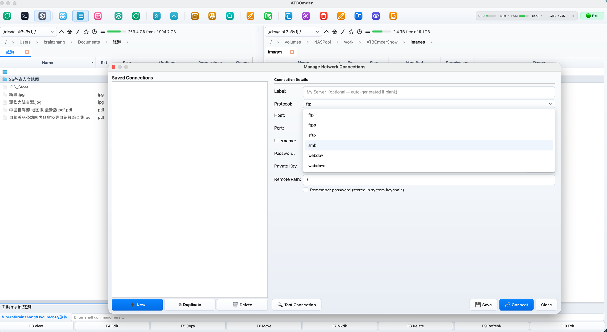

# 제6장: 가상 파일 시스템 및 네트워크

최신 파일 관리가 단일 물리적 하드 드라이브의 경계에서 끝나는 경우는 거의 없습니다. 소프트웨어 개발자는 SFTP를 통해 원격 스테이징 환경을 유지합니다. 시스템 관리자는 SMB/CIFS를 통해 기업 파일 공유를 관리합니다. 콘텐츠 제작자는 WebDAV를 통해 클라우드 스토리지 및 미디어 서버에 액세스합니다. 고급 사용자는 기가바이트 규모의 압축 아카이브를 정기적으로 검사, 편집 및 패키지합니다. 

기존 데스크탑 환경에서는 사용자가 zip 아카이브의 압축을 풀고 다시 압축하는 독립형 아카이브 유틸리티, 서버 자산을 관리하는 외부 FTP/SFTP 클라이언트, 연결이 끊긴 Finder 창에 원격 볼륨을 분산시키는 운영 체제 마운트 대화상자 등 분리된 애플리케이션을 저글링해야 합니다. 

ATBCmder는 **가상 파일 시스템(VFS)** 엔진을 통해 이러한 조각화를 제거합니다. 통합 `vfs://` URI 추상화 계층을 기반으로 구축된 ATBCmder는 원격 서버와 압축 아카이브를 표준 로컬 폴더와 똑같이 처리합니다. `.tar.gz` 아카이브로 이동하고, `F3`로 코드 파일을 미리 보고, `F4`으로 중첩된 구성 파일을 편집하고(저장 시 자동 라이브 재압축 사용), 표준 `F5` 키를 사용하여 보안 SFTP 세션을 통해 온프레미스 SMB NAS로 직접 자산을 복사할 수 있습니다. 이 모든 작업은 중간 파일을 추출하지 않고도 수행할 수 있습니다. 디스크로 이동하거나 별도의 도구 간에 전환할 수 있습니다. 

---

## 1. 시각적 빠른 시작: VFS 아키텍처 및 명령 매트릭스

ATBCmder는 통합 추상화 계층을 통해 모든 파일 시스템 액세스를 라우팅합니다. 경로가 Apple APFS SSD 파티션을 가리키든, 중첩된 `.zip` 아카이브 내부 구성원을 가리키든, 지구 반대편에 있는 Linux SFTP 서버에서 호스팅되는 원격 디렉터리를 가리키든 상관없이 듀얼 패널 인터페이스는 동일한 작동 모델을 제공합니다. 

```
┌────────────────────────────────────────────────────────────────────────────────────────┐
│                              ATBCMDER DUAL-PANEL GUI                                   │
│            Left Panel (Active)                  Right Panel (Inactive / Target)        │
├────────────────────────────────────────────────────────────────────────────────────────┤
│                                          │                                             │
│  [1] Local File System                   │  [2] Archive Virtual File System (VFS)      │
│      file:///Users/brain/projects/       │      vfs:///Users/brain/backup.tar.gz/src/  │
│      Direct POSIX / APFS access          │      In-place browse, F3 view, F4 live edit │
│                                          │                                             │
│  [3] Remote Network VFS (SFTP/SSH)       │  [4] Remote Storage VFS (SMB / WebDAV)      │
│      vfs://sftp://deploy@aws.prod/app/   │      vfs://smb://admin@truenas/Pool/Media/  │
│      Paramiko / SSH Keys / Keychain      │      Kernel mount_smbfs / WebDAVClient3     │
│                                          │                                             │
├────────────────────────────────────────────────────────────────────────────────────────┤
│                          UNIFIED VFS DISPATCH ENGINE (vfs://)                          │
│     FileSystemModel ➔ VFSManager ➔ SessionCache ➔ StreamCopyWorker / RepackWorker      │
└────────────────────────────────────────────────────────────────────────────────────────┘
```

### 듀얼 매트릭스 VFS 및 네트워크 치트 시트

| 액션 | macOS 바로가기 | 클래식 커맨더 단축키 | 명령 ID | 설명 | 
| :--- | :--- | :--- | :--- | :--- | 
| **파일을 아카이브에 압축** | `Alt+F5` / `⌥F5` | `Alt+F5` | `cm_PackFiles` | 형식, 압축 및 비밀번호 옵션이 포함된 아카이브 팩 대화 상자를 엽니다. | 
| **아카이브에서 파일 추출** | `Alt+F9` / `⌥F9` | `Alt+F9` | `cm_ExtractFiles` | 충돌 해결을 통해 선택한 아카이브의 압축을 풉니다. | 
| **빠른 네트워크 연결** | 메뉴: 네트워크 | `cm_NetworkConnect` | `cm_NetworkConnect` | 빠른 임시 연결 대화 상자를 엽니다. | 
| **연결 관리자** | 메뉴: 네트워크 | `cm_ManageConnections`| `cm_ManageConnections`| 저장된 연결 프로필을 사용하여 전체 CRUD 네트워크 관리자를 엽니다. | 
| **FTP 연결** | `Ctrl+S` / `⌃S` | `Ctrl+S` | `cm_FTPConnect` | FTP 연결 세션을 트리거하는 빠른 바로가기. | 
| **아카이브/폴더 입력** | `Enter` / `⏎` | `Enter` | `cm_Open` | `.zip`, `.tar`, `.7z` 또는 원격 디렉터리 내에서 직접 탐색합니다. | 
| **상위 폴더로 올라가기** | `Backspace` / `⌫` | `Backspace` | `cm_GoToParent` | 아카이브 또는 원격 디렉토리에서 상위 수준으로 다시 올라갑니다. | 
| **가상/원격 파일 보기**| `F3` / `Fn+F3` | `F3` | `cm_View` | 원격 또는 아카이브 파일을 Universal Lister로 스트리밍합니다. | 
| **가상/원격 파일 편집**| `F4` / `Fn+F4` | `F4` | `cm_Edit` | 편집기에서 파일을 엽니다. 저장 시 자동으로 다시 압축하거나 다시 업로드합니다. | 
| **패널 간 복사/VFS** | `F5` / `Fn+F5` | `F5` | `cm_Copy` | 로컬, 아카이브 또는 네트워크 엔드포인트에서 선택한 항목을 복사합니다. | 
| **백그라운드 작업 패널**| 메뉴: 표시 | `cm_OperationsPanel` | `cm_OperationsPanel` | 백그라운드 전송 큐, 속도 및 활성 스레드를 모니터링합니다. | 

---

## 2. 통합 `vfs://` URI 추상화

기존 파일 관리자는 원격 서버와 아카이브를 2급 시민으로 취급하므로 외부 마운트 유틸리티, 임시 추출 폴더 또는 타사 전송 클라이언트가 필요합니다. ATBCmder는 잘 정의된 단일 URI 사양으로 모든 파일 소스를 통합합니다. 

```
vfs://[protocol]://[user]@[host]:[port]/[remote_path]
```

### 2.1 가상 경로의 분석

운영 도메인에 따라 `vfs://` URI는 두 가지 표준 형식 중 하나를 사용합니다. 

1. **아카이브 가상 경로**: 
   ```
   vfs:///Users/brain/Documents/release_v1.7.zip/src/main.py
   ```
 

- **외부 접두사**: `vfs://`는 `FileSystemModel`에 경로 탐색을 차단하도록 지시합니다. 
- **컨테이너 경로**: `/Users/brain/Documents/release_v1.7.zip`은 로컬 스토리지의 물리적 컨테이너 아카이브를 식별합니다. 
- **내부 구성원**: `src/main.py`은 아카이브 내부에 중첩된 가상 리소스를 찾아냅니다. 

2. **네트워크 서버 경로**: 
   ```
   vfs://sftp://developer@staging.internal.net:2222/var/www/html/index.php
   vfs://smb://admin@192.168.1.50/StoragePool/Backups/2026/
   vfs://webdavs://user@cloud.mycompany.com:443/remote.php/dav/files/user/
   ```
 

- **체계 지정자**: 전송 드라이버를 식별합니다(`sftp`, `ftp`, `ftps`, `smb`, `webdav`, `webdavs`, `gdrive`, `dropbox`). 
- **인증**: 사용자 자격 증명 및 대상 포트를 인코딩합니다. 
- **원격 대상**: 원격 호스트의 절대 디렉터리 및 파일 경로를 확인합니다. 

```
┌────────────────────────────────────────────────────────────────────────────────────────┐
│                              VFS URI ROUTING IN ACTION                                 │
├────────────────────────────────────────────────────────────────────────────────────────┤
│                                                                                        │
│   Input URI: vfs://sftp://deploy@aws.infra:22/var/log/nginx/access.log                 │
│                 │      │        │        │   └────────────────────► Remote Path        │
│                 │      │        │        └────────────────────────► Port (Default 22)  │
│                 │      │        └─────────────────────────────────► Host / Server      │
│                 │      └──────────────────────────────────────────► Username           │
│                 └─────────────────────────────────────────────────► Protocol Scheme    │
│                                                                                        │
│   Input URI: vfs:///Volumes/Data/Archive.zip/docs/manual.pdf                           │
│                 │                      │        └─────────────────► Archive Member     │
│                 │                      └──────────────────────────► Physical Archive   │
│                 └─────────────────────────────────────────────────► Virtual Scheme     │
└────────────────────────────────────────────────────────────────────────────────────────┘
```

### 2.2 원활한 듀얼 패널 통합

가상 경로는 ATBCmder 내부의 표준 디렉터리 구조를 따르므로 완전한 이중 패널 패리티를 누릴 수 있습니다. 

- **탭으로 구분된 가상 작업 공간**: 탭 1에서 원격 SFTP 폴더를 열고, 탭 2에서 암호화된 로컬 ZIP 아카이브를 열고, 탭 3에서 로컬 `~/Downloads` 폴더를 엽니다. 
- **방향 복사(`F5`)**: 로컬 활성 패널에서 파일을 선택하고 `F5`을 눌러 비활성 패널에 표시된 원격 서버 또는 압축 아카이브에 직접 업로드합니다. 
- **드래그 앤 드롭 상호 운용성**: 중간 준비 없이 로컬 디스크, 네트워크 공유 및 아카이브 계층 사이의 패널에서 항목을 드래그합니다. 
- **대화형 이동 경로 표시줄**: 이동 경로 표시줄은 가상 URI를 클릭 가능한 세그먼트로 구문 분석합니다. 트리 위로 즉시 이동하려면 상위 폴더나 루트 서버 배지를 클릭하세요. 

---

## 3. 아카이브 VFS: 현장 탐색 및 검사

ATBCmder에서 아카이브를 열려면 수동 추출이나 타사 압축 해제 도구가 필요하지 않습니다. 지원되는 아카이브를 강조 표시하고 **`Enter`**을 누르거나 두 번 클릭하면 됩니다. ATBCmder는 아카이브를 제자리에 마운트하여 패널을 고속 가상 디렉터리 브라우저로 변환합니다. 

 
*그림 6.1: 압축되지 않은 크기, 타임스탬프 및 하위 디렉터리를 표시하는 가상 폴더로 다중 중첩된 압축 아카이브 내부를 탐색합니다.*

### 3.1 지원되는 아카이브 형식

ATBCMder에는 모든 업계 표준 아카이브 및 압축 형식을 위한 내장 드라이버가 있습니다. 

| 형식 | 파일 확장자 | 지원 읽기 | 쓰기/포장 | 암호화 지원 | 
| :--- | :--- | :---: | :---: | :--- | 
| **우편번호** | `.zip` | 예 | 예 | 표준 및 AES-256(`pyzipper`) | 
| **GZip 타르볼** | `.tar.gz`, `.tgz` | 예 | 예 | POSIX 표준 타르 스트리밍 | 
| **BZip2 타르볼**| `.tar.bz2`, `.tbz2` | 예 | 예 | 높은 비율의 bzip2 블록 압축 | 
| **XZ 타르볼** | `.tar.xz`, `.txz` | 예 | 예 | 고효율 LZMA2 압축 | 
| **일반 TAR** | `.tar` | 예 | 예 | 압축되지 않은 UNIX 테이프 아카이브 | 
| **7-Zip** | `.7z` | 예 | 예(`py7zr`을 통해)| LZMA / LZMA2 솔리드 압축 |

### 3.2 내부 탐색 작업 흐름

아카이브 내부를 탐색할 때: 

1. **하위 디렉터리 입력**: 아카이브 내의 폴더에서 `Enter`을 눌러 중첩된 트리를 탐색합니다. 
2. **상위(`..`)로 상승**: `Backspace`(`⌫`)을 누르거나 `.. [Parent Directory]` 항목을 두 번 클릭하여 상승합니다. 아카이브 루트에 도달한 후 `Backspace`을 누르면 아카이브 파일이 포함된 실제 디렉터리로 완전히 돌아갑니다. 
3. **즉시 미리보기(`F3` / `Fn+F3`)**: 아카이브 내의 문서, 이미지 또는 소스 파일을 강조 표시하고 `F3`을 누릅니다. ATBCmder는 자동으로 대상 파일을 안전한 임시 샌드박스로 추출하여 Universal Lister 내부에 렌더링합니다. 
4. **선택적 복사(`F5` / `Fn+F5`)**: 하나 또는 두 개의 파일을 검색하기 위해 전체 수 기가바이트 아카이브의 압축을 푸는 대신 필요한 특정 구성원을 선택하고 `F5`을 누르십시오. ATBCmder는 선택한 항목만 비활성 패널에 직접 압축을 풉니다. 

> [!NOTE] 
> 아카이브에서 개별 파일을 미리 보거나 복사할 때 ATBCmder는 요청된 파일 바이트만 컨테이너 스트림에서 직접 스트리밍합니다. 선택되지 않은 형제 파일의 압축을 풀 때 디스크 공간이나 시간을 낭비하지 않습니다. 

---

## 4. 라이브 리패킹: 아카이브 내부의 내부 편집

ATBCmder의 가장 강력한 워크플로우 중 하나는 **Live Repacking**입니다. 역사적으로 압축된 아카이브 내에 중첩된 단일 파일을 수정하려면 지루한 6단계 순서가 필요했습니다. 전체 아카이브 추출, 대상 파일 찾기, 편집 및 저장, 디렉터리를 새 아카이브로 다시 압축, 원본 아카이브 삭제, 임시 폴더 정리. 

ATBCmder를 사용하면 표준 로컬 파일을 편집하는 것만큼 쉽게 아카이브 내부의 파일을 편집할 수 있습니다. 

```
┌────────────────────────────────────────────────────────────────────────────────────────┐
│                              LIVE REPACKING LIFECYCLE                                  │
├────────────────────────────────────────────────────────────────────────────────────────┤
│                                                                                        │
│  1. User presses F4 on "config.json" inside "package.zip"                              │
│     │                                                                                  │
│     ├──► ATBCmder extracts "config.json" to sandbox: /tmp/dc_repack_xyz/config.json    │
│     └──► Opens internal EditorDialog with window title: "config.json — Editor"         │
│                                                                                        │
│  2. User modifies file and presses Cmd+S (Save)                                        │
│     │                                                                                  │
│     ├──► Editor emits file_saved signal                                                │
│     └──► RepackWorker checks original archive size vs ArchiveRepackWarningMB threshold │
│                                                                                        │
│  3. Atomic Repack Execution                                                            │
│     │                                                                                  │
│     ├──► Writes modified stream to staging archive: /tmp/package.zip.tmp               │
│     ├──► Validates container integrity via archive driver                              │
│     ├──► Atomic swap: os.replace("/tmp/package.zip.tmp", "/original/package.zip")      │
│     └──► Refreshes active file panel and cleans up sandbox /tmp/dc_repack_xyz/         │
│                                                                                        │
└────────────────────────────────────────────────────────────────────────────────────────┘
```

### 4.1 단계별: 보관된 구성 파일 편집

1. `Enter`을 눌러 아카이브(예: `application_bundle.zip`)로 이동합니다. 
2. 수정하려는 파일을 찾습니다(예: `settings.yaml`). 
3. **`F4`**(`Fn+F4`)을 누릅니다. ATBCmder는 파일을 임시 캐시로 추출하고 내장 편집기를 시작합니다. 
4. 편집기에서 수정합니다. 
5. **`Cmd+S`**(`⌘S`)을 눌러 저장합니다. 
6. `Cmd+W`(`⌘W`) 또는 `Esc`을 사용하여 편집기를 닫습니다. 
7. ATBCmder의 `RepackWorker`은 내부 멤버를 자동으로 업데이트하고, 업데이트된 구조를 임시 파일로 압축하고, 원본 아카이브를 원자적으로 대체하고, 패널 보기를 새로 고칩니다. 

> [!CAUTION] 
> **대형 기록 보관소 안전 가드(`ArchiveRepackWarningMB`)** 
> 압축된 아카이브를 다시 압축하려면 컨테이너 스트림의 압축을 풀고 다시 인코딩해야 합니다. 20GB `.tar.gz` 비디오 아카이브 내에서 10KB 파일을 수정하면 컴퓨터가 20GB의 데이터를 모두 다시 쓰게 됩니다. 
> 
> 우발적인 디스크 정지를 방지하기 위해 ATBCmder에는 보호 안전 임계값(`ArchiveRepackWarningMB`, 기본값: `atbcmder.xml`의 **100MB**)이 포함되어 있습니다. 이 제한보다 큰 아카이브 내의 파일을 편집하거나 삭제하려고 하면 ATBCmder가 확인 메시지를 표시합니다. 
> *"이 아카이브를 수정하려면 전체 파일을 다시 압축해야 하므로 시간이 오래 걸릴 수 있습니다. 계속하시겠습니까?"* 

---

## 5. 아카이브 생성 및 추출(`Alt+F5` / `Alt+F9`)

ATBCmder는 아카이브 생성 및 추출을 위한 전용 백그라운드 작업자를 제공하여 장시간 실행되는 압축 작업 중에도 파일 패널의 응답성을 유지합니다. 

 
*그림 6.2: 대상 경로, 형식 선택, 압축 수준 및 비밀번호 암호화를 보여주는 아카이브 매개변수 대화상자(Alt+F5 / cm_PackFiles).*

### 5.1 파일 압축(`Alt+F5` / `⌥F5` / `cm_PackFiles`)

새 아카이브를 생성하려면: 

1. 활성 패널에서 번들로 묶으려는 파일이나 디렉터리를 선택합니다. 
2. **`Alt+F5`**(`⌥F5`)을 누르거나 메뉴 모음에서 **파일 ➔ 압축...**을 선택합니다. 
3. **파일 압축** 대화 상자가 나타납니다. 
- **아카이브 파일 생성**: 대상 파일 경로입니다. 기본적으로 ATBCmder는 초점이 맞춰진 항목의 이름을 딴 비활성 패널의 디렉터리에 아카이브를 배치할 것을 제안합니다. 
- **아카이브 형식**: `ZIP`, `TAR`, `TAR.GZ`, `TAR.BZ2`, `TAR.XZ` 또는 `7Z` 중에서 선택합니다. 
- **압축 수준**: 
- `Store`: 0 압축; 사전 압축된 미디어(MP4, JPEG)를 즉시 패키징합니다. 
- `Fast`: 낮은 CPU 오버헤드; 빠른 전송에 이상적입니다. 
- `Normal (Deflated)`: 균형 잡힌 속도와 압축 비율(일반 용도에 권장) 
- `Maximum`: 최고 밀도 압축(해당되는 경우 LZMA/Bzip2 활용) 
- **비밀번호(ZIP만)**: 아카이브를 암호화하려면 비밀 비밀번호 문구를 입력하세요. 
4. **시작**을 클릭합니다(또는 `Enter`을 누릅니다). 작업은 진행률 표시줄 및 파일별 상태 표시기가 있는 비차단 백그라운드 스레드에서 실행됩니다.

#### 군용 등급 AES-256 비밀번호 암호화

표준 ZIP 암호화(레거시 ZipCrypto)는 암호화 방식으로 손상되어 일반 텍스트 사전 공격에 취약합니다. ZIP 아카이브에 대한 비밀번호를 지정하면 ATBCmder는 `pyzipper`(`WZ_AES` 표준의 `pyzipper.AESZipFile`)으로 구동되는 **AES-256 암호화**를 활용합니다. 이를 통해 macOS, WinZip 및 7-Zip과의 호환성을 보장하는 동시에 무차별 암호 해독으로부터 민감한 데이터를 보호합니다.

#### 다중 볼륨 세트에 걸쳐 거대한 아카이브 분할

파일 크기 제한이 있는 이메일 첨부 파일, FAT32 드라이브 또는 클라우드 업로드 경계에 걸쳐 아카이브를 배포해야 하는 경우: 

1. `Alt+F5`(`cm_PackFiles`)을 사용하여 파일을 묶습니다. 
2. 결과 `.zip` 또는 `.tar` 아카이브를 강조 표시하고 **`Alt+F6`**(`cm_FileSpliter`)을 통해 파일 분할기를 트리거합니다. 
3. 미리 설정된 분할 크기(예: `100 MB`, `4.7 GB DVD`, `CD 700 MB` 또는 사용자 정의 바이트 크기)를 선택합니다. 
4. ATBCmder는 CRC32 확인 매니페스트와 함께 번호가 매겨진 분할 조각(`archive.zip.001`, `archive.zip.002` 등)을 생성합니다. 수신자는 언제든지 **`cm_FileLinker`**(`cm_Combine`)을 사용하여 원래 컨테이너를 재조립할 수 있습니다. 

---

### 5.2 아카이브 추출(`Alt+F9` / `⌥F9` / `cm_ExtractFiles`)

디스크에 아카이브를 추출하려면: 

1. 활성 패널에서 하나 이상의 아카이브를 강조 표시합니다. 
2. **`Alt+F9`**(`⌥F9`)을 누르거나 메뉴 모음에서 **파일 ➔ 추출...**을 선택합니다. 
3. **파일 추출** 대화 상자가 표시됩니다. 
- **추출할 아카이브**: 선택한 컨테이너 소스 경로입니다. 
- **디렉터리로 추출**: 대상 디렉터리(기본값은 비활성 패널)입니다. 
- **미리보기 콘텐츠**: 아카이브 멤버를 실시간으로 로드하는 대화형 목록 상자입니다. 
- **비밀번호**: 비밀번호로 보호된 아카이브를 위한 입력 필드입니다. 
4. **시작**을 클릭합니다. 대상 폴더에 대상 파일이 이미 있는 경우 ATBCmder는 작업자를 일시 중지하고 대화형 충돌 대화 상자를 표시합니다. 
- **덮어쓰기**: 충돌하는 대상 파일을 대체합니다. 
- **건너뛰기**: 기존 파일을 그대로 두고 다음 항목으로 진행합니다. 
- **모두 덮어쓰기**: 이후의 모든 충돌을 자동으로 덮어씁니다. 
- **모두 건너뛰기**: 기존 대상 파일을 모두 자동으로 건너뜁니다. 
- **취소**: 추출 과정을 안전하게 중단합니다. 

---

## 6. 원격 네트워크 VFS: 프로토콜 및 원격 저장소

ATBCmder에는 이중 패널 작업 공간 내에서 직접 원격 서버를 마운트, 탐색 및 조작할 수 있는 다중 프로토콜 네트워크 클라이언트 엔진이 포함되어 있습니다. 

 
*그림 6.3: 라이브 파일 속성, 소유권 권한 및 이중 패널 전송을 사용하여 보안 SFTP를 통해 원격 Linux 서버 디렉터리 검색.* 

 
*그림 6.4: 지원되는 네트워크 연결 유형: FTP/FTPS, 보안 SFTP, WebDAV 클라우드 스토리지 및 SMB 네트워크 공유.*

### 6.1 지원되는 네트워크 프로토콜

| 프로토콜 체계 | 기본 포트 | 전송 계층 | 인증 모드 | 최고의 용도 | 
| :--- | :---: | :--- | :--- | :--- | 
| **`sftp://`** | `22` | SSH-2(파라미코) | 비밀번호, SSH 키(`id_rsa`, `id_ed25519`) | Linux 서버, 클라우드 인스턴스, 스테이징 호스트 | 
| **`ftp://`** | `21` | 일반 RFC 959 | 익명, 일반 텍스트 사용자 이름 및 비밀번호 | 레거시 웹 호스팅, 로컬 랩 장치 | 
| **`ftps://`** | `990` | TLS 암호화 FTP | SSL/TLS를 사용한 사용자 이름 및 비밀번호 | 안전한 상업용 FTP 서버 | 
| **`smb://`** | `445` | CIFS/SMB3 | Windows NT/Kerberos/로컬 계정 | Windows 공유, NAS 기기, Samba 서버 | 
| **`webdav://`** | `80` | HTTP 웹DAV | 기본, 다이제스트 인증 | 웹 서버, 로컬 네트워크 스토리지 | 
| **`webdavs://`** | `443` | HTTPS WebDAV | SSL 암호화 기본/다이제스트 인증 | Nextcloud, ownCloud, 상용 클라우드 스토리지 | 
| **`gdrive://`** | `443` | 구글 드라이브 API | OAuth2 토큰 인증 | Google Drive 클라우드 드라이브 및 공유 폴더 |
| **`dropbox://`** | `443` | Dropbox API v2 | OAuth2 토큰 인증 | Dropbox 클라우드 드라이브 및 공유 폴더 | 

---

### 6.2 프로토콜 기능 및 심층 분석

#### SFTP(SSH 파일 전송 프로토콜)

업계 표준 `paramiko` SSH 엔진을 기반으로 하는 ATBCmder의 SFTP 드라이버는 포트 22를 통해 암호화된 터널을 설정합니다. 

- **호스트 키 안전(`WarningPolicy`)**: 엄격한 보안 요구 사항에 따라 ATBCmder는 자동으로 로컬 `~/.ssh/known_hosts` 파일을 참조합니다. 알려진 호스트에 연결할 때 호스트 키는 암호화 방식으로 확인됩니다. 알 수 없는 서버가 발견되면 ATBCmder는 예상치 못한 공개 키를 자동으로 신뢰하는 대신 안전 경고를 표시합니다. 
- **SSH 키 인증**: ATBCmder는 표준 비밀번호 인증 외에도 SSH 개인 키 파일(`~/.ssh/id_rsa`, `~/.ssh/id_ed25519`)을 지원합니다. 
- **UNIX 속성 매핑**: 원격 8진수 파일 모드(`chmod`), 사용자/그룹 소유권 문자열 및 정확한 POSIX 수정 타임스탬프를 보존합니다.

#### FTP 및 FTPS(명시적/암시적 SSL)

Python의 `ftplib`에 의해 구동되는 FTP 드라이버는 다음을 지원합니다. 

- **패시브 모드(PASV)**: 제한적인 NAT 라우터 및 소비자 방화벽을 통해 안정적인 연결을 보장하기 위해 기본적으로 활성화됩니다. 
- **구성 가능한 인코딩**: `UTF-8`, `ISO-8859-1`, `GB18030` 및 `Windows-1252` 문자 집합 간 전환을 허용하여 비ASCII 파일 이름 표시 문제를 해결합니다.

#### SMB/Samba(Windows 공유 및 NAS 어플라이언스)

전송 속도가 느린 순진한 사용자 공간 Python SMB 라이브러리와 달리 ATBCmder는 하이브리드 아키텍처를 사용합니다. 

- **macOS 기본 커널 가속(`mount_smbfs`)**: macOS에서 ATBCmder의 `SambaMounter`은 Apple의 기본 `/sbin/mount_smbfs` 하위 시스템을 활용합니다. 원격 공유를 macOS VFS 트리(`/Volumes/` 또는 격리된 마운트 디렉터리)에 직접 마운트하여 전체 하드웨어 가속 SMB3 읽기/쓰기 처리량을 잠금 해제합니다. 
- **기존 마운트 감지**: macOS Finder 또는 시스템 스크립트가 대상 SMB 공유를 이미 마운트한 경우 ATBCmder는 OS `mount` 테이블에서 활성 마운트 지점을 자동으로 감지하고 즉시 탐색하여 중복 네트워크 연결을 방지합니다. 

> [!IMPORTANT] 
> **SMB 공유 이름 요구 사항** 
> SMB 서버는 기본 호스트 이름 수준에서 탐색할 수 없습니다. SMB URI는 **반드시** 경로에 대상 공유 또는 내보내기 이름을 포함해야 합니다. 
> 
> - ❌ 유효하지 않음: `vfs://smb://nas.local/` 
> - ✅ 유효함: `vfs://smb://nas.local/StoragePool` 또는 `vfs://smb://192.168.1.100/Media`

#### WebDAV 및 WebDAVS(Nextcloud/클라우드 스토리지)

`webdavclient3`을 기반으로 구축된 이 드라이버는 최신 클라우드 스토리지 솔루션과 양방향 파일 동기화를 제공합니다. 

- **SSL 인증서 확인**: 개인 홈랩 설정에서 자체 서명된 인증서에 대한 재정의 토글을 사용하여 공개 WebDAVS 호스트에 대해 엄격한 SSL 인증서 검증을 지원합니다. 
- **재귀 디렉터리 생성(`makedirs`)**: 대량 업로드 작업 중에 누락된 중첩 원격 디렉터리 경로를 자동으로 생성합니다. 

---

---

### 6.3 Google Drive 클라우드 스토리지: 단계별 설정 가이드

웹 브라우저를 통해 Google Drive를 관리하는 것은 대용량 파일을 업로드하거나 중첩된 폴더를 정리할 때 종종 답답함을 유발합니다. 또한 공식 Google Drive 데스크톱 앱은 전체 폴더 트리를 로컬 Mac SSD에 동기화하려고 하여 소중한 저장 공간을 차지합니다.

ATBCmder는 **Google Drive를 실시간 가상 드라이브(`gdrive://`)로 마운트**하여 이 문제를 완벽하게 해결합니다. 듀얼 패널 인터페이스에서 원격 클라우드 폴더를 직접 탐색하고, `F3`으로 클라우드 파일을 즉시 미리 보며, `F5`를 눌러 Mac과 Google Drive 간에 고속 양방향 복사를 수행할 수 있습니다——**전체 클라우드 드라이브를 컴퓨터에 다운로드할 필요가 전혀 없습니다**.

  
*그림 6.5: 연결 관리자에서 OAuth2 클라이언트 자격 증명을 구성하여 Google Drive에 연결하고, 듀얼 패널 보기에서 로컬 폴더와 함께 클라우드 파일을 탐색하는 모습.*

#### 왜 "클라이언트 ID"와 "클라이언트 비밀번호"가 필요한가요?

개인정보와 계정 보안을 보호하기 위해 Google은 타사 데스크톱 앱이 Google 계정 비밀번호를 직접 요청하는 것을 엄격히 금지합니다. 대신 **OAuth 2.0 공식 승인 메커니즘**을 사용합니다.

Google Cloud Console에서 무료로 본인 전용 OAuth 자격 증명을 생성하면:

- **100% 비공개 및 직접 통신**: 데이터는 Mac과 Google 공식 서버 간에 직접 전송됩니다. 어떤 제3자나 중간 프록시 서버도 파일이나 자격 증명을 열람할 수 없습니다.
- **전용 속도 및 할당량**: 수천 명의 다른 사용자와 요청 제한을 공유하지 않고 비공개 API 대역폭을 온전히 누릴 수 있습니다.
- **언제든지 철회 가능**: 완전한 제어권을 유지합니다. Google 계정 보안 대시보드에서 클릭 한 번으로 언제든지 ATBCmder의 접근 권한을 취소할 수 있습니다.

설정에는 **3분 미만**이 소요되며 한 번만 구성하면 영구적으로 사용 가능합니다!

---

#### 1단계: Google Cloud에서 무료 자격 증명 만들기 (소요 시간 2분)

1. 웹 브라우저에서 [Google Cloud Console — 사용자 인증 정보](https://console.cloud.google.com/apis/credentials)를 열고 Google 계정으로 로그인합니다.
2. **프로젝트 선택 또는 새로 만들기**:
   - 페이지 상단의 조직 / 프로젝트 드롭다운을 클릭합니다.
   - *(기업/조직 팁: `aitobox.com`과 같은 Google Workspace 또는 Cloud Identity 조직이 있는 경우, 드롭다운에서 해당 조직을 선택하여 프로젝트가 회사 도메인 아래에 생성되도록 합니다)*.
   - 프로젝트가 아직 없다면 **[새 프로젝트]**를 클릭하고 원하는 이름(예: `ATBCmder`)을 입력한 뒤 **[만들기]**를 클릭합니다.
3. **Google Drive API 사용 설정**:
   - 왼쪽 사이드바 또는 상단 검색창에서 **[사용 설정된 API 및 서비스]**(또는 **[+ API 및 서비스 사용 설정]**)로 이동합니다.
   - **Google Drive API**를 검색하여 클릭한 후 파란색 **[사용]** 버튼을 클릭합니다.
4. **OAuth 동의 화면 구성** *(메시지가 표시되는 경우)*:
   - 처음 자격 증명을 만드는 경우 Google에서 동의 화면 구성을 요청할 수 있습니다:
     - **[외부 (External)]**를 선택하고 **[만들기]**를 클릭합니다.
     - **앱 이름**(예: `ATBCmder`)을 입력하고 지원 및 개발자 연락처 이메일 주소를 입력합니다.
     - **앱 도메인**에서 **애플리케이션 홈페이지**를 웹사이트(예: `https://cmder.aitobox.com`)로 설정합니다.
     - **승인된 도메인**에 루트 도메인(예: `aitobox.com`)을 추가합니다.
     - 이후 화면에서 **[저장 후 계속]**을 클릭하여 설정을 마칩니다.
5. **데스크톱 앱 자격 증명 만들기**:
   - **[API 및 서비스] ➔ [사용자 인증 정보]**로 돌아옵니다.
   - 상단의 **[+ 사용자 인증 정보 만들기]**를 클릭하고 **[OAuth 클라이언트 ID]**를 선택합니다.
   - **애플리케이션 유형** 드롭다운에서 **[데스크톱 앱 (Desktop app)]**을 선택합니다.
   - **이름** 필드에 `ATBCmder Desktop`(또는 원하는 이름)을 입력합니다.
   - **[만들기]**를 클릭합니다.
6. **키 복사**:
   - **클라이언트 ID**(`.apps.googleusercontent.com`으로 끝남)와 **클라이언트 보안 비밀번호**가 표시된 팝업이 나타납니다.
   - 두 문자열을 복사합니다(브라우저 탭을 열어두거나 임시로 저장합니다).

---

#### 커스텀 브랜딩: "액세스 권한 부여 대상" (Access Granted To) 이해하기

Google 계정 보안 센터([myaccount.google.com/connections](https://myaccount.google.com/connections))에서 연결된 타사 앱을 확인할 때 Google은 ATBCmder의 앱 상세 카드를 표시합니다:

- **앱 이름**: `ATBCmder`
- **액세스 권한 부여 대상 (Access granted to)**: 예: `aitobox.com` 또는 `oplist.org`
- **홈페이지**: `https://cmder.aitobox.com`

##### 왜 Google은 특정 조직 이름을 표시하나요?

**"액세스 권한 부여 대상" (Access granted to)** 행은 OAuth 클라이언트 ID가 생성된 GCP 프로젝트를 소유한 **Google Cloud 조직**(또는 Google Workspace 계정)을 기반으로 Google이 자동 결정합니다:

- 클라이언트 ID가 타사 조직(예: `oplist.org`)의 프로젝트에서 생성된 경우 Google은 해당 도메인을 표시하여 소유자를 사용자에게 안내합니다.
- 개인 Google 계정에서 생성된 경우 개발자 연락처 정보를 표시합니다.

##### 부여 대상을 본인 도메인(예: `aitobox.com`)으로 설정하는 방법

Google 계정 보안 대시보드에 본인 회사의 도메인(예: `aitobox.com`)이 표시되도록 하려면:

1. **회사 도메인 조직 아래에 프로젝트 생성**:
   - [Google Cloud Console](https://console.cloud.google.com/)에서 회사 도메인 계정(예: `admin@aitobox.com`)으로 로그인합니다.
   - 상단 조직 드롭다운에서 도메인(예: `aitobox.com`)이 선택되어 있는지 확인한 후 프로젝트를 만듭니다.
2. **OAuth 동의 화면에서 앱 도메인 구성**:
   - **[API 및 서비스] ➔ [OAuth 동의 화면]**으로 이동합니다.
   - **애플리케이션 홈페이지**를 공식 제품 페이지(예: `https://cmder.aitobox.com`)로 설정합니다.
   - **승인된 도메인**에 루트 도메인(예: `aitobox.com`)을 등록합니다.
   - 지원 이메일과 개발자 연락처를 도메인 이메일로 설정합니다.
3. **새 데스크톱 앱 클라이언트 ID 발급**:
   - **[API 및 서비스] ➔ [사용자 인증 정보]**에서 **데스크톱 앱** 유형의 새 **OAuth 클라이언트 ID**를 만듭니다.
4. **ATBCmder에서 키 업데이트 및 재인증**:
   - 새 클라이언트 ID와 비밀번호를 ATBCmder 연결 관리자에 붙여넣고 **[재인증...]**을 클릭합니다.
   - 이제 계정 보안 설정에 본인 회사 도메인(`aitobox.com`)이 부여 대상으로 깔끔하게 표시됩니다!

---

#### 2단계: ATBCmder에 Google Drive 추가 및 간편 인증

키를 발급받았다면 ATBCmder에 추가하는 작업은 몇 번의 클릭으로 끝납니다:

1. ATBCmder 상단 메뉴 바에서 **[네트워크] ➔ [연결 관리...]**를 엽니다(또는 `cm_ManageConnections`).
2. 왼쪽 하단의 **`+ 새로 만들기`** 버튼을 클릭하여 새 프로필을 시작합니다.
3. 오른쪽 **연결 세부 정보** 폼에서:
   - **레이블**: 기억하기 쉬운 이름(예: `내 Google Drive` 또는 `회사 드라이브`)을 입력합니다.
   - **프로토콜**: 드롭다운 메뉴에서 **`gdrive`**를 선택합니다.
   - **클라이언트 ID**: Google Cloud에서 복사한 클라이언트 ID를 붙여넣습니다.
   - **클라이언트 비밀번호**: Google Cloud에서 복사한 클라이언트 비밀번호를 붙여넣습니다.
   - *(팁: 비밀번호 필드 아래의 파란색 링크 `Create OAuth 2.0 credentials in Google Cloud Console`을 클릭하여 언제든지 이동할 수 있습니다)*.
4. **[인증]**(또는 **[재인증...]**) 버튼을 클릭합니다:
   - ATBCmder가 시스템 기본 웹 브라우저를 자동으로 띄워 Google 공식 로그인 페이지를 엽니다.
   - **중요 보안 경고 메시지 (정상이며 안전합니다)**:  
     공식 마켓플레이스 상용 앱이 아닌 자체 Google Cloud 프로젝트에서 비공개 개발자 클라이언트 ID를 생성했기 때문에, Google은 *“Google에서 확인하지 않은 앱입니다” / “보안 위험”*이라는 경고 화면을 표시합니다.  
     **이는 완전히 정상이며 안전합니다.** 브라우저에서 옵션을 펼치고(**[고급 / Advanced]** 클릭), 하단의 **“안전하지 않은 페이지로 이동 / 계속”**을 클릭하여 인증을 진행하세요.
   - Google 계정을 선택하고 요청된 권한(Google Drive 읽기/쓰기 권한)을 검토합니다.
   - **[계속 / 허용]**을 클릭합니다.
   - 승인이 완료되면 브라우저에 성공 메시지가 표시됩니다. ATBCmder로 돌아오면 상태가 다음과 같이 업데이트됩니다:  
     `✓ Authorized (your_account@gmail.com)`!

> [!NOTE]
> **왜 Google은 앱이 확인되지 않았다는 보안 경고를 표시하나요?**  
> 브라우저에 Google 공식 인증 페이지가 열릴 때 Google은 앱이 확인되지 않았다는 경고를 띄웁니다. 이는 직접 생성한 개발자 OAuth 자격 증명에 대한 업계 표준 보안 절차입니다. 본인의 Google Cloud Console에서 직접 만들었으며 오직 본인만이 키를 제어하므로 계정과 파일은 100% 안전하게 보호됩니다. 브라우저에서 **[고급 (Advanced)]**을 클릭하고 **[계속]**을 선택해 인증을 마무리하세요.

5. **💾 저장**을 클릭하여 연결을 북마크에 추가한 후 **🔗 연결**을 클릭합니다(또는 왼쪽 목록에서 더블 클릭).
6. 활성 패널에 새 탭이 즉시 열리며 다음 경로를 표시합니다:
   ```
   vfs://gdrive://your_account@gmail.com//
   ```
   모든 Google Drive 파일과 폴더가 눈앞에 펼쳐집니다!

---

#### 3단계: 로컬 드라이브처럼 Google Drive 다루기

연결되면 Google Drive는 일반 로컬 폴더와 똑같이 동작합니다:

- **탐색 및 즉시 미리보기**: 더블 클릭하거나 `Enter`를 눌러 폴더를 엽니다. 이미지, PDF, 소스 코드 또는 문서를 선택하고 **`F3`**을 누르면 로컬에 내려받지 않고도 통합 뷰어에서 스트리밍으로 즉시 미리 볼 수 있습니다.
- **클라우드 업로드 (`F5`)**: 로컬 패널(예: `다운로드` 폴더)에서 파일을 선택하고 **`F5`**를 눌러 Google Drive 원격 경로로 곧바로 업로드합니다.
- **로컬 다운로드 (`F5`)**: Google Drive 패널에서 원격 파일을 선택하고 **`F5`**를 눌러 로컬 대상 폴더로 다운로드합니다.
- **마우스 드래그 앤 드롭**: 마우스를 이용해 로컬 패널과 Google Drive 패널 사이에서 파일과 폴더를 자유롭게 끌어다 놓을 수 있습니다.
- **원클릭 빠른 새로고침 (`F9` / `Ctrl+R`)**: 동료가 새 파일을 공유했거나 모바일에서 변경 사항이 생겼을 때 **`F9`**를 누르면 최신 클라우드 변경 사항이 밀리초 단위로 동기화됩니다.
- **실시간 클라우드 용량 게이지**: 툴바 오른쪽 상단의 상태 캡슐에 Google Drive의 잔여 용량이 실시간으로 표시됩니다(예: `259.7 GB free of 994.7 GB`).
- **다중 계정 지원**: 연결 관리자에 여러 Google Drive 프로필을 등록할 수 있습니다(예: `개인 드라이브`와 `업무용 드라이브`). 왼쪽 패널에 계정 A, 오른쪽 패널에 계정 B를 열고 클라우드 간에 파일을 직접 전송할 수도 있습니다!
- **Apple Secure Enclave 하드웨어 암호화**: 클라이언트 비밀번호와 OAuth 토큰은 Apple 칩의 Secure Enclave가 보호하는 **macOS 시스템 키체인**(`ATBCmder_VFS`)에 직접 암호화되어 안전하게 보관됩니다.

---

### 6.4 Dropbox 클라우드 스토리지: 단계별 설정 가이드

Google Drive와 마찬가지로 ATBCmder에서 Dropbox에 직접 접속하면 수백 기가바이트의 클라우드 파일을 로컬 Mac SSD에 동기화할 필요 없이 가볍게 클라우드 자료를 탐색하고 정리할 수 있습니다.

ATBCmder는 **Dropbox를 실시간 가상 드라이브(`dropbox://`)로 마운트**하여 `F3` 파일 미리보기, `F5` 청크 스트리밍 업로드/다운로드, 툴바 실시간 용량 모니터링을 완벽하게 지원합니다.

#### 왜 "App Key"와 "App Secret"이 필요한가요?

사용자의 개인정보와 보안을 보호하기 위해 Dropbox는 타사 데스크톱 앱이 Dropbox 계정 비밀번호를 저장하거나 요구하는 것을 허용하지 않습니다. 대신 **OAuth 2.0 승인 메커니즘**을 사용합니다.

공식 Dropbox App Console에서 본인 전용 App Key와 App Secret을 무료로 생성하면:

- **100% 비공개 및 직접 통신**: 데이터는 Mac과 Dropbox 공식 서버 간에 직접 암호화되어 전송됩니다. 어떤 중간 서버도 파일이나 자격 증명을 가로챌 수 없습니다.
- **전용 속도 및 할당량**: 다른 사용자와 속도 제한을 공유하지 않고 본인만의 전용 API 대역폭을 확보합니다.
- **언제든지 철회 가능**: 완전한 제어권을 가집니다. Dropbox 계정 보안 설정에서 원클릭으로 ATBCmder의 권한을 즉시 취소할 수 있습니다.

설정에는 **2분 미만**이 걸리며 한 번 구성하면 영구적으로 유지됩니다!

---

#### 1단계: Dropbox App Console에서 앱 만들기

1. 웹 브라우저에서 [Dropbox App Console](https://www.dropbox.com/developers/apps)을 열고 Dropbox 계정으로 로그인합니다.
2. 오른쪽 상단의 파란색 **[Create app]** 버튼을 클릭합니다.
3. 아래 스크린샷과 같이 앱 설정을 구성합니다:

  
*그림 6.6: Scoped access 및 Full Dropbox 전체 권한을 가진 새 앱을 Dropbox 개발자 센터에서 만드는 과정.*

- **1. Choose an API**: **Scoped access**를 선택합니다.
- **2. Choose the type of access you need**: **Full Dropbox**(Dropbox 내의 모든 파일 및 폴더 접근 권한)를 선택합니다.  
  *(참고: ATBCmder가 단일 격리 샌드박스 폴더만 접근하도록 제한하려면 "App folder"를 선택할 수도 있습니다)*.
- **3. Name your app**: 고유한 앱 이름을 입력합니다(예: `ATBCmder` 또는 `ATBCmder-YourName`).
- **I agree to Dropbox API Terms and Conditions** 체크박스를 선택합니다.
- 오른쪽 하단의 파란색 **[Create app]** 버튼을 클릭합니다.

---

#### 2단계: 리디렉션 URI 구성 및 키 복사 (Settings 탭)

앱이 생성되면 대시보드로 이동합니다. 상단의 **[Settings]** 탭을 클릭합니다.

  
*그림 6.7: 로컬 루프백 리디렉션 URI (http://127.0.0.1:53682/callback) 구성 및 App key와 App secret 복사.*

1. **OAuth 2 Redirect URI 등록**:
   - **OAuth 2** 섹션으로 스크롤을 내립니다.
   - **Redirect URIs** 입력 필드를 찾습니다.
   - 다음 정확한 URL을 입력하거나 붙여넣습니다:
     ```
     http://127.0.0.1:53682/callback
     ```

   - 입력란 옆의 **[Add]** 버튼을 클릭합니다.  
   *(원리 설명: ATBCmder는 인증 중에 53682 포트에서 안전한 로컬 루프백 리스너를 실행합니다. 이 URI를 등록해 두면 Dropbox가 인증 완료 후 원클릭으로 ATBCmder에 안전하게 토큰을 돌려줍니다)*.
2. **공개 클라이언트 허용 (PKCE)**:
   - **Allow public clients (Implicit Grant & PKCE)** 드롭다운이 **Allow**(또는 기본값)로 설정되어 있는지 확인합니다.
3. **App Key와 App Secret 복사**:
   - Settings 탭 상단 근처에서 **App key**를 찾아 복사합니다.
   - 바로 아래에서 **App secret**을 찾아 **Show** 링크를 클릭한 후 비밀 키를 복사합니다.  
   *(이 브라우저 창을 열어두거나 키를 임시 저장해 두세요. 4단계에서 사용합니다)*.

---

#### 3단계: 필수 권한 범위 설정 (Permissions 탭)

다음으로 앱 설정 페이지 상단의 **[Permissions]** 탭을 클릭합니다.

  
*그림 6.8: Permissions 탭에서 files.metadata.read/write 및 files.content.read/write를 포함한 필수 권한 선택.*

1. **Account Info** 아래:
   - `account_info.read`: Dropbox 계정 기본 정보 보기(기본 체크됨. 연결 시 계정 이메일을 자동 감지하여 표시).
2. **Files and folders** 아래에서 다음 체크박스를 활성화합니다:
   - `files.metadata.write`: Dropbox 파일 및 폴더 정보 보기 및 편집.
   - `files.content.write`: Dropbox 파일 및 폴더 내용 편집(파일 업로드 및 수정).
   - `files.content.read`: Dropbox 파일 및 폴더 내용 보기(파일 다운로드 및 열람).

> [!NOTE]
> **왜 `files.metadata.read`는 연한 회색으로 체크되어 클릭할 수 없나요?**  
> 위 스크린샷에서 `files.metadata.read` 확인란에 연한 회색 체크 표시가 되어 있어 수동으로 클릭할 수 없습니다.  
> **이는 완전히 정상적이며 의도된 동작입니다!**  
> Dropbox 권한 체계에서 쓰기 권한(`files.metadata.write` 및 `files.content.write`)은 읽기 권한을 엄격히 필요로 합니다. 둘 중 하나를 선택하면 Dropbox가 **자동으로 `files.metadata.read`를 활성화하고 고정**하여 실수로 해제되지 않도록 보호합니다. 권한은 이미 정상 작동 중입니다!

> [!IMPORTANT]
> **매우 중요: 페이지 맨 아래의 "Submit" 버튼을 반드시 클릭해야 합니다!**  
> Dropbox는 Permissions 탭에서 확인란을 선택해도 변경 사항을 자동으로 저장**하지 않습니다**!  
> **반드시 Permissions 페이지 맨 아래로 스크롤을 내려 파란색 [Submit] 버튼을 클릭하세요.**  
> Submit을 누르지 않고 탭을 닫거나 Settings로 돌아가면 선택한 모든 권한 설정이 취소됩니다!

---

#### 4단계: ATBCmder에 Dropbox 추가 및 원클릭 인증

Dropbox 앱이 설정되었다면 ATBCmder에 등록하는 과정은 매우 간단합니다:

1. ATBCmder 상단 메뉴 바에서 **[네트워크] ➔ [연결 관리...]**를 엽니다(또는 `cm_ManageConnections`).
2. 왼쪽 하단의 **`+ 새로 만들기`** 버튼을 클릭합니다.
3. 오른쪽 **연결 세부 정보** 폼에서:
   - **레이블**: 직관적인 이름(예: `내 Dropbox` 또는 `팀 Dropbox`)을 입력합니다.
   - **프로토콜**: 드롭다운 메뉴에서 **`dropbox`**를 선택합니다.
   - **App Key**: Dropbox Settings 탭에서 복사한 App key를 붙여넣습니다.
   - **App Secret**: Dropbox Settings 탭에서 복사한 App secret을 붙여넣습니다.
   - *(팁: 입력란 아래의 보조 링크 `Create app in Dropbox App Console`을 클릭해 언제든 콘솔로 이동할 수 있습니다)*.
4. **[브라우저로 로그인...]**(또는 **[인증]**) 버튼을 클릭합니다:
   - ATBCmder가 시스템 기본 브라우저를 열어 Dropbox 공식 동의 페이지를 표시합니다.
   - 요청된 권한 범위를 확인하고 **[Allow (허용)]**을 클릭합니다.
   - 승인 후 브라우저에 성공 메시지가 나타납니다. ATBCmder로 돌아오면 상태가 다음과 같이 바뀝니다:  
     `✓ Authorized (your_account@email.com)`!
5. **💾 저장**을 클릭하여 연결을 등록하고 **🔗 연결**을 클릭합니다(또는 왼쪽 목록에서 더블 클릭).
6. 활성 패널에 새 탭이 즉시 열리며 다음 경로를 표시합니다:
   ```
   vfs://dropbox://your_account@email.com//
   ```
   모든 Dropbox 파일과 폴더가 깔끔하게 펼쳐집니다!

---

#### 자주 묻는 질문 및 문제 해결

> [!WARNING]
> **문제 해결: "Your app is not permitted to access this endpoint because it does not have the required scope 'files.metadata.read'"**  
> 연결은 되었으나 폴더를 열거나 파일을 복사할 때 위와 같은 오류가 발생한다면 원인과 30초 해결 방법은 다음과 같습니다:  
> 
> 1. **왜 이런 현상이 발생하나요?**  
>    - **Submit 버튼을 누르셨나요?** Permissions 탭에서 권한을 체크했지만 페이지 맨 아래로 내려가 파란색 **Submit** 버튼을 누르는 것을 잊었다면 Dropbox는 권한을 저장하지 않았습니다.  
>    - **토큰 스냅샷 특성**: OAuth 2.0에서 발급된 토큰은 *인증이 부여된 정확한 시점*의 권한만을 캡처합니다. 권한을 설정하거나 Submit을 누르기 전에 이미 ATBCmder에서 인증을 완료했다면, macOS 키체인에 저장된 기존 토큰에는 새 권한이 없습니다.  
> 2. **해결 방법:**  
>    - [Dropbox App Console](https://www.dropbox.com/developers/apps) ➔ **Permissions** 탭으로 이동하여 체크박스를 확인하고 **맨 아래로 내려가 Submit을 클릭**합니다.  
>    - ATBCmder ➔ **[네트워크] ➔ [연결 관리...]**로 돌아와 Dropbox 연결을 선택하고 **[재인증...]** 버튼을 누릅니다.  
>    - 브라우저에서 **Allow**를 클릭하여 모든 권한이 포함된 새 토큰을 발급받습니다.  
>    - 다시 **연결**을 클릭하면 문제가 해결됩니다!

---

#### 5단계: 로컬 드라이브처럼 Dropbox 다루기

연결 후 Dropbox는 고속 로컬 디스크처럼 쾌적하게 동작합니다:

- **듀얼 패널 양방향 복사 (`F5`)**: 로컬 패널(예: Mac의 `문서`나 `다운로드`)에서 파일을 선택하고 **`F5`**를 눌러 Dropbox로 곧장 업로드합니다. 반대로 클라우드 파일을 선택하고 **`F5`**를 누르면 로컬로 빠르게 다운로드됩니다.
- **스마트 청크 스트리밍 전송**: 실시간 진행률 표시와 함께 비차단 청크 스트리밍 세션을 사용하여 시스템 메모리를 소모하지 않고 수 기가바이트의 대용량 비디오나 압축 파일을 매끄럽게 전송합니다.
- **원클릭 빠른 미리보기 (`F3`)**: Dropbox의 이미지, PDF, Markdown, 텍스트 파일을 선택하고 **`F3`**을 누르면 디스크에 임시 저장하지 않고도 통합 뷰어에서 즉시 열람할 수 있습니다.
- **원격 폴더 만들기 (`F7`)**: `F7`을 눌러 새 원격 디렉터리를 만들며, 누락된 상위 폴더도 재귀적으로 자동 생성됩니다.
- **마우스 드래그 앤 드롭**: 로컬 패널과 Dropbox 패널 간에 마우스로 파일과 폴더를 자유롭게 끌어다 옮길 수 있습니다.
- **실시간 용량 게이지**: 툴바 오른쪽 상단에 Dropbox의 잔여 용량과 전체 용량이 실시간 표시됩니다(예: `1.8 GB free of 2.0 GB`).
- **원클릭 빠른 새로고침 (`F9` / `Ctrl+R`)**: 키 하나로 다른 기기에서 수정한 변경 사항을 즉시 동기화합니다.
- **하드웨어 레벨 보안**: OAuth 리프레시 토큰과 자격 증명은 Apple Silicon의 Secure Enclave가 뒷받침하는 **macOS 시스템 키체인**(`ATBCmder_VFS`)에 안전하게 암호화되어 보관됩니다.

## 7. 빠른 연결과 연결 관리자

ATBCmder는 원격 호스트에 연결하기 위한 두 가지 유연한 메커니즘을 제공합니다. 빠른 임시 세션을 위한 **빠른 연결**과 영구적이고 분류된 서버 북마크를 위한 **연결 관리자**입니다.

### 7.1 빠른 연결(`cm_NetworkConnect`)

영구 구성을 복잡하게 하지 않고 서버에 빠르게 액세스해야 하는 경우: 

1. **네트워크 ➔ 빠른 연결...**을 선택합니다(또는 `cm_NetworkConnect` 명령 실행). 
2. 경량 연결 프롬프트가 나타납니다. 
- **프로토콜**: `sftp`, `ftp`, `ftps`, `smb`, `webdav`, `webdavs`, `gdrive` 또는 `dropbox`을 선택합니다. 
- **호스트 및 포트**: 서버 주소를 입력합니다(포트는 기본값을 자동으로 입력합니다). 
- **사용자 이름 및 비밀번호**: 연결 자격 증명을 입력합니다. 
- **원격 경로**: 원격 디렉터리를 시작합니다(기본값: `/`). 
- **비밀번호 기억**: 단일 세션 임시 연결의 경우 선택하지 않은 상태로 둡니다. 
3. **연결 테스트**를 클릭하여 연결하기 전에 네트워크 핸드셰이크와 자격 증명을 확인합니다. 
4. **연결**을 클릭합니다. ATBCmder는 원격 서버를 가리키는 활성 패널의 새 탭을 즉시 엽니다. 

---

### 7.2 연결 관리자(`cm_ManageConnections`)

정기적으로 액세스하는 서버의 경우 **연결 관리자**는 완전한 구성 대시보드를 제공합니다. 

```
┌────────────────────────────────────────────────────────────────────────────────────────┐
│                              CONNECTION MANAGER DIALOG                                 │
├──────────────────────────────┬─────────────────────────────────────────────────────────┤
│  Saved Connections           │  Connection Details                                     │
│  ┌────────────────────────┐  │  Label:        [ Staging Web Server (AWS)             ] │
│  │ 🔐 AWS Staging Server  │  │  Protocol:     [ SFTP (port 22)                     ▼ ] │
│  │ 🖧 Synology Office NAS │  │  Host:         [ ec2-54-210-10-2.compute.amazonaws.com] │
│  │ 🌐 Nextcloud Personal  │  │  Port:         [ 22                                   ] │
│  │ 📂 Legacy Archive FTP  │  │  Username:     [ ubuntu                               ] │
│  │                        │  │  Password:     [ ••••••••••••••••••                   ] │
│  │                        │  │  Remote Path:  [ /var/www/production                  ] │
│  │                        │  │  [✓] Remember password in macOS Keychain                │
│  └────────────────────────┘  │                                                         │
│  [➕ New] [⧉ Dup] [🗑 Del]    │  [🔍 Test Connection]          [💾 Save]  [🔗 Connect] │
└──────────────────────────────┴─────────────────────────────────────────────────────────┘
```

#### 서버 프로필 관리

- **새로 만들기(`➕ New`)**: 새 서버 구성을 정의하려면 오른쪽 양식을 지웁니다. 
- **복제(`⧉ Duplicate`)**: 선택한 연결 프로필을 복제합니다. 동일한 호스트 구성에서 여러 환경(개발, 스테이징, 프로덕션)을 관리하는 데 적합합니다. 
- **삭제(`🗑 Delete`)**: 연결 프로필을 제거하고 시스템 키체인에서 연결된 자격 증명을 삭제합니다. 
- **연결 테스트(`🔍 Test Connection`)**: 연결, 인증 및 연결 해제를 위해 백그라운드 작업자(`ConnectionTestWorker`)를 파견하여 다른 곳으로 이동하지 않고도 서버 응답성을 확인합니다. 
- **연결(`🔗 Connect`)**: 보류 중인 필드 편집 내용을 저장하고, 원격 세션을 설정하고, 원격 디렉터리를 새 활성 패널 탭에 로드합니다.

#### 동적 저장된 연결 메뉴

저장된 연결은 **네트워크 ➔ 저장된 연결** 아래 상단 메뉴 표시줄에 자동으로 통합됩니다. 한 번의 클릭으로 북마크된 서버를 마운트할 수 있습니다. 

- `Network ➔ Saved Connections ➔ 🔐 AWS Staging Server` 
- `Network ➔ Saved Connections ➔ 🖧 Synology Office NAS` 

---

## 8. 자격 증명 안전 및 키체인 통합

파일 관리자 구성 파일은 자격 증명 수집 악성 코드의 주요 대상입니다. 많은 레거시 파일 관리자는 사용자의 홈 디렉터리에 있는 일반 텍스트 XML 또는 INI 구성 파일에 FTP/SFTP 비밀번호를 저장합니다. 

**ATBCmder는 일반 텍스트 자격 증명 저장을 보장하지 않습니다.**

### 8.1 보안 아키텍처

```
┌────────────────────────────────────────────────────────────────────────────────────────┐
│                           CREDENTIAL STORAGE ARCHITECTURE                              │
├────────────────────────────────────────────────────────────────────────────────────────┤
│                                                                                        │
│   Connection Configuration XML                    Apple System Keychain                │
│   (~/.config/atbcmder/atbcmder.xml)               (service: "ATBCmder_VFS")            │
│   ┌─────────────────────────────────────┐         ┌──────────────────────────────────┐ │
│   │ <connection>                        │         │ Label: "AWS Staging Server"      │ │
│   │   <label>AWS Staging</label>        │         │ Key:   Encrypted Secret          │ │
│   │   <scheme>sftp</scheme>             │         │ Access: Controlled by macOS      │ │
│   │   <host>aws.infra.net</host>        │         │         Hardware Security Enclave│ │
│   │   <user>deploy</user>               │         └──────────────────────────────────┘ │
│   │   <password></password>             │                           ▲                  │
│   │ </connection>                       │                           │                  │
│   └─────────────────────────────────────┘                           │                  │
│         ▲                                                           │                  │
│         │ Password stripped on save                                 │ Stored via       │
│         └─────────────────── ConnectionManager ─────────────────────┘ Python keyring   │
│                                                                                        │
└────────────────────────────────────────────────────────────────────────────────────────┘
```
 

1. **일반 텍스트 XML 스크러빙**: 연결 프로필이 디스크(`atbcmder.xml`)에 직렬화될 때마다 `ConnectionManager.save()` 루틴은 쓰기 전에 명시적으로 `d["password"] = ""`을 강제합니다. 권한이 없는 당사자가 구성 XML을 검사하더라도 서버 비밀번호는 공개되지 않습니다. 
2. **macOS 시스템 키체인 암호화**: **비밀번호 기억** 확인란을 선택하면 비밀번호는 보안 서비스 식별자 `ATBCmder_VFS` 아래 시스템 `keyring` API를 통해 macOS 키체인에 직접 저장됩니다. 키 파생 및 저장은 Apple의 하드웨어 Secure Enclave로 보호됩니다. 
3. **임시 메모리 내 세션**: "비밀번호 기억"을 선택 취소하면 자격 증명은 현재 애플리케이션 수명 주기 동안 동적 메모리(`VFSSessionCache`)에 엄격하게 보관되며 ATBCmder가 종료되는 순간 삭제됩니다. 

---

## 9. ⚡ 전문가 팁: 고성능 원격 작업

### 팁 1: 비차단 백그라운드 전송 대기열(`cm_OperationsPanel`)

원격 서버를 통해 대규모 디렉토리를 복사하거나 SFTP를 통해 수 기가바이트 ISO를 다운로드할 때 작업 공간을 동결하지 마십시오. ATBCmder의 모든 네트워크 파일 작업은 **백그라운드 작업 대기열**과 자동으로 통합됩니다. 

- **`F5`**을 눌러 전송을 시작한 다음 **백그라운드**를 클릭합니다(또는 자동으로 대기하도록 설정). 
- **표시 ➔ 작업 패널**(`cm_OperationsPanel`)을 통해 작업 패널을 열어 실시간 대역폭 차트, 파일별 바이트 수 및 남은 전송 추정치를 모니터링합니다. 
- 두 패널에서 로컬 파일을 계속 탐색하면서 대기 중인 네트워크 전송을 일시 중지, 재개 또는 재정렬할 수 있습니다.

### 팁 2: 이기종 프로토콜을 통한 스트림 복사

ATBCMder의 `stream_copy_file` 엔진은 직접적인 **서버 간 스트리밍**을 가능하게 합니다. 왼쪽 패널의 SFTP 서버에서 오른쪽 패널의 SMB 네트워크 공유로 폴더를 드래그하는 경우: 

- ATBCmder는 다시 업로드하기 전에 전체 디렉터리를 로컬 Mac 하드 드라이브에 다운로드하지 **않습니다**. 
- 데이터는 메모리 내 버퍼 링을 통해 청크되어 소스 소켓의 바이트를 대상 소켓으로 직접 스트리밍합니다. 이렇게 하면 로컬 디스크 마모가 제거되고 사용 가능한 로컬 SSD 용량보다 큰 전송을 수용할 수 있습니다.

### 팁 3: 네트워크 연결 유지 및 연결 끊김 방지

상태 저장 네트워크 방화벽과 NAT 게이트웨이는 60~300초 동안 활동이 없으면 유휴 TCP 연결을 끊는 경우가 많습니다. 대규모 원격 트리를 탐색할 때 연결이 끊긴 세션을 방지하려면 다음을 수행하십시오. 

- ATBCmder의 `BaseNetworkVFS` 계층은 유휴 연결 전반에 걸쳐 세션 하트비트를 자동으로 유지합니다. 
- 일시적인 네트워크 중단이 발생하는 경우 내부 `_retry()` 메커니즘은 연결 실패를 보고하기 전에 지수 백오프(`2^attempt`초 간격)를 사용하여 최대 **3번의 재시도**를 실행합니다.

### 팁 4: 자동 업로드 수명 주기로 원격 파일 편집하기

원격 서버에서 직접 `nginx.conf` 또는 Python 스크립트를 편집해야 합니까? 

1. SFTP 또는 WebDAV 패널 보기에서 원격 파일을 강조 표시합니다. 
2. **`F4`**(`Fn+F4`)을 누릅니다. 
3. ATBCmder는 파일을 격리된 임시 샌드박스(`/tmp/`)에 다운로드하고 내장 편집기에서 엽니다. 
4. **`Cmd+S`**(`⌘S`)을 누를 때마다 ATBCmder는 `_upload_vfs_temp()`을 트리거하여 업데이트된 파일을 비동기적으로 원격 서버로 다시 스트리밍하고 상태 표시줄에 확인 메시지를 표시합니다. 
5. 편집기를 닫으면 임시 파일이 `/tmp/`에서 안전하게 연결 해제됩니다. 

---

## 10. 시스템 및 보안 경고

> [!WARNING] 
> **SSH 호스트 키 확인 불일치** 
> SFTP 서버가 호스트 키를 재생성하는 경우(예: OS 재설치 후) 또는 중간자 네트워크 차단이 시도되는 경우 ATBCmder는 서버 키가 `~/.ssh/known_hosts`에 등록된 지문과 일치하지 않음을 감지합니다. 
> 시스템 관리자에게 서버의 공개 키 지문을 독립적으로 확인하지 않고 신뢰할 수 없는 공개 Wi-Fi 네트워크에서 호스트 키 경고를 우회하지 마십시오. 

> [!IMPORTANT] 
> **대형 원격 파일을 위한 임시 캐시 공간** 
> 원격 VFS 서버에 저장된 멀티 기가바이트 파일을 보거나(`F3`) 편집(`F4`)할 때 ATBCmder는 대상 항목을 로컬 `/tmp` 볼륨으로 스트리밍합니다. 대용량 원격 비디오 또는 데이터베이스 파일을 열기 전에 Mac의 기본 APFS 컨테이너에 여유 저장 공간이 충분한지 확인하세요. 

> [!CAUTION] 
> **원격 네트워크 공유 마운트 해제** 
> macOS `mount_smbfs`을 통해 마운트된 SMB 공유의 경우 연결을 끊지 않고 네트워크 연결을 종료하면 `/Volumes/`에 오래된 마운트 핸들이 남을 수 있습니다. 랩톱을 닫거나 Wi-Fi 네트워크를 변경하기 전에 항상 패널 드라이브 메뉴를 사용하거나 연결 끊기 작업을 수행하십시오. 

---

## 11. 마스터 듀얼 매트릭스 키보드 참조 표

| 카테고리 | 작업 설명 | macOS 바로가기 | 클래식 커맨더 단축키 | 명령 ID | 
| :--- | :--- | :--- | :--- | :--- | 
| **아카이브 작업** | 선택한 파일/폴더 압축 | `Alt+F5` / `⌥F5` | `Alt+F5` | `cm_PackFiles` | 
| **아카이브 작업** | 선택한 아카이브 추출 | `Alt+F9` / `⌥F9` | `Alt+F9` | `cm_ExtractFiles` | 
| **아카이브 작업** | 내부 아카이브 컨테이너 찾아보기| `Enter` / `⏎` | `Enter` | `cm_Open` | 
| **아카이브 작업** | 상위 디렉토리로 아카이브 종료| `Backspace` / `⌫` | `Backspace` | `cm_ChangeDirToParent` | 
| **아카이브 작업** | 아카이브 내 파일 미리보기 | `F3` / `Fn+F3` | `F3` | `cm_View` | 
| **아카이브 작업** | 아카이브 내에서 파일 편집(라이브)| `F4` / `Fn+F4` | `F4` | `cm_Edit` | 
| **아카이브 작업** | 선택한 항목만 추출 | `F5` / `Fn+F5` | `F5` | `cm_Copy` | 
| **아카이브 작업** | 대용량 아카이브를 볼륨으로 분할| `Alt+F6` / `⌥F6` | `Alt+F6` | `cm_FileSpliter` / `cm_Split` | 
| **아카이브 작업** | 분할 볼륨 조각 재조립 | 메뉴: 파일 ➔ 파일 결합 | — | `cm_FileLinker` / `cm_Combine` | 
| **네트워크 연결**| 빠른 네트워크 연결 대화 상자 | 메뉴: 네트워크 | — | `cm_NetworkConnect` | 
| **네트워크 연결**| 네트워크 연결 관리 | 메뉴: 네트워크 | — | `cm_ManageConnections` | 
| **네트워크 연결**| FTP 서버에 빠른 연결 | `Ctrl+S` / `⌃S` | `Ctrl+S` | `cm_FTPConnect` | 
| **네트워크 연결**| 원격 네트워크 공유 연결 끊기| 메뉴: 네트워크 | — | `cm_NetworkDisconnect` | 
| **이체 관리**| 공개 작업 전송 대기열 | 메뉴: 표시 | — | `cm_OperationsPanel` | 
| **이체 관리**| 활성 대기열 일시 중지/재개 | `Space`(큐에 있음)| `Space` | — |

--- 

<div align="center">
  <p>시스템 리소스를 모니터링하고 디스크 사용량을 분석하며 캐시를 안전하게 정리할 준비가 되셨습니까?</p>
  <p><strong><a href="system_tools.md">제7장: 시스템 도구 및 유지 관리로 이동 &rarr;</a></strong></p>
</div>