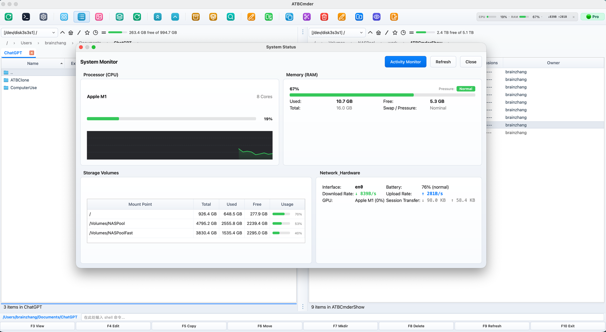
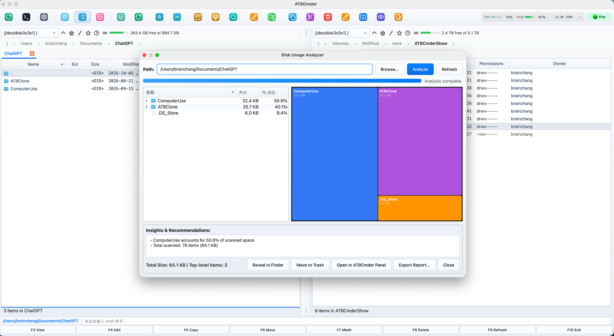
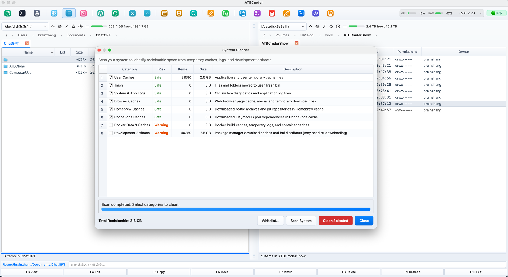
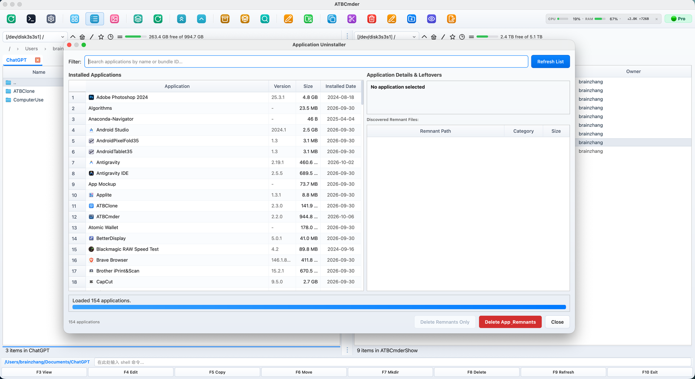

# 제7장: 시스템 도구 및 유지 관리

전문적인 파일 관리자는 고립된 상태로 작동하지 않습니다. 스토리지, 메모리 및 운영체제 리소스를 총괄하는 핵심 신경 중추 역할을 수행합니다. 정통 듀얼 패널 파일 관리는 디렉터리 계층을 구성하고, 이동하고, 동기화하는 데 탁월하지만, 고급 사용자, 개발자 및 시스템 관리자는 종종 시스템 수준의 문제에 직면합니다. 50GB의 디스크 공간을 조용히 잠식한 숨겨진 디렉터리를 찾아내고, CPU 코어를 과점유하는 폭주 백그라운드 프로세스를 식별하며, 수 기가바이트에 달하는 방치된 개발자 캐시 및 빌드 아티팩트를 정리하고, `~/Library/` 곳곳에 남겨진 고아 환경설정 파일, 런치 데몬(LaunchDaemons) 또는 애플리케이션 지원 폴더 없이 기존 macOS 앱을 완전히 제거해야 하는 상황이 바로 그것입니다.

ATBCmder는 네 가지 전문 시스템 유지 관리 및 진단 도구를 **도구(Tools)** 메뉴에 직접 통합했습니다. 비동기 네이티브 모니터링 데몬을 기반으로 하는 이 도구들은 사용자 인터페이스를 멈추게 하거나 무겁고 광고가 가득한 타사 유틸리티 앱 없이도 파일 패널과 함께 원활하게 작동합니다.

---

## 1. 시각적 빠른 시작: 시스템 도구 및 상태 HUD

ATBCmder는 시스템 유지 관리를 네 가지 핵심 운영 도구로 나누고, 항상 표시되는 툴바 모니터링 캡슐을 함께 제공합니다.

```
┌────────────────────────────────────────────────────────────────────────────────────────────────────────┐
│                                       ATBCMDER SYSTEM TOOLS SUITE                                      │
├────────────────────────────────────────────────────────────────────────────────────────────────────────┤
│                                                                                                        │
│  [1] Status Capsule HUD & Popover       [2] System Status & Diagnostics (⌘⇧M)                         │
│      • Real-time CPU, RAM, and Network      • Per-core utilization bars, full process table            │
│      • Color-coded threshold styling        • Search/filter processes, send SIGTERM/SIGKILL            │
│      • Click for multi-metric popover       • Disk filesystem capacity and network interface graphs   │
│                                                                                                        │
│  [3] Disk Usage Analyzer (⌘⇧D)          [4] System Cleaner (⌘⇧C)                                      │
│      • Multi-threaded directory scanner     • Two-stage safe cleaner: scan first, review, then clean   │
│      • Interactive squarified treemap       • 6 categories: caches, logs, Xcode, dev tools, trash      │
│      • Breadcrumb drill-down navigation     • 3 risk levels (Safe, Warning, Danger) + Whitelist        │
│                                                                                                        │
│  [5] Application Uninstaller (⌘⇧U)                                                                     │
│      • Complete removal of .app bundles and deep remnant files                                         │
│      • Cleans Application Support, Preferences, Caches, LaunchAgents, and Containers                   │
│      • Dual mode: Complete Uninstall vs. Remnants Only (clean up previously deleted apps)              │
│                                                                                                        │
└────────────────────────────────────────────────────────────────────────────────────────────────────────┘
```

### 듀얼 매트릭스 시스템 도구 단축키 매트릭스

| 도구 / 작업 | macOS 단축키 | 클래식 커맨더 키 | 명령 ID | 메뉴 위치 |
| :--- | :--- | :--- | :--- | :--- |
| **시스템 상태 패널** | `Cmd+Shift+M` / `⌘⇧M` | `Ctrl+Shift+M` | `cm_SystemStatus` | **도구 ➔ 시스템 상태...** |
| **디스크 사용량 분석기** | `Cmd+Shift+D` / `⌘⇧D` | `Ctrl+Shift+D` | `cm_DiskUsageAnalyzer` | **도구 ➔ 디스크 사용량 분석기...** |
| **시스템 클리너** | `Cmd+Shift+C` / `⌘⇧C` | `Ctrl+Shift+C` | `cm_CleanSystem` | **도구 ➔ 시스템 클리너...** |
| **애플리케이션 제거기** | `Cmd+Shift+U` / `⌘⇧U` | `Ctrl+Shift+U` | `cm_UninstallApp` | **도구 ➔ 애플리케이션 제거...** |
| **상태 캡슐 표시 전환** | 환경설정 ➔ 일반 | — | *(설정)* | **구성 ➔ 옵션 ➔ 일반** |

---

## 2. 툴바 상태 캡슐 HUD 및 실시간 팝오버

ATBCmder는 메인 툴바 오른쪽에 직접 내장된 **시스템 상태 캡슐(System Status Capsule)**을 제공합니다. 활성 상태 보기(Activity Monitor)로 전환하거나 별도의 터미널을 열 필요 없이 주변 시야에서 시스템 상태를 즉시 파악할 수 있습니다.

```
┌────────────────────────────────────────────────────────────────────────────────────────┐
│ [Left Panel Tabs]                   [Right Panel Tabs]          [ CPU 18% | RAM 44% | ↓1.2M ↑340K ]│
└───────────────────────────────────────────────────────────────────────────┬────────────┘
                                                                            │ Click Capsule
                                                                            ▼
                                                ┌───────────────────────────────────────┐
                                                │ SYSTEM METRICS SUMMARY                │
                                                ├───────────────────────────────────────┤
                                                │ CPU Usage:     [████░░░░░░░░░░]   18% │
                                                │ Memory:        [████████░░░░░░]   44% │
                                                │ GPU Load:      [██░░░░░░░░░░░░]   12% │
                                                │ Battery:       [████████████░░]   88% │
                                                ├───────────────────────────────────────┤
                                                │ Storage:                              │
                                                │  Macintosh HD:  312.4 GB / 994.6 GB   │
                                                │  External SSD:  842.1 GB / 2.0 TB     │
                                                ├───────────────────────────────────────┤
                                                │ Top Processes:                        │
                                                │  • ATBCmder         PID: 54102  CPU: 2%│
                                                │  • WindowServer     PID: 284    CPU: 8%│
                                                │  • Xcode            PID: 88120  CPU: 4%│
                                                ├───────────────────────────────────────┤
                                                │ [ Open Full System Monitor (⌘⇧M) ➔ ] │
                                                └───────────────────────────────────────┘
```

### 2.1 캡슐 구성 요소 및 시각적 스타일

상태 캡슐(`320px` 너비)은 1초마다 업데이트되는 세 가지 실시간 원격 측정 지표를 표시합니다.

1. **CPU 사용률**: 동적 색상 구분을 적용한 실시간 통합 프로세서 사용률 백분율:
   - **정상 (< 75%)**: 강조 파란색 / 테마 전경색.
   - **주의 (75% – 90%)**: 경고 주황색.
   - **위험 (> 90%)**: 경고 빨간색.
2. **메모리 사용률 (RAM)**: 물리적 RAM의 백분율로 표시되는 현재 활성 및 고정(Wired) 메모리 압력.
3. **네트워크 처리량**: 모든 활성 네트워크 어댑터의 실시간 통합 업로드 및 다운로드 속도를 간결한 형식으로 표시(예: `↓2.4 MB/s ↑512 KB/s`).

### 2.2 대화형 팝오버 (`StatusPopup`)

상태 캡슐의 아무 곳이나 클릭하면 모달이 아닌 플로팅 **상태 팝오버**가 열립니다.

- **하드웨어 텔레메트리**: CPU, 메모리, GPU 및 배터리 상태(충전 비율 및 충전 상태 포함)의 종합 백분율을 확인합니다.
- **파일 시스템 마운트**: 여유 공간 및 총 용량 표시 막대와 함께 마운트된 모든 로컬 APFS 컨테이너와 외장 드라이브를 나열합니다.
- **상위 5개 프로세스**: CPU 사용률 및 메모리 점유율을 기준으로 리소스를 가장 많이 소비하는 5개 프로세스를 강조 표시합니다.
- **상세 진단 버튼**: **"전체 시스템 모니터 열기"**를 클릭하거나 `⌘⇧M`을 눌러 포괄적인 진단 창을 실행합니다.

### 2.3 캡슐 표시 여부 설정

파일 탐색 제어 컨트롤만 있는 깔끔한 툴바를 선호하는 경우:

1. **환경설정**(`⌘,` / **구성 ➔ 옵션...**)을 엽니다.
2. 왼쪽 사이드바에서 **일반(General)**을 선택합니다.
3. **화면 표시 및 레이아웃(Display & Layout)** 아래에서 다음 확인란을 전환합니다.  
   `[X] Show system status capsule on toolbar`
4. **적용(Apply)** 또는 **확인(OK)**을 클릭합니다. 캡슐이 메인 툴바에서 즉시 나타나거나 사라집니다.

---

## 3. 시스템 상태 및 진단 (`cm_SystemStatus` / `⌘⇧M`)

**`⌘⇧M`**(또는 **`Ctrl+Shift+M`**)을 누르면 전체 **시스템 상태 패널**이 열립니다. 이 유틸리티는 시스템 관리자, 개발자 및 성능 문제 해결을 위해 맞춤 제작된 통합 진단 콘솔 역할을 합니다.

```
┌────────────────────────────────────────────────────────────────────────────────────────┐
│                             SYSTEM STATUS & DIAGNOSTICS                                │
├────────────────────────────────────────────────────────────────────────────────────────┤
│ CPU USAGE: Apple M3 Max (14 Cores)                                                     │
│ Core 01: [██████░░░░] 60%    Core 05: [██░░░░░░░░] 20%    Core 09: [███░░░░░░░] 30%    │
│ Core 02: [████░░░░░░] 40%    Core 06: [████░░░░░░] 42%    Core 10: [█░░░░░░░░░] 10%    │
│ Core 03: [████████░░] 80%    Core 07: [█░░░░░░░░░] 12%    Core 11: [░░░░░░░░░░]  5%    │
│ Core 04: [███░░░░░░░] 30%    Core 08: [██░░░░░░░░] 18%    Core 12: [░░░░░░░░░░]  4%    │
├────────────────────────────────────────────────────────────────────────────────────────┤
│ MEMORY: Total 36.0 GB  |  Used: 16.2 GB (45%)  |  App: 9.4 GB  |  Wired: 4.1 GB       │
│ SWAP:   Total 2.0 GB   |  Used: 0 MB (0%)                                              │
├────────────────────────────────────────────────────────────────────────────────────────┤
│ PROCESS LIST                                 Filter: [ node                     ] [x]  │
│ PID      Name             User           CPU %       Memory      Threads    Action     │
│ ────────────────────────────────────────────────────────────────────────────────────── │
│ 72841    node (dev-srv)   brain          48.2%       612.4 MB    28         [ Kill ✕ ] │
│ 72910    node (esbuild)   brain          12.1%       184.2 MB    14         [ Kill ✕ ] │
│ 73104    node (lsp)       brain           1.4%        98.5 MB     8         [ Kill ✕ ] │
├────────────────────────────────────────────────────────────────────────────────────────┤
│ Update Interval: [ 1.0s ▼ ]       [ Pause Monitoring ]              [ Close (Esc) ]    │
└────────────────────────────────────────────────────────────────────────────────────────┘
```

  
*그림 7.1: CPU, RAM, 디스크 I/O 및 상위 활성 프로세스를 추적하는 실시간 시스템 상태 및 진단 대시보드.*

### 3.1 진단 기능 및 메트릭 섹션

1. **멀티 코어 프로세서 모니터**:
   - 전체 시스템 부하와 개별 성능(Performance) 및 효율(Efficiency) 코어 전반의 분석 현황을 시각화합니다.
   - 코어별 진행률 표시줄을 통해 멀티스레드 컴파일이나 렌더링 중 코어 포화 상태를 즉시 파악할 수 있습니다.
2. **메모리 세부 분석 및 스왑 압력**:
   - 물리적 메모리 할당을 앱 메모리, 고정(Wired) 메모리, 압축 메모리 및 캐시된 파일로 분류합니다.
   - 가상 스왑 사용량을 모니터링하여 메모리 누수로 인한 디스크 페이징 발생 시점을 식별하도록 돕습니다.
3. **스토리지 및 마운트 개요**:
   - 마운트 지점 용량 데이터와 함께 실시간 디스크 읽기/쓰기 처리량 지표를 제공합니다.
4. **대화형 프로세스 관리자**:
   - 실행 중인 모든 시스템 및 사용자 작업을 포함하는 실시간 정렬 가능한 테이블입니다.
   - **검색 및 필터링**: 검색 상자에 프로세스 이름이나 PID를 입력하여 결과를 즉시 필터링합니다.
   - **프로세스 종료**:
     - **Kill**을 클릭하거나 프로세스를 선택하고 `Delete`를 누릅니다.
     - 정상 종료를 위한 **종료 (`SIGTERM`)** 또는 응답하지 않는 작업을 위한 **강제 종료 (`SIGKILL`)**를 제공하는 확인 대화 상자가 표시됩니다.

---

### 3.2 맥 앱 스토어 샌드박스 모드(`Top Processes` + `Running Applications`)

Mac App Store 샌드박스 빌드에서 ATBCmder는 진단을 손상시키지 않고 Apple의 개인 정보 보호 경계 내에서 엄격하게 작동하도록 시스템 원격 측정을 조정합니다. 

- **현재 사용자 프로세스 검사**: ATBCmder는 루트 권한이 필요한 전역 Mach 커널 호출을 시도하는 대신 Darwin 커널 프로세스 구조(`sysctl KERN_PROC_UID`) 및 `proc_pidinfo`을 쿼리하여 사용자 계정의 CPU 비율, 상주 메모리(RSS), 가상 메모리 및 프로세스 스레드 수를 측정합니다. 
- **이중 탭 아키텍처**: 
- **상위 프로세스**: 구성 가능한 새로 고침 간격(기본값: 2.0초)을 사용하여 동적으로 정렬된 실시간 프로세스별 CPU, 메모리 및 상태 순위를 표시합니다. 
- **실행 중인 애플리케이션**: 캐시된 Retina 도크 아이콘을 사용하여 사용자 공간에서 실행 중인 GUI 애플리케이션을 구체적으로 식별하여 백그라운드 시스템 데몬, 실행된 에이전트 및 도우미 XPC 서비스에서 발생하는 소음을 깔끔하게 필터링합니다. 
- **샌드박스 안전 컨텍스트 메뉴 작업**: 프로세스 항목을 마우스 오른쪽 버튼으로 클릭하여 대상 작업을 실행합니다. **프로세스 종료**(`SIGTERM`), **강제 종료**(`SIGKILL`), **창을 앞으로 가져오기**, **Finder에 표시**(`open -R`) 또는 **활동 모니터에서 검사**.

---

## 4. 디스크 사용량 분석기 (`cm_DiskUsageAnalyzer` / `⌘⇧D`)

솔리드 스테이트 드라이브(SSD)의 여유 공간이 부족해지기 시작할 때, 수십 기가바이트의 데이터가 어디에 숨어 있는지 찾는 작업은 매우 번거롭고 느릴 수 있습니다. 표준 Finder 파일 목록은 폴더 크기를 자동으로 계산하지 않으며, 수동 검사는 중첩된 계층 구조를 일일이 탐색해야 합니다.

**디스크 사용량 분석기**(`cm_DiskUsageAnalyzer`, 단축키 **`⌘⇧D`** / **`Ctrl+Shift+D`**)는 멀티스레드 스캐너를 사용하여 전체 디렉터리 트리를 비동기적으로 스캔하고, 기존의 계층적 트리 목록과 대화형 **스퀘어화된 트리맵(Squarified Treemap)**을 통해 스토리지를 시각화합니다.

```
┌────────────────────────────────────────────────────────────────────────────────────────┐
│ DISK USAGE ANALYZER: /Users/brainzhang                                                 │
├────────────────────────────────────────────────────────────────────────────────────────┤
│ Path: /Users/brainzhang ➔ Developer ➔ Projects                                        │
├──────────────────────────────────────┬─────────────────────────────────────────────────┤
│ DIRECTORY HIERARCHY                  │ INTERACTIVE SQUARIFIED TREEMAP                  │
│ Folder Name      Size       Percent  │ ┌───────────────────────────┬─────────────────┐ │
│ ──────────────────────────────────── │ │                           │ node_modules    │ │
│ ▼ Developer      142.6 GB   58.2%    │ │ target/debug              │ 28.4 GB         │ │
│   ► Projects     118.2 GB   48.2%    │ │ 64.2 GB                   │ (Rust build)    │ │
│   ► Caches        24.4 GB   10.0%    │ │                           ├─────────────────┤ │
│ ▼ Library         64.2 GB   26.2%    │ │                           │ DerivedData     │ │
│   ► Caches        38.1 GB   15.5%    │ │                           │ 18.2 GB         │ │
│   ► App Support   22.4 GB    9.1%    │ ├───────────────────────────┴─────────────────┤ │
│ ► Downloads       24.1 GB    9.8%    │ │ Video Footage (4K Prores)                   │ │
│ ► Pictures        14.2 GB    5.8%    │ │ 31.8 GB                                     │ │
├──────────────────────────────────────┴─┴───────────────────────────────────────────────┤
│ [ Zoom Out (..) ]  [ Reveal in Dual Panel ]  [ Move to Trash (⌘⌫) ]  [ Export CSV... ]  │
└────────────────────────────────────────────────────────────────────────────────────────┘
```

  
*그림 7.2: 분류된 공간 분석 및 트리맵 탐색을 통해 로컬 볼륨을 검색하는 디스크 사용량 분석기.*

### 4.1 핵심 아키텍처 및 주요 기능

- **비동기 멀티스레드 스캔**: ATBCmder의 기본 인터페이스를 멈추지 않고 APFS 컨테이너 전반의 수십만 개 파일을 스캔합니다. 진행률 표시줄에 초당 스캔된 디렉터리 수가 표시됩니다.
- **스퀘어화된 트리맵 시각화**:
  - 폴더와 파일은 디스크 상의 크기에 엄격하게 비례하는 2D 면적을 가진 중첩된 직사각형 블록으로 표시됩니다.
  - 색상이 디렉터리 깊이를 자동으로 반영하므로 대용량 스토리지 점유 항목을 한눈에 식별할 수 있습니다.
- **양방향 동기화**:
  - 디렉터리 트리에서 항목을 선택하면 트리맵에서 해당 블록이 강조 표시됩니다.
  - 트리맵에서 직사각형을 클릭하면 트리 뷰의 행이 강조 표시되고 전체 파일 경로와 정확한 바이트 크기가 표시됩니다.

### 4.2 대화형 탐색 및 워크플로

1. **하위 탐색 (Drill Down)**: 폴더 행이나 트리맵 블록을 두 번 클릭하여 해당 하위 디렉터리로 확대하고 새 루트를 기준으로 뷰를 다시 계산합니다.
2. **상위 이동 (Zoom Out)**: 툴바의 **축소(Zoom Out)** 버튼을 클릭하거나 상단의 경로 표시줄 세그먼트를 클릭하여 상위 디렉터리로 돌아갑니다.
3. **듀얼 패널에서 확인**: **듀얼 패널에서 보기(Reveal in Dual Panel)**를 클릭하면 활성 ATBCmder 파일 패널이 선택한 디렉터리로 즉시 이동합니다.
4. **즉시 정리**: 불필요한 대용량 폴더나 파일을 선택하고 **`⌘⌫`**를 누릅니다(또는 **휴지통으로 이동** 클릭). 항목이 macOS 휴지통으로 안전하게 이동되며, 스캔 트리가 자동으로 업데이트됩니다.
5. **스토리지 보고서 내보내기**: **내보내기(Export)**를 클릭하여 스토리지 계획 수립을 위한 구조화된 CSV 또는 일반 텍스트 요약 형식의 종합 디스크 사용량 감사 보고서를 생성합니다.

---

## 5. 최근 파일 및 폴더 변경 사항(`cm_RecentChanges`)

새로 다운로드한 자산이 있는 위치를 추적하거나, 여러 프로젝트에서 수정된 코드 파일을 찾거나, 백그라운드 빌드 스크립트의 출력을 확인할 때 **최근 변경 사항** 도구는 마지막 수정 타임스탬프를 기준으로 파일 시스템을 스캔합니다. 

- **실행 트리거**: 메뉴 모음에서 **도구 ➔ 최근 변경 사항...**을 선택하거나 명령 팔레트에서 `cm_RecentChanges`을 호출합니다. 

--- 

### 5.1 범위, 시간 사전 설정 및 크기 필터링

필터 표시줄은 몇 초 만에 큰 디렉터리의 범위를 좁힐 수 있는 타겟 컨트롤을 제공합니다. 

- **검색 경로**: 기본값은 활성 패널 디렉터리이거나 임의의 경로(`/var/log`, `~/Library` 또는 외부 드라이브 마운트)를 입력합니다. 
- **항목 유형 필터링**: **파일 및 폴더**, **파일만** 또는 **폴더만** 간에 전환합니다. 
- **시간 사전 설정**: 빠른 전환 확인 기간(**지난 1시간**, **지난 24시간**, **지난 7일**, **지난 30일**)을 선택하거나 사용자 정의 달력 범위를 지정합니다. 
- **최소 크기 임계값**: `0 B`, `1 KB`, `1 MB`, `10 MB` 또는 사용자 지정 임계값보다 큰 항목을 필터링하여 사소한 파일 접촉(예: 잠금 파일 또는 `.DS_Store`)을 제외합니다. 

--- 

### 5.2 빠른 검색 및 즉각적인 조치

결과는 실시간 진행률 표시기를 통해 비동기적으로 채워집니다. 

- **스포트라이트 사전 시딩**: 로컬 APFS/HFS+ 볼륨에서 ATBCmder는 네트워크 공유 및 인덱싱되지 않은 디렉터리에 대한 POSIX 디렉터리 순회로 폴백하기 전에 macOS 스포트라이트 인덱스(`mdfind`)를 쿼리하여 1초 미만의 반환을 확인합니다. 
- **컨텍스트 작업**: 결과를 두 번 클릭하거나 `Enter`을 눌러 파일을 엽니다. `Cmd+Enter`을 눌러 활성 패널에서 해당 항목을 찾아서 강조 표시하거나 결과를 외부 앱으로 직접 드래그하세요.

---

## 6. 시스템 클리너 (`cm_CleanSystem` / `⌘⇧C`)

수개월 동안 매일 사용하는 동안 macOS에는 오래된 앱 캐시, Xcode 빌드 아티팩트, 패키지 관리자 다운로드 파일, 고아 진단 로그, 브라우저 캐시 등 수 기가바이트의 임시 데이터가 축적됩니다. 일부 캐시는 작업 흐름 속도를 높여주지만, 더 이상 사용되지 않는 항목은 소중한 초고속 SSD 스토리지를 낭비합니다.

**시스템 클리너**(`cm_CleanSystem`, 단축키 **`⌘⇧C`** / **`Ctrl+Shift+C`**)는 엔터프라이즈급 안전성을 보장하도록 설계된 결정론적 2단계 시스템 클리너를 제공합니다.

```
┌────────────────────────────────────────────────────────────────────────────────────────┐
│                              SYSTEM CLEANER: DRY RUN AUDIT                             │
├────────────────────────────────────────────────────────────────────────────────────────┤
│ [ Scan System ]  Scanned: 48,192 items in 2.1s        Total Reclaimable: 34.8 GB        │
├────────────────────────────────────────────────────────────────────────────────────────┤
│ CATEGORY                          ITEMS       SIZE        RISK LEVEL     SELECTION     │
│ ────────────────────────────────────────────────────────────────────────────────────── │
│ [X] Application Caches            12,410      14.2 GB     Safe (Green)   [ Select All] │
│ [X] System & User Logs             4,218       1.8 GB     Safe (Green)   [ Select All] │
│ [X] Xcode Derived Data             8,940      12.4 GB     Warning (Org)  [ Select All] │
│ [ ] Homebrew & CocoaPods Caches    1,420       3.6 GB     Warning (Org)  [ Select All] │
│ [ ] Web Browser Caches            21,200       2.8 GB     Safe (Green)   [ Select All] │
│ [ ] Trash Bin Container                4       8.2 GB     Danger (Red)   [ Unselected] │
├────────────────────────────────────────────────────────────────────────────────────────┤
│ Selected for Cleanup: 28.4 GB across 25,568 files                                     │
│ Whitelist: ~/.config/atbsys/whitelist (4 rules active)                                │
├────────────────────────────────────────────────────────────────────────────────────────┤
│ [ Whitelist Editor... ]      [ Export Log ]       [ Clean Selected Items (28.4 GB) ]   │
└────────────────────────────────────────────────────────────────────────────────────────┘
```

  
*그림 7.3: 캐시, 로그 및 임시 정크 파일 복구 예상치를 표시하는 시스템 클리너 안전 검색 인터페이스.*

### 6.1 2단계 안전 아키텍처

백그라운드에서 자동으로 파일을 지워버리는 무모한 "원클릭 클리너"와 달리, ATBCmder는 엄격한 **2단계 안전 프로토콜(Two-Stage Safety Protocol)**을 시행합니다.

1. **1단계: Dry-Run 스캔 및 평가**:
   - 클리너가 표준화된 시스템 위치를 대상으로 읽기 전용 조사를 수행합니다.
   - 단 1바이트도 수정하거나 삭제하지 않고 정확한 파일 수와 바이트 크기를 계산합니다.
   - 명시적인 위험 등급과 함께 결과를 투명한 카테고리로 분류합니다.
2. **2단계: 사용자 검토 기반 선택적 삭제**:
   - 분류된 목록을 검토하고 개별 항목 또는 전체 카테고리를 선택하거나 선택 해제합니다.
   - **"선택한 항목 정리"**를 클릭하면 명시적으로 선택된 대상에 대해서만 삭제가 실행됩니다.
   - 모든 삭제 이벤트는 `~/Library/Preferences/atbcmder/operations.log`의 원자적 감사 로그에 기록됩니다.

### 6.2 그룹화 모드, 유지된 크기 및 보존 투명성

데이터를 삭제하기 전에 고급 사용자에게 완전한 확신을 주기 위해 ATBCmder는 세부적인 위험 제어 및 보존 지표를 사용하여 결과를 구성합니다. 

- **애플리케이션별 및 도메인별 그룹화**: 범주 중심 보기(캐시, 로그, 휴지통)와 애플리케이션 중심 그룹화(Xcode, Docker, Node.js, 브라우저) 사이를 전환하여 도구별 정확한 공간을 검사합니다. 
- **유지된 크기 및 10가지 보존 이유**: 안전 규칙으로 인해 항목(예: 활성 소켓 파일, 열린 데이터베이스, 잠긴 캐시 또는 화이트리스트 디렉터리) 삭제가 금지되는 경우 ATBCmder는 현지화된 설명(예: *활성 프로세스에서 사용 중*, *시스템 보호 규칙*, *최근에 수정된 유예 기간*)과 함께 보존된 정확한 바이트 크기를 표시합니다.

---

### 6.3 6대 핵심 정리 영역

| 카테고리 | 일반적인 위치 | 위험 등급 | 설명 |
| :--- | :--- | :---: | :--- |
| **애플리케이션 캐시** | `~/Library/Caches/` | **안전 (Safe)** | 데스크톱 앱에서 생성된 오래된 캐시로, 필요 시 자동으로 다시 생성됩니다. |
| **시스템 및 사용자 로그** | `~/Library/Logs/`, `/var/log/` | **안전 (Safe)** | 더 이상 문제 해결에 필요하지 않은 이전 충돌 로그, 진단 덤프 및 소프트웨어 업데이트 로그입니다. |
| **웹 브라우저 캐시** | Safari, Chrome, Edge, Firefox | **안전 (Safe)** | 설치된 데스크톱 웹 브라우저 전체의 캐시된 웹 페이지, 미디어 버퍼 및 스크립트 아티팩트입니다. |
| **Xcode Derived Data** | `~/Library/Developer/Xcode/DerivedData` | **경고 (Warning)** | 과거 Apple 개발자 빌드에서 생성된 중간 오브젝트 파일, 모듈 캐시 및 인덱스 데이터입니다. |
| **패키지 관리자 캐시** | Homebrew, CocoaPods, NPM, Yarn | **경고 (Warning)** | 다운로드된 tarball 아카이브, formula 캐시 및 패키지 캐시 디렉터리입니다. |
| **휴지통** | `~/.Trash`, `.Trashes` | **위험 (Danger)** | 이전에 macOS 휴지통으로 이동되었으며 아직 영구적으로 비워지지 않은 항목입니다. |

### 6.4 위험 등급 및 안전 허용 목록

- 🟢 **안전 (Safe - 녹색)**: 설정 손실이나 작업 흐름 중단 없이 제거할 수 있는 임시 캐시 및 폐기된 메타데이터입니다.
- 🟡 **경고 (Warning - 주황색)**: 개발자 아티팩트 또는 패키지 캐시입니다. 삭제해도 안전하지만 항목을 다시 가져와야 하므로 후속 프로젝트 컴파일 또는 패키지 다운로드에 시간이 더 오래 걸릴 수 있습니다.
- 🔴 **위험 (Danger - 빨간색)**: 명시적인 확인이 필요한 파일이 포함되어 있습니다(예: 휴지통 영구 비우기).
- **사용자 지정 허용 목록 (Whitelist) 규칙**:
  - ATBCmder가 **절대** 건드려서는 안 되는 특정 경로, 확장자 또는 폴더 이름을 `~/.config/atbsys/whitelist`에 추가할 수 있습니다.
  - 내장된 보호 규칙이 중요 macOS 운영체제 파일, 사용자 키체인 디렉터리 및 클라우드 스토리지 오프라인 동기화 폴더의 스캔을 자동으로 차단합니다.

---

## 7. 애플리케이션 제거기 (`cm_UninstallApp` / `⌘⇧U`)

macOS에서 애플리케이션을 `/Applications`에서 휴지통으로 드래그하면 `.app` 번들 자체만 제거됩니다. 최신 애플리케이션은 환경설정 plist, 애플리케이션 지원 데이터베이스, 백그라운드 실행 에이전트(LaunchAgents), 컨테이너 샌드박스, 캐시된 미디어 등 수백 개의 보조 파일을 드라이브 곳곳에 남기는 경우가 많습니다. 시간이 지남에 따라 이러한 고아 잔여 파일은 수 기가바이트의 저장 공간을 차지하고 로그인 시 불필요한 백그라운드 프로세스를 실행 상태로 남겨둘 수 있습니다.

**애플리케이션 제거기**(`cm_UninstallApp`, 단축키 **`⌘⇧U`** / **`Ctrl+Shift+U`**)는 심층 종속성 스캔을 제공하여 애플리케이션과 관련 잔여 파일을 완전히 제거합니다.

```
┌────────────────────────────────────────────────────────────────────────────────────────┐
│                             APPLICATION DEEP UNINSTALLER                               │
├────────────────────────────────────────────────────────────────────────────────────────┤
│ [ Filter: Docker                     ]  Found: 142 Applications (Total: 48.2 GB)       │
├──────────────────────────────────────┬─────────────────────────────────────────────────┤
│ INSTALLED APPLICATIONS               │ ASSOCIATED REMNANTS & SUPPORT FILES             │
│ App Name          Version    Size    │ File Path / Component               Size        │
│ ──────────────────────────────────── │ ─────────────────────────────────────────────── │
│ [X] Docker.app    4.28.0     1.8 GB  │ [X] /Applications/Docker.app        1.8 GB (.app│
│ [ ] Figma.app     116.15     240 MB  │ [X] ~/Library/Application Support/Docker 14.2 GB│
│ [ ] Slack.app     4.36.0     310 MB  │ [X] ~/Library/Caches/com.docker.docker   2.1 GB │
│ [ ] Visual Studio 1.87.0     450 MB  │ [X] ~/Library/Preferences/com.docker...  12 KB  │
│ [ ] Xcode.app     15.3      12.4 GB  │ [X] ~/Library/LaunchAgents/com.docker...  4 KB  │
│                                      │ [X] ~/Library/Containers/com.docker...  380 MB  │
├──────────────────────────────────────┴─────────────────────────────────────────────────┤
│ Mode: (•) Complete Uninstall (.app + remnants)     ( ) Remnants Only (clean orphans)   │
│ Total Selected for Removal: 18.48 GB across 6 items                                    │
├────────────────────────────────────────────────────────────────────────────────────────┤
│ [ Refresh Applications ]       [ Cancel ]              [ Uninstall Application (18.5G)│
└────────────────────────────────────────────────────────────────────────────────────────┘
```

  
*그림 7.4: Application Support, Caches 및 Preferences 전반에 걸쳐 정밀한 잔여 파일 검색을 수행하는 애플리케이션 제거기.*

### 7.1 잔여 파일 감지 위치

애플리케이션 구성 요소를 스캔할 때 ATBCmder는 정확한 번들 식별자(Bundle Identifier) 일치를 사용하여 다음 표준 macOS 하위 시스템 위치를 검색합니다.

1. **애플리케이션 번들**: `/Applications/<Name>.app` 및 `~/Applications/<Name>.app`.
2. **애플리케이션 지원(Application Support)**: `~/Library/Application Support/<Name>` 및 `<BundleID>`.
3. **애플리케이션 캐시**: `~/Library/Caches/<BundleID>`.
4. **환경설정 및 기본값(Preferences & Defaults)**: `~/Library/Preferences/<BundleID>.plist`.
5. **저장된 상태(Saved State)**: `~/Library/Saved Application State/<BundleID>.savedState`.
6. **실행 데몬 및 에이전트(Launch Daemons & Agents)**: `~/Library/LaunchAgents/<BundleID>.plist`.
7. **샌드박스 컨테이너(Sandbox Containers)**: `~/Library/Containers/<BundleID>/` 및 `~/Library/Group Containers/`.
8. **애플리케이션 로그**: `~/Library/Logs/<Name>/`.

### 7.2 듀얼 작동 모드

- **전체 제거 (기본값)**:
  - 현재 Mac에 설치되어 있는 애플리케이션을 제거하기 위한 모드입니다.
  - 실행 가능한 `.app` 번들을 `/Applications`에서 삭제하고 모든 관련 보조 지원 파일을 단일 원자적 작업으로 삭제합니다.
- **잔여 파일만 정리 (Remnants Only)**:
  - 이전에 Finder 또는 타사 도구를 통해 수동으로 삭제된 애플리케이션의 잔여 파일을 정리하기 위한 모드입니다.
  - 상위 `.app` 번들이 더 이상 시스템에 존재하지 않는 `~/Library/` 내의 고아 지원 폴더를 스캔합니다.

### 7.3 Apple 시스템 무결성 및 안전 보호 장치

우발적인 시스템 불안정화를 방지하기 위해 다음과 같은 보호 장치를 제공합니다.

- **시스템 앱 보호**: 내장 macOS 시스템 애플리케이션(Safari, Finder, 미리보기, 음악, 시스템 설정 등)은 읽기 전용 자물쇠 아이콘으로 보호되며 제거할 수 없습니다.
- **실행 중인 프로세스 감지**: 애플리케이션 또는 해당 도우미 데몬이 현재 실행 중인 경우 ATBCmder는 제거를 진행하기 전에 앱을 정상적으로 종료하도록 안내합니다.
- **휴지통 우선 프로토콜**: 제거된 모든 항목은 디스크에서 즉시 영구 삭제되지 않고 기본적으로 macOS 휴지통으로 이동되므로 필요한 경우 언제든지 완벽하게 복구할 수 있습니다.

---

## 8. 시스템 및 유지 관리 알림

> [!NOTE]
> **최소한의 시스템 리소스 오버헤드**  
> 백그라운드 상태 모니터 데몬은 네이티브 컴파일 코드로 구현되어 1.0초 폴링 주기로 작동합니다. 활성 파일 탐색 중에도 CPU 사용률이 0.1% 미만에 불과하며, ATBCmder가 최소화되거나 가려지면 자동으로 폴링을 일시 중단합니다.

> [!TIP]
> **디스크 사용량 분석기와 듀얼 패널 평면 브랜치 뷰(Branch View) 연계**  
> 디스크 사용량 분석기에서 수천 개의 임시 파일이 흩어져 있는 디렉터리가 발견되면, 해당 디렉터리를 선택하고 **듀얼 패널에서 보기**를 클릭합니다. 그런 다음 **`Cmd+B`** (`cm_DirBranch`)를 눌러 전체 중첩 트리를 단일 목록으로 평면화하면 키보드로 정확하게 항목을 정렬, 선택 및 일괄 삭제할 수 있습니다.

> [!IMPORTANT]
> **확인하기 전에 항상 클리너 선택 항목 검토**  
> 시스템 클리너는 캐시를 **안전 (Green)**으로 분류하지만, 일부 개발자 도구(예: Xcode DerivedData 또는 로컬 Docker 볼륨)는 다음 프로젝트 빌드 시 다시 컴파일하거나 다운로드하는 데 시간이 걸릴 수 있습니다. 진행 중인 작업 스프린트의 필수 캐시를 실수로 지우지 않도록 선택된 카테고리를 미리 검토하십시오.

> [!CAUTION]
> **시스템 프로세스 강제 종료 (`SIGKILL`)**  
> 시스템 상태의 프로세스 관리자에서 `SIGKILL`(강제 종료) 신호를 보내면 열려 있는 파일 버퍼를 비우거나 문서 상태를 저장할 기회 없이 대상 프로세스가 즉시 중단됩니다. 항상 먼저 `SIGTERM`을 통한 정상 종료를 시도하십시오.

> [!WARNING]
> **앱 샌드박스 컨테이너 제거**  
> Mac App Store 앱을 제거할 때 `~/Library/Containers/<BundleID>` 아래에 저장된 보조 파일에는 샌드박스 문서 데이터베이스가 포함되어 있는 경우가 많습니다. 컨테이너 삭제를 확인하기 전에 필요한 중요 로컬 프로젝트 파일이 백업되어 있는지 확인하십시오.

---

## 9. 마스터 듀얼 매트릭스 시스템 도구 참조 표

| 카테고리 | 작업 설명 | macOS 단축키 | 클래식 커맨더 키 | 명령 ID |
| :--- | :--- | :--- | :--- | :--- |
| **시스템 모니터** | 전체 시스템 진단 패널 열기 | `Cmd+Shift+M` / `⌘⇧M` | `Ctrl+Shift+M` | `cm_SystemStatus` |
| **시스템 모니터** | 경량 상태 팝오버 열기 | 툴바 캡슐 클릭 | — | *(UI 동작)* |
| **시스템 모니터** | 프로세스 관리자 목록 필터링 | `Cmd+F` (패널 내부) | `F7` | — |
| **시스템 모니터** | 프로세스 정상 종료 (`SIGTERM`) | `Delete` / `⌫` | `Delete` | — |
| **시스템 모니터** | 프로세스 강제 종료 (`SIGKILL`) | `Shift+Delete` / `⇧⌫` | `Shift+Delete` | — |
| **디스크 분석기** | 디스크 사용량 분석기 대화 상자 열기 | `Cmd+Shift+D` / `⌘⇧D` | `Ctrl+Shift+D` | `cm_DiskUsageAnalyzer` |
| **디스크 분석기** | 선택한 폴더 하위 탐색 (Drill Down) | `Enter` / `Return` | `Enter` | — |
| **디스크 분석기** | 상위 디렉터리로 이동 (Zoom Out) | `Backspace` / `⌫` | `Backspace` | — |
| **디스크 분석기** | 선택 항목을 휴지통으로 이동 | `Cmd+Delete` / `⌘⌫` | `F8` / `Delete` | — |
| **디스크 분석기** | 듀얼 패널에서 선택 항목 보기 | `Cmd+Return` / `⌘⏎` | `Ctrl+Enter` | — |
| **시스템 클리너** | 안전한 시스템 클리너 대화 상자 열기 | `Cmd+Shift+C` / `⌘⇧C` | `Ctrl+Shift+C` | `cm_CleanSystem` |
| **시스템 클리너** | 읽기 전용 Dry-Run 스캔 실행 | `Cmd+R` / `⌘R` | `Ctrl+R` | — |
| **시스템 클리너** | 카테고리 선택 전환 | `Space` | `Space` | — |
| **앱 제거기** | 애플리케이션 제거기 열기 | `Cmd+Shift+U` / `⌘⇧U` | `Ctrl+Shift+U` | `cm_UninstallApp` |
| **앱 제거기** | 잔여 파일 전용 모드로 전환 | `Cmd+2` / `⌘2` | `Alt+2` | — |
| **환경설정** | 툴바 상태 캡슐 HUD 표시 전환 | 환경설정 ➔ 일반 | — | *(설정)* |

---

<div align="center">
  <p>단축키, 패널 보기 및 애플리케이션 동작을 사용자 정의할 준비가 되셨습니까?</p>
  <p><strong><a href="preferences_and_customization.md">제8장: 환경설정 및 사용자 정의로 이동 &rarr;</a></strong></p>
</div>
