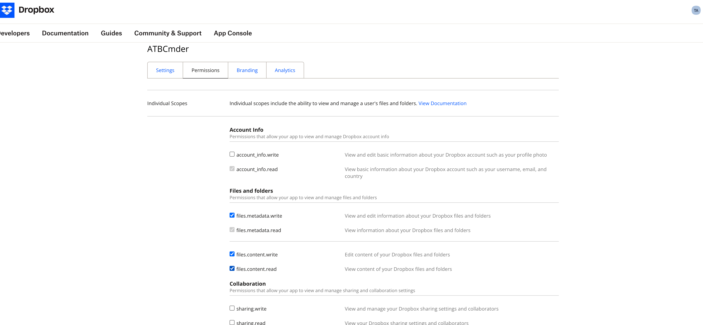

# Глава 6: Виртуальные файловые системы и сеть

Современное управление файлами редко ограничивается пределами одного физического жесткого диска. Разработчики программного обеспечения поддерживают удаленные промежуточные среды через SFTP; системные администраторы управляют общими файловыми ресурсами предприятия через SMB/CIFS; создатели контента получают доступ к облачному хранилищу и медиа-серверам через WebDAV; и опытные пользователи регулярно проверяют, редактируют и упаковывают сжатые архивы размером в гигабайты. 

Традиционные среды рабочего стола вынуждают пользователей манипулировать разрозненными приложениями: отдельная утилита архивирования для распаковки и повторного сжатия zip-архивов, внешний FTP/SFTP-клиент для управления ресурсами сервера и диалоговые окна монтирования операционной системы, которые разбрасывают удаленные тома по отключенным окнам Finder. 

ATBCmder устраняет эту фрагментацию с помощью механизма **Виртуальной файловой системы (VFS)**. Созданный на основе унифицированного уровня абстракции URI `vfs://`, ATBCmder обрабатывает удаленные серверы и сжатые архивы точно так же, как стандартные локальные папки. Вы можете перейти к архиву `.tar.gz`, просмотреть файлы кода с помощью `F3`, отредактировать вложенный файл конфигурации с помощью `F4` (с автоматической переупаковкой в реальном времени при сохранении) и скопировать ресурсы непосредственно через защищенный сеанс SFTP на локальный NAS SMB, используя стандартный ключ `F5` — и все это без извлечения промежуточного ключа. файлы на диск или переключение между отдельными инструментами. 

---

## 1. Краткое руководство: архитектура VFS и матрица команд

ATBCmder направляет весь доступ к файловой системе через единый уровень абстракции. Независимо от того, указывает ли путь на раздел Apple APFS SSD, элемент внутри вложенного архива `.zip` или удаленный каталог, размещенный на SFTP-сервере Linux на другом конце света, двухпанельный интерфейс обеспечивает идентичную операционную модель. 

```
┌────────────────────────────────────────────────────────────────────────────────────────┐
│                              ATBCMDER DUAL-PANEL GUI                                   │
│            Left Panel (Active)                  Right Panel (Inactive / Target)        │
├────────────────────────────────────────────────────────────────────────────────────────┤
│                                          │                                             │
│  [1] Local File System                   │  [2] Archive Virtual File System (VFS)      │
│      file:///Users/brain/projects/       │      vfs:///Users/brain/backup.tar.gz/src/  │
│      Direct POSIX / APFS access          │      In-place browse, F3 view, F4 live edit │
│                                          │                                             │
│  [3] Remote Network VFS (SFTP/SSH)       │  [4] Remote Storage VFS (SMB / WebDAV)      │
│      vfs://sftp://deploy@aws.prod/app/   │      vfs://smb://admin@truenas/Pool/Media/  │
│      Paramiko / SSH Keys / Keychain      │      Kernel mount_smbfs / WebDAVClient3     │
│                                          │                                             │
├────────────────────────────────────────────────────────────────────────────────────────┤
│                          UNIFIED VFS DISPATCH ENGINE (vfs://)                          │
│     FileSystemModel ➔ VFSManager ➔ SessionCache ➔ StreamCopyWorker / RepackWorker      │
└────────────────────────────────────────────────────────────────────────────────────────┘
```

### Двойная матрица VFS и сетевая шпаргалка

| Действие | Сочетание клавиш macOS | Классическая клавиша Commander | Идентификатор команды | Описание | 
| :--- | :--- | :--- | :--- | :--- | 
| **Упаковать файлы в архив** | `Alt+F5` / `⌥F5` | `Alt+F5` | `cm_PackFiles` | Открывает диалоговое окно «Архивный пакет» с параметрами формата, сжатия и пароля. | 
| **Извлечение файлов из архива** | `Alt+F9` / `⌥F9` | `Alt+F9` | `cm_ExtractFiles` | Распаковывает выбранные архивы с разрешением коллизий. | 
| **Быстрое подключение к сети** | Меню: Сеть | `cm_NetworkConnect` | `cm_NetworkConnect` | Открывает диалоговое окно быстрого специального подключения. | 
| **Диспетчер подключений** | Меню: Сеть | `cm_ManageConnections`| `cm_ManageConnections`| Открывает полный сетевой менеджер CRUD с сохраненными профилями подключения. | 
| **FTP-соединение** | `Ctrl+S` / `⌃S` | `Ctrl+S` | `cm_FTPConnect` | Быстрый ярлык для запуска сеанса FTP-соединения. | 
| **Войти в архив/папку** | `Enter` / `⏎` | `Enter` | `cm_Open` | Перемещается непосредственно внутри `.zip`, `.tar`, `.7z` или удаленного каталога. | 
| **Вернуться к родительской папке** | `Backspace` / `⌫` | `Backspace` | `cm_GoToParent` | Вылезает из архива или удаленного каталога обратно на родительский уровень. | 
| **Просмотр виртуального/удаленного файла**| `F3` / `Fn+F3` | `F3` | `cm_View` | Передаёт удаленный или архивный файл в Universal Lister. | 
| **Редактировать виртуальный/удаленный файл**| `F4` / `Fn+F4` | `F4` | `cm_Edit` | Открывает файл в редакторе; автоматически перепаковывается или загружается обратно при сохранении. | 
| **Копирование по панелям/VFS** | `F5` / `Fn+F5` | `F5` | `cm_Copy` | Копирует выбранные элементы на локальные, архивные или сетевые конечные точки. | 
| **Панель фоновых операций**| Меню: Показать | `cm_OperationsPanel` | `cm_OperationsPanel` | Отслеживает фоновые очереди передачи, скорости и активные потоки. | 

---

## 2. Унифицированная абстракция URI `vfs://`

Традиционные файловые менеджеры относятся к удаленным серверам и архивам как к людям второго сорта, требуя внешних утилит монтирования, папок временного извлечения или сторонних клиентов передачи. ATBCmder объединяет каждый источник файлов в единую, четко определенную спецификацию URI: 

```
vfs://[protocol]://[user]@[host]:[port]/[remote_path]
```

### 2.1 Анатомия виртуальных путей

В зависимости от операционной области URI `vfs://` принимают одну из двух стандартных форм: 

1. **Архивировать виртуальные пути**: 
   ```
   vfs:///Users/brain/Documents/release_v1.7.zip/src/main.py
   ```
 

- **Внешний префикс**: `vfs://` указывает `FileSystemModel` перехватывать обход пути. 
- **Путь к контейнеру**: `/Users/brain/Documents/release_v1.7.zip` идентифицирует физический архив контейнера в локальном хранилище. 
- **Внутренний элемент**: `src/main.py` указывает виртуальный ресурс, вложенный в архив. 

2. **Пути к сетевому серверу**: 
   ```
   vfs://sftp://developer@staging.internal.net:2222/var/www/html/index.php
   vfs://smb://admin@192.168.1.50/StoragePool/Backups/2026/
   vfs://webdavs://user@cloud.mycompany.com:443/remote.php/dav/files/user/
   ```
 

- **Спецификатор схемы**: идентифицирует драйвер транспорта (`sftp`, `ftp`, `ftps`, `smb`, `webdav`, `webdavs`, `gdrive`, `dropbox`). 
- **Аутентификация**: кодирует учетные данные пользователя и целевой порт. 
- **Удаленная цель**: определяет абсолютные пути к каталогам и файлам на удаленном хосте. 

```
┌────────────────────────────────────────────────────────────────────────────────────────┐
│                              VFS URI ROUTING IN ACTION                                 │
├────────────────────────────────────────────────────────────────────────────────────────┤
│                                                                                        │
│   Input URI: vfs://sftp://deploy@aws.infra:22/var/log/nginx/access.log                 │
│                 │      │        │        │   └────────────────────► Remote Path        │
│                 │      │        │        └────────────────────────► Port (Default 22)  │
│                 │      │        └─────────────────────────────────► Host / Server      │
│                 │      └──────────────────────────────────────────► Username           │
│                 └─────────────────────────────────────────────────► Protocol Scheme    │
│                                                                                        │
│   Input URI: vfs:///Volumes/Data/Archive.zip/docs/manual.pdf                           │
│                 │                      │        └─────────────────► Archive Member     │
│                 │                      └──────────────────────────► Physical Archive   │
│                 └─────────────────────────────────────────────────► Virtual Scheme     │
└────────────────────────────────────────────────────────────────────────────────────────┘
```

### 2.2 Бесшовная интеграция двух панелей

Поскольку виртуальные пути соответствуют стандартным структурам каталогов внутри ATBCmder, вы получаете полную четность двух панелей: 

- **Виртуальные рабочие пространства с вкладками**: откройте удаленную папку SFTP на вкладке 1, зашифрованный локальный ZIP-архив на вкладке 2 и локальную папку `~/Downloads` на вкладке 3. 
- **Направленное копирование (`F5`)**: выберите файлы на локальной активной панели и нажмите `F5`, чтобы загрузить их непосредственно на удаленный сервер или в сжатый архив, отображаемый на неактивной панели. 
- **Взаимодействие с перетаскиванием**: перетаскивайте элементы по панелям между локальными дисками, общими сетевыми ресурсами и архивными иерархиями без промежуточной подготовки. 
- **Интерактивная навигационная панель**: навигационная панель разбивает виртуальные URI на кликабельные сегменты. Щелкните любую родительскую папку или значок корневого сервера, чтобы мгновенно перейти вверх по дереву. 

---

## 3. Архив VFS: навигация и проверка на месте

Открытие архива в ATBCmder не требует ручного извлечения или стороннего инструмента распаковки. Просто выделите любой поддерживаемый архив и нажмите **`Enter`** (или дважды щелкните мышью). ATBCmder монтирует архив на месте, превращая панель в высокоскоростной браузер виртуальных каталогов. 

 
*Рисунок 6.1: Навигация внутри многовложенного сжатого архива как виртуальной папки с отображением несжатых размеров, временных меток и подкаталогов.*

### 3.1 Поддерживаемые форматы архивов

ATBCmder имеет встроенные драйверы для всех стандартных форматов архивирования и сжатия: 

| Формат | Расширения файлов | Читать раздел «Поддержка» | Написать / Упаковать | Поддержка шифрования | 
| :--- | :--- | :---: | :---: | :--- | 
| **Почтовый индекс** | `.zip` | Да | Да | Стандарт и AES-256 (`pyzipper`) | 
| **GZip-архив** | `.tar.gz`, `.tgz` | Да | Да | Стандартная потоковая передача tar POSIX | 
| **Архив BZip2**| `.tar.bz2`, `.tbz2` | Да | Да | Высокоскоростное сжатие блоков bzip2 | 
| **XZ-тарбол** | `.tar.xz`, `.txz` | Да | Да | Высокоэффективное сжатие LZMA2 | 
| **Обычная СМОЛА** | `.tar` | Да | Да | Несжатый ленточный архив UNIX | 
| **7-Zip** | `.7z` | Да | Да (через `py7zr`)| LZMA / LZMA2 твердое сжатие |

### 3.2 Рабочие процессы навигации на месте

При просмотре внутри архива: 

1. **Ввести подкаталоги**: нажмите `Enter` в любой папке внутри архива, чтобы просмотреть вложенные деревья. 
2. **Восхождение к родительскому элементу (`..`)**: нажмите `Backspace` (`⌫`) или дважды щелкните запись `.. [Parent Directory]`, чтобы подняться. Как только вы достигнете корня архива, нажатие `Backspace` вернет вас в физический каталог, содержащий файл архива. 
3. **Мгновенный просмотр (`F3` / `Fn+F3`)**: выделите любой документ, изображение или исходный файл внутри архива и нажмите `F3`. ATBCmder автоматически извлекает целевой файл в безопасную временную песочницу и отображает его в универсальном листере. 
4. **Выборочное копирование (`F5` / `Fn+F5`)**: вместо распаковки всего многогигабайтного архива только для получения одного или двух файлов выберите нужные конкретные элементы и нажмите `F5`. ATBCmder распаковывает только выбранные элементы непосредственно в неактивную панель. 

> [!NOTE] 
> При предварительном просмотре или копировании отдельных файлов из архива ATBCmder передает только запрошенные байты файла непосредственно из потока контейнера. Он не тратит дисковое пространство и время на распаковку невыбранных одноуровневых файлов. 

---

## 4. Живая переупаковка: редактирование на месте внутри архивов

Один из самых мощных рабочих процессов в ATBCmder — это **Живая переупаковка**. Исторически сложилось так, что изменение одного файла, вложенного в сжатый архив, требовало утомительной последовательности из шести шагов: извлечь весь архив, найти целевой файл, отредактировать и сохранить его, повторно сжать каталог в новый архив, удалить исходный архив и очистить временные папки. 

ATBCmder делает редактирование файлов внутри архивов таким же простым, как и редактирование стандартных локальных файлов. 

```
┌────────────────────────────────────────────────────────────────────────────────────────┐
│                              LIVE REPACKING LIFECYCLE                                  │
├────────────────────────────────────────────────────────────────────────────────────────┤
│                                                                                        │
│  1. User presses F4 on "config.json" inside "package.zip"                              │
│     │                                                                                  │
│     ├──► ATBCmder extracts "config.json" to sandbox: /tmp/dc_repack_xyz/config.json    │
│     └──► Opens internal EditorDialog with window title: "config.json — Editor"         │
│                                                                                        │
│  2. User modifies file and presses Cmd+S (Save)                                        │
│     │                                                                                  │
│     ├──► Editor emits file_saved signal                                                │
│     └──► RepackWorker checks original archive size vs ArchiveRepackWarningMB threshold │
│                                                                                        │
│  3. Atomic Repack Execution                                                            │
│     │                                                                                  │
│     ├──► Writes modified stream to staging archive: /tmp/package.zip.tmp               │
│     ├──► Validates container integrity via archive driver                              │
│     ├──► Atomic swap: os.replace("/tmp/package.zip.tmp", "/original/package.zip")      │
│     └──► Refreshes active file panel and cleans up sandbox /tmp/dc_repack_xyz/         │
│                                                                                        │
└────────────────────────────────────────────────────────────────────────────────────────┘
```

### 4.1 Шаг за шагом: редактирование архивного файла конфигурации

1. Перейдите в архив (например, `application_bundle.zip`), нажав `Enter`. 
2. Найдите файл, который хотите изменить (например, `settings.yaml`). 
3. Нажмите **`F4`** (`Fn+F4`). ATBCmder извлекает файл во временный кэш и запускает встроенный редактор. 
4. Внесите изменения в редакторе. 
5. Нажмите **`Cmd+S`** (`⌘S`), чтобы сохранить. 
6. Закройте редактор с помощью `Cmd+W` (`⌘W`) или `Esc`. 
7. `RepackWorker` ATBCmder автоматически обновляет внутренний элемент, сжимает обновленную структуру во временный файл, атомарно заменяет исходный архив и обновляет вид панели. 

> [!ВНИМАНИЕ] 
> **Охранник большого архива (`ArchiveRepackWarningMB`)** 
> Переупаковка сжатого архива требует распаковки и перекодирования потоков контейнера. Изменение файла размером 10 КБ внутри видеоархива `.tar.gz` размером 20 ГБ заставит компьютер перезаписать все 20 ГБ данных. 
> 
> Чтобы предотвратить случайное зависание диска, ATBCmder включает защитный порог безопасности (`ArchiveRepackWarningMB`, по умолчанию: **100 МБ** в `atbcmder.xml`). Если вы попытаетесь отредактировать или удалить файл внутри архива, размер которого превышает этот предел, ATBCmder отобразит запрос подтверждения: 
> *"Модификация этого архива требует перепаковки всего файла, что может занять много времени. Продолжить?"* 

---

## 5. Создание и извлечение архивов (`Alt+F5` / `Alt+F9`)

ATBCmder предоставляет выделенных фоновых работников для создания и извлечения архивов, гарантируя, что ваши файловые панели останутся отзывчивыми даже во время длительных заданий сжатия. 

 
*Рис. 6.2. Диалоговое окно «Параметры архива» (Alt+F5 / cm_PackFiles), показывающее путь назначения, выбор формата, уровни сжатия и шифрование пароля.*

### 5.1 Сжатие файлов (`Alt+F5` / `⌥F5` / `cm_PackFiles`)

Чтобы создать новый архив: 

1. На активной панели выберите файлы или каталоги, которые вы хотите объединить. 
2. Нажмите **`Alt+F5`** (`⌥F5`) или выберите **Файлы ➔ Упаковать...** в строке меню. 
3. Появится диалоговое окно **Упаковать файлы**: 
- **Создать файл архива**: путь к файлу назначения. По умолчанию ATBCmder предлагает поместить архив в каталог неактивной панели, названный в честь выделенного элемента. 
- **Формат архива**: выберите между `ZIP`, `TAR`, `TAR.GZ`, `TAR.BZ2`, `TAR.XZ` или `7Z`. 
- **Уровень сжатия**: 
- `Store`: нулевое сжатие; мгновенная упаковка предварительно сжатых медиафайлов (MP4, JPEG). 
- `Fast`: низкая нагрузка на процессор; идеально подходит для быстрых переводов. 
- `Normal (Deflated)`: сбалансированная скорость и степень сжатия (рекомендуется для общего использования). 
- `Maximum`: сжатие максимальной плотности (где применимо, используется LZMA/Bzip2). 
- **Пароль (только ZIP)**: введите секретную фразу-пароль для шифрования архива. 
4. Нажмите **Пуск** (или нажмите `Enter`). Операция выполняется в неблокирующем фоновом потоке с индикатором выполнения и индикатором состояния каждого файла.

#### Шифрование пароля военного уровня AES-256

Стандартное шифрование ZIP (устаревшее ZipCrypto) криптографически взломано и уязвимо для атак по словарю открытого текста. Когда вы указываете пароль для ZIP-архива, ATBCmder использует **шифрование AES-256** на базе `pyzipper` (`pyzipper.AESZipFile` со стандартом `WZ_AES`). Это обеспечивает совместимость с macOS, WinZip и 7-Zip, одновременно защищая конфиденциальные данные от грубого расшифрования.

#### Разделение огромных архивов на многотомные наборы

Если вам нужно распределить архив по вложениям электронной почты, дискам FAT32 или границам загрузки в облако с ограничением размера файла: 

1. Объедините файлы, используя `Alt+F5` (`cm_PackFiles`). 
2. Выделите полученный архив `.zip` или `.tar` и запустите File Splitter через **`Alt+F6`** (`cm_FileSpliter`). 
3. Выберите предустановленный размер разделения (например, `100 MB`, `4.7 GB DVD`, `CD 700 MB` или собственный размер в байтах). 
4. ATBCmder генерирует пронумерованные разделенные части (`archive.zip.001`, `archive.zip.002` и т. д.) вместе с манифестом проверки CRC32. Получатели могут собрать исходный контейнер в любое время, используя **`cm_FileLinker`** (`cm_Combine`). 

---

### 5.2 Извлечение архивов (`Alt+F9` / `⌥F9` / `cm_ExtractFiles`)

Чтобы извлечь архивы на диск: 

1. Выделите один или несколько архивов на активной панели. 
2. Нажмите **`Alt+F9`** (`⌥F9`) или выберите **Файлы ➔ Извлечь...** в строке меню. 
3. Откроется диалоговое окно **Извлечение файлов**: 
- **Архивировать для извлечения**: выбран исходный путь контейнера. 
- **Извлечь в каталог**: каталог назначения (по умолчанию неактивная панель). 
- **Предварительный просмотр содержимого**: интерактивный список, загружающий элементы архива в режиме реального времени. 
- **Пароль**: поле ввода для архивов, защищенных паролем. 
4. Нажмите **Начать**. Если какой-либо целевой файл уже существует в папке назначения, ATBCmder приостанавливает рабочий процесс и отображает интерактивный диалог коллизий: 
- **Перезаписать**: заменяет конфликтующий целевой файл. 
- **Пропустить**: существующий файл остается нетронутым и переходит к следующему элементу. 
- **Перезаписать все**: автоматически перезаписывает все последующие конфликты. 
- **Пропустить все**: автоматически пропускает все существующие целевые файлы. 
- **Отмена**: безопасно останавливает процесс извлечения. 

---

## 6. Удаленная сеть VFS: протоколы и удаленное хранилище

ATBCmder включает в себя многопротокольный сетевой клиентский механизм, способный монтировать, просматривать и манипулировать удаленными серверами непосредственно внутри рабочей области с двумя панелями. 

 
*Рисунок 6.3: Просмотр каталогов удаленного сервера Linux через безопасный SFTP с живыми атрибутами файлов, правами владения и передачей с двух панелей.* 

 
*Рис. 6.4. Поддерживаемые типы сетевых подключений: FTP/FTPS, безопасный SFTP, облачное хранилище WebDAV и общие сетевые ресурсы SMB.*

### 6.1 Поддерживаемые сетевые протоколы

| Схема протокола | Порт по умолчанию | Транспортный уровень | Режимы аутентификации | Лучше всего использовать для | 
| :--- | :---: | :--- | :--- | :--- | 
| **`sftp://`** | `22` | СШ-2 (Парамико) | Пароль, ключ SSH (`id_rsa`, `id_ed25519`) | Серверы Linux, облачные экземпляры, промежуточные хосты | 
| **`ftp://`** | `21` | Обычный RFC 959 | Анонимное имя пользователя и пароль в открытом виде | Устаревший веб-хостинг, локальные лабораторные устройства | 
| **`ftps://`** | `990` | FTP с шифрованием TLS | Имя пользователя и пароль с SSL/TLS | Безопасные коммерческие FTP-серверы | 
| **`smb://`** | `445` | CIFS/SMB3 | Windows NT/Kerberos/Локальная учетная запись | Общие ресурсы Windows, устройства NAS, серверы Samba | 
| **`webdav://`** | `80` | HTTP WebDAV | Базовая, дайджест-аутентификация | Веб-серверы, локальные сетевые хранилища | 
| **`webdavs://`** | `443` | HTTPS WebDAV | Базовая аутентификация с шифрованием SSL/дайджест-аутентификация | Nextcloud, ownCloud, коммерческое облачное хранилище | 
| **`gdrive://`** | `443` | API Google Диска | Авторизация токена OAuth2 | Облачные диски и общие папки Google Drive |
| **`dropbox://`** | `443` | API Dropbox v2 | Авторизация токена OAuth2 | Облачные диски и общие папки Dropbox | 

---

### 6.2 Возможности протокола и подробное описание

#### SFTP (протокол передачи файлов SSH)

Драйвер SFTP ATBCmder, поддерживаемый стандартным механизмом SSH `paramiko`, устанавливает зашифрованные туннели через порт 22: 

- **Безопасность ключа хоста (`WarningPolicy`)**: в соответствии со строгими требованиями безопасности ATBCmder автоматически обращается к вашему локальному файлу `~/.ssh/known_hosts`. При подключении к известному хосту ключи хоста проверяются криптографически. Если обнаружен неизвестный сервер, ATBCmder выдает предупреждение о безопасности, а не молча доверяет неожиданным открытым ключам. 
- **Аутентификация по ключу SSH**: помимо стандартной аутентификации по паролю, ATBCmder поддерживает файлы секретных ключей SSH (`~/.ssh/id_rsa`, `~/.ssh/id_ed25519`). 
- **Сопоставление атрибутов UNIX**: сохраняет удаленные восьмеричные режимы файлов (`chmod`), строки владения пользователем/группой и точные временные метки модификации POSIX.

#### FTP и FTPS (явный/неявный SSL)

Драйвер FTP, управляемый Python __ATB_INL_0000__, поддерживает: 

- **Пассивный режим (PASV)**: включен по умолчанию для обеспечения надежных соединений через маршрутизаторы с ограничительным NAT и потребительские брандмауэры. 
- **Настраиваемые кодировки**: устраняются проблемы с отображением имен файлов, отличных от ASCII, позволяя переключаться между наборами символов `UTF-8`, `ISO-8859-1`, `GB18030` и `Windows-1252`.

#### SMB/Samba (общие ресурсы Windows и устройства NAS)

В отличие от простых библиотек Python SMB пользовательского пространства, которые страдают от низкой скорости передачи, ATBCmder использует гибридную архитектуру: 

- **Встроенное ускорение ядра macOS (`mount_smbfs`)**: в macOS `SambaMounter` ATBCmder использует собственную подсистему Apple `/sbin/mount_smbfs`. Он монтирует удаленный общий ресурс непосредственно в дерево VFS macOS (`/Volumes/` или изолированный каталог монтирования), открывая полную пропускную способность чтения/записи SMB3 с аппаратным ускорением. 
- **Обнаружение существующего монтирования**: если macOS Finder или системный сценарий уже смонтировали целевой общий ресурс SMB, ATBCmder автоматически определяет активную точку монтирования из таблицы ОС `mount` и мгновенно переходит к ней, избегая избыточных сетевых подключений. 

> [!IMPORTANT] 
> **Требования к имени общего ресурса SMB** 
> Сервер SMB невозможно просмотреть на уровне простого имени хоста. URI SMB **должен** включать в путь целевой общий ресурс или имя экспорта: 
> 
> - ❌ Неверно: `vfs://smb://nas.local/` 
> - ✅ Допустимо: `vfs://smb://nas.local/StoragePool` или `vfs://smb://192.168.1.100/Media`

#### WebDAV и WebDAVS (Nextcloud/облачное хранилище)

Этот драйвер, созданный на основе `webdavclient3`, обеспечивает двунаправленную синхронизацию файлов с современными решениями облачного хранения: 

- **Проверка сертификата SSL**: поддерживает строгую проверку сертификата SSL для общедоступных хостов WebDAVS с возможностью переопределения самозаверяющих сертификатов в настройках частной домашней лаборатории. 
- **Рекурсивное создание каталогов (`makedirs`)**: автоматически создает недостающие вложенные пути к удаленным каталогам во время операций массовой загрузки. 

---

---

### 6.3 Облачное хранилище Google Drive: Пошаговое руководство по настройке

Управление Google Drive через веб-браузер часто кажется медленным при загрузке больших файлов или организации многоуровневых папок. Кроме того, официальное настольное приложение Google Drive обычно пытается синхронизировать целые деревья папок с локальным SSD вашего Mac, занимая ценное дисковое пространство.

ATBCmder решает эту проблему, подключая **Google Drive как активный виртуальный диск (`gdrive://`)**. Вы можете просматривать удаленные папки прямо в двухпанельном интерфейсе, мгновенно просматривать файлы в облаке с помощью `F3` и копировать данные с помощью `F5` между Mac и Google Drive — **без необходимости скачивать все облачное хранилище на ваш компьютер**.

  
*Рисунок 6.5: Подключение к Google Drive через Диспетчер подключений с учетными данными клиента OAuth2 и просмотр облачных файлов рядом с локальными папками в двухпанельном режиме.*

#### Зачем мне нужны «Client ID» и «Client Secret»?

Для защиты вашей конфиденциальности и безопасности Google запрещает сторонним приложениям запрашивать пароль от вашей учетной записи Google напрямую. Вместо этого используется **официальная авторизация OAuth 2.0**.

Создав свои собственные бесплатные учетные данные OAuth в Google Cloud Console:

- **100% приватность и прямое соединение**: Ваши данные передаются напрямую между вашим Mac и официальными серверами Google. Никакие сторонние или промежуточные серверы не имеют доступа к вашим файлам.
- **Выделенная скорость и квота**: Вы получаете собственную пропускную способность API без конкуренции за лимиты с тысячами других пользователей.
- **Отзыв в любой момент**: Полный контроль остается у вас. Вы можете отозвать доступ ATBCmder в один клик в настройках безопасности вашего аккаунта Google в любое время.

Настройка занимает **менее 3 минут** и выполняется только один раз!

---

#### Шаг 1: Создание бесплатных учетных данных в Google Cloud (2 минуты)

1. Откройте [Google Cloud Console — Учетные данные](https://console.cloud.google.com/apis/credentials) в браузере и войдите в свой аккаунт Google.
2. **Выберите или создайте проект**:
   - В верхней части страницы нажмите на раскрывающийся список организации / проекта.
   - *(Совет для организаций: если у вас есть организация Google Workspace или Cloud Identity, например `aitobox.com`, выберите ее, чтобы проект был создан под доменом компании)*.
   - Если проекта еще нет, нажмите **Новый проект**, укажите любое имя (например, `ATBCmder`) и нажмите **Создать**.
3. **Включите Google Drive API**:
   - В левом меню или верхней строке поиска перейдите в **Включенные API и сервисы** (или нажмите **+ ВКЛЮЧИТЬ API И СЕРВИСЫ**).
   - Найдите **Google Drive API**, откройте и нажмите синюю кнопку **Включить**.
4. **Настройте экран согласия OAuth** *(при первом запросе)*:
   - Если вы создаете учетные данные впервые, Google предложит настроить экран согласия:
     - Выберите **Внешний (External)** и нажмите **Создать**.
     - Укажите **Имя приложения** (например, `ATBCmder`) и введите адрес электронной почты для поддержки и связи с разработчиком.
     - В поле **Главная страница приложения** укажите ваш сайт (например, `https://cmder.aitobox.com`).
     - В разделе **Авторизованные домены** добавьте корневой домен (например, `aitobox.com`).
     - Нажмите **Сохранить и продолжить** на всех последующих шагах.
5. **Создайте учетные данные для приложения рабочего стола**:
   - Вернитесь в **API и сервисы ➔ Учетные данные**.
   - Нажмите **+ Создать учетные данные** вверху и выберите **Идентификатор клиента OAuth**.
   - В типе приложения выберите **Приложение для ПК (Desktop app)**.
   - В поле **Имя** введите `ATBCmder Desktop` (или любое понятное имя).
   - Нажмите **Создать**.
6. **Скопируйте ключи**:
   - Появится диалоговое окно с вашим **Идентификатором клиента (Client ID)** (заканчивается на `.apps.googleusercontent.com`) и **Секретом клиента (Client Secret)**.
   - Скопируйте обе строки (или не закрывайте вкладку браузера).

---

#### Пользовательский брендинг: Значение строки «Доступ предоставлен» (Access Granted To)

Когда вы просматриваете подключенные сторонние приложения в центре безопасности аккаунта Google ([myaccount.google.com/connections](https://myaccount.google.com/connections)), отображается карточка ATBCmder:

- **Имя приложения**: `ATBCmder`
- **Доступ предоставлен (Access granted to)**: например, `aitobox.com` или `oplist.org`
- **Главная страница**: `https://cmder.aitobox.com`

##### Почему Google отображает определенное название организации?

Строка **«Доступ предоставлен» (Access granted to)** автоматически определяется Google на основе **организации Google Cloud** (или аккаунта Google Workspace), владеющей проектом GCP, где был создан идентификатор клиента OAuth:

- Если идентификатор был создан в проекте сторонней организации (например, `oplist.org`), Google покажет этот домен, чтобы уведомить пользователя о принадлежности клиента API.
- Если проект создан в личном аккаунте Google, отображаются контактные данные разработчика.

##### Как установить организацию на собственный домен (например, `aitobox.com`)

Если вы хотите, чтобы в центре безопасности отображался домен вашей компании (например, `aitobox.com`):

1. **Создайте проект под организацией вашего домена**:
   - Войдите в [Google Cloud Console](https://console.cloud.google.com/) с аккаунтом вашего домена (например, `admin@aitobox.com`).
   - Убедитесь, что в верхнем селекторе выбран домен вашей компании, перед созданием проекта.
2. **Настройте экран согласия OAuth под бренд компании**:
   - Перейдите в **API и сервисы ➔ Экран согласия OAuth**.
   - Укажите **Главную страницу приложения** как официальный сайт (например, `https://cmder.aitobox.com`).
   - Добавьте ваш домен в **Авторизованные домены** (например, `aitobox.com`).
   - Укажите адреса электронной почты техподдержки на вашем домене.
3. **Выпустите новый идентификатор клиента для ПК**:
   - В **Учетных данных** создайте новый **Идентификатор клиента OAuth** типа **Приложение для ПК**.
4. **Обновите ключи в ATBCmder**:
   - Вставьте новые ключи в Диспетчер подключений ATBCmder и нажмите **Повторно авторизовать...**.
   - Теперь Google будет отображать домен вашей компании (`aitobox.com`) как получателя доступа!

---

#### Шаг 2: Добавление Google Drive в ATBCmder

После получения ключей подключение в ATBCmder занимает считанные секунды:

1. В ATBCmder в строке меню выберите **Сеть ➔ Управление подключениями...** (или нажмите `cm_ManageConnections`).
2. Нажмите кнопку **`+ Создать`** в левом нижнем углу.
3. В форме **Сведения о подключении** справа:
   - **Метка**: Введите понятное имя (например, `Мой Google Drive` или `Рабочий диск`).
   - **Протокол**: Выберите **`gdrive`** из раскрывающегося списка.
   - **Идентификатор клиента**: Вставьте Client ID из Google Cloud.
   - **Секрет клиента**: Вставьте Client Secret из Google Cloud.
   - *(Подсказка: ссылка `Create OAuth 2.0 credentials in Google Cloud Console` позволяет перейти в консоль в любой момент)*.
4. Нажмите кнопку **Авторизовать** (или **Повторно авторизовать...**):
   - ATBCmder автоматически откроет браузер со страницей авторизации Google.
   - **Важное предупреждение безопасности (Абсолютно нормально и ожидаемо)**:  
     Поскольку вы используете собственный закрытый Client ID разработчика, а не общедоступное приложение из маркетплейса, Google покажет предупреждение *«Google не проверил это приложение» / «Угроза безопасности»*.  
     **Это стандартная процедура и совершенно безопасно.** В браузере разверните дополнительные параметры (нажмите **Дополнительно / Advanced**) и нажмите **«Перейти на страницу приложения (небезопасно) / Продолжить»**.
   - Выберите свой аккаунт Google и подтвердите разрешения на чтение и запись в Google Drive.
   - Нажмите **Продолжить / Разрешить**.
   - После успешной авторизации статус в ATBCmder изменится на:  
     `✓ Authorized (your_account@gmail.com)`!

> [!NOTE]
> **Почему Google показывает предупреждение о непроверенном приложении?**  
> При открытии страницы авторизации Google предупреждает, что приложение не прошло коммерческую верификацию. Это стандартный протокол для собственных учетных данных разработчика. Поскольку ключи созданы лично вами в вашей консоли и доступны только вам, ваши файлы и данные находятся в абсолютной безопасности. Нажмите **Дополнительно (Advanced)**, а затем **«Продолжить»**, чтобы завершить подключение.

5. Нажмите **💾 Сохранить**, а затем **🔗 Подключиться** (или дважды кликните по записи в списке).
6. В активной панели откроется новая вкладка с адресом:
   ```
   vfs://gdrive://your_account@gmail.com//
   ```
   Все ваши файлы и папки Google Drive мгновенно готовы к работе!

---

#### Шаг 3: Работа с Google Drive как с локальным диском

После подключения Google Drive работает точно так же, как обычная локальная папка:

- **Быстрый просмотр без загрузки**: Открывайте папки двойным кликом или клавишей `Enter`. Выделите изображение, PDF, файл кода или документ и нажмите **`F3`** для потокового предпросмотра во встроенном просмотрщике без скачивания на диск.
- **Загрузка в облако (`F5`)**: Выберите файлы в локальной панели (например, в папке `Загрузки`) и нажмите **`F5`** для прямой отправки в текущую папку Google Drive.
- **Скачивание на компьютер (`F5`)**: Выделите файлы на панели Google Drive и нажмите **`F5`** для загрузки в локальную папку.
- **Перетаскивание мышью (Drag & Drop)**: Перетаскивайте файлы и папки между локальной панелью и панелью Google Drive.
- **Мгновенное обновление (`F9` / `Ctrl+R`)**: Нажмите **`F9`**, чтобы за доли секунды синхронизировать последние изменения из облака.
- **Индикатор квоты хранилища в реальном времени**: В правом верхнем углу панели инструментов отображается доступный объем Google Drive (например, `259.7 GB free of 994.7 GB`).
- **Поддержка нескольких учетных записей**: Вы можете настроить несколько профилей Google Drive и даже открывать их одновременно в левой и правой панелях для прямой передачи файлов между ними!
- **Аппаратное шифрование через Secure Enclave**: Секретные ключи и токены OAuth зашифрованы непосредственно в **Связке ключей macOS** (`ATBCmder_VFS`) под защитой чипа Apple Secure Enclave.

---

### 6.4 Облачное хранилище Dropbox: Пошаговое руководство по настройке

Как и в случае с Google Drive, прямой доступ к Dropbox в ATBCmder освобождает вас от необходимости синхронизировать сотни гигабайт с локальным SSD вашего Mac.

ATBCmder подключает **Dropbox как активный виртуальный диск (`dropbox://`)**, обеспечивая предпросмотр файлов с помощью `F3`, быструю потоковую передачу данных с `F5` и мониторинг квоты в реальном времени.

#### Зачем мне нужны «App Key» и «App Secret»?

Для обеспечения безопасности Dropbox запрещает сторонним приложениям запрашивать пароль от вашей учетной записи. Все операции авторизуются через протокол **OAuth 2.0**.

Создав свои бесплатные ключи App Key и App Secret в Dropbox App Console:

- **100% приватность и прямое соединение**: Данные передаются напрямую между Mac и серверами Dropbox в зашифрованном виде.
- **Выделенная скорость и квота**: Вы получаете собственные лимиты API без конкуренции с другими пользователями.
- **Отзыв доступа в любой момент**: Вы можете аннулировать разрешения в настройках Dropbox в любое время.

Настройка занимает **менее 2 минут** и делается всего один раз!

---

#### Шаг 1: Создание приложения в Dropbox App Console

1. Откройте [Dropbox App Console](https://www.dropbox.com/developers/apps) в браузере и войдите в свой аккаунт Dropbox.
2. Нажмите синюю кнопку **Create app** в правом верхнем углу.
3. Настройте параметры приложения, как показано на скриншоте:

  
*Рисунок 6.6: Создание нового приложения в Dropbox App Console с доступом Scoped access и Full Dropbox.*

- **1. Choose an API**: Выберите **Scoped access**.
- **2. Choose the type of access you need**: Выберите **Full Dropbox** (Доступ ко всем файлам и папкам).  
  *(Примечание: если вам нужен доступ только к изолированной папке, можно выбрать "App folder")*.
- **3. Name your app**: Введите уникальное имя приложения (например, `ATBCmder` или `ATBCmder-YourName`).
- Отметьте флажок **I agree to Dropbox API Terms and Conditions**.
- Нажмите синюю кнопку **Create app** внизу справа.

---

#### Шаг 2: Настройка URI перенаправления и копирование ключей (Вкладка Settings)

После создания откроется панель управления. Перейдите на вкладку **Settings** вверху.

  
*Рисунок 6.7: Настройка локального URI перенаправления (http://127.0.0.1:53682/callback) и копирование App key и App secret.*

1. **Укажите Redirect URI для OAuth 2**:
   - Прокрутите страницу до раздела **OAuth 2**.
   - Найдите поле **Redirect URIs**.
   - Введите или вставьте следующий точный адрес:
     ```
     http://127.0.0.1:53682/callback
     ```

   - Нажмите кнопку **Add** рядом с полем.  
   *(Пояснение: во время авторизации ATBCmder запускает локальный слушатель на порту 53682. Этот URI позволяет Dropbox вернуть авторизацию в ATBCmder в один клик)*.
2. **Разрешите публичные клиенты (PKCE)**:
   - Убедитесь, что для параметра **Allow public clients (Implicit Grant & PKCE)** установлено значение **Allow** (или по умолчанию).
3. **Скопируйте App Key и App Secret**:
   - В верхней части вкладки Settings скопируйте **App key**.
   - Чуть ниже найдите **App secret**, нажмите ссылку **Show** и скопируйте секретный ключ.  
   *(Не закрывайте окно браузера или временно сохраните ключи)*.

---

#### Шаг 3: Настройка необходимых разрешений (Вкладка Permissions)

Перейдите на вкладку **Permissions** в верхней части страницы настроек приложения.

  
*Рисунок 6.8: Выбор необходимых разрешений на вкладке Permissions, включая files.metadata.read/write и files.content.read/write.*

1. В разделе **Account Info**:
   - `account_info.read`: Просмотр базовой информации об аккаунте Dropbox (включено по умолчанию, позволяет ATBCmder отображать ваш email).
2. В разделе **Files and folders** включите следующие флажки:
   - `files.metadata.write`: Просмотр и изменение метаданных файлов и папок.
   - `files.content.write`: Изменение содержимого файлов и папок (загрузка и редактирование).
   - `files.content.read`: Просмотр содержимого файлов и папок (скачивание и открытие).

> [!NOTE]
> **Почему `files.metadata.read` отображается серым цветом и недоступен для нажатия?**  
> На скриншоте видно, что пункт `files.metadata.read` отмечен светло-серой галочкой и заблокирован.  
> **Это абсолютно нормальное поведение!**  
> В структуре разрешений Dropbox права на запись строго требуют прав на чтение. Когда вы отмечаете запись или загрузку, Dropbox **автоматически включает и блокирует `files.metadata.read`**, чтобы исключить случайное отключение. Разрешение уже активно!

> [!IMPORTANT]
> **КРАЙНЕ ВАЖНО: Вы ДОЛЖНЫ нажать кнопку «Submit» внизу страницы!**  
> Dropbox **не** сохраняет автоматически изменения на вкладке Permissions!  
> **Обязательно прокрутите страницу Permissions до самого низа и нажмите синюю кнопку «Submit».**  
> Если закрыть вкладку без нажатия Submit, все изменения разрешений будут потеряны!

---

#### Шаг 4: Добавление Dropbox в ATBCmder и авторизация в один клик

После настройки приложения в Dropbox подключить его к ATBCmder очень просто:

1. В меню ATBCmder выберите **Сеть ➔ Управление подключениями...** (или нажмите `cm_ManageConnections`).
2. Нажмите кнопку **`+ Создать`** в нижнем левом углу.
3. В форме **Сведения о подключении** справа:
   - **Метка**: Введите имя (например, `Мой Dropbox` или `Командный Dropbox`).
   - **Протокол**: Выберите **`dropbox`** из списка.
   - **App Key**: Вставьте скопированный App key.
   - **App Secret**: Вставьте скопированный App secret.
   - *(Подсказка: ссылка внизу позволяет быстро открыть консоль приложений Dropbox)*.
4. Нажмите кнопку **Войти через браузер...** (или **Авторизовать**):
   - ATBCmder откроет страницу согласия Dropbox в вашем браузере.
   - Проверьте запрашиваемые разрешения и нажмите **Allow (Разрешить)**.
   - После подтверждения статус в ATBCmder обновится на:  
     `✓ Authorized (your_account@email.com)`!
5. Нажмите **💾 Сохранить**, а затем **🔗 Подключиться** (или дважды щелкните по записи в левом списке).
6. В активной панели откроется новая вкладка по адресу:
   ```
   vfs://dropbox://your_account@email.com//
   ```
   Все ваши файлы и папки Dropbox мгновенно доступны!

---

#### Устранение распространенных неполадок

> [!WARNING]
> **Ошибка: «Your app is not permitted to access this endpoint because it does not have the required scope 'files.metadata.read'»**  
> Если подключение прошло успешно, но при открытии папки возникает эта ошибка, вот причина и 30-секундное решение:  
> 
> 1. **В чем причина?**  
>    - **Вы нажали Submit?** Если вы отметили пункты на вкладке Permissions, но забыли прокрутить страницу вниз и нажать синюю кнопку **Submit**, Dropbox не сохранил изменения.  
>    - **Снимок токена**: В OAuth 2.0 токен фиксирует только те разрешения, которые существовали *на момент авторизации*. Если вы авторизовали ATBCmder до нажатия Submit, старый токен в связке ключей macOS не содержит новых разрешений.  
> 2. **Как исправить:**  
>    - Откройте [Dropbox App Console](https://www.dropbox.com/developers/apps) ➔ вкладку **Permissions**, убедитесь в наличии галочек, **прокрутите вниз и нажмите Submit**.  
>    - Вернитесь в ATBCmder ➔ **Сеть ➔ Управление подключениями...**, выберите подключение Dropbox и нажмите **Повторно авторизовать...**.  
>    - Нажмите **Allow** в браузере, чтобы выпустить новый обновленный токен.  
>    - Нажмите **Подключиться** еще раз — всё заработает!

---

#### Шаг 5: Работа с Dropbox как с локальным диском

После подключения Dropbox работает со скоростью локального накопителя:

- **Двухпанельное копирование (`F5`)**: Выберите файлы в локальной панели (например, в папке `Документы` или `Загрузки`) и нажмите **`F5`** для быстрой выгрузки в Dropbox; либо выберите удаленные файлы и нажмите **`F5`** для скачивания на Mac.
- **Потоковая передача чанками**: Передача выполняется в неблокирующем потоковом режиме с индикацией прогресса в реальном времени, легко обрабатывая видеофайлы и архивы размером в несколько гигабайт без перегрузки оперативной памяти.
- **Мгновенный предпросмотр (`F3`)**: Выделите изображение, PDF, файл Markdown или текст на Dropbox и нажмите **`F3`** для открытия во встроенном просмотрщике без сохранения на жесткий диск.
- **Создание удаленных папок (`F7`)**: Нажмите `F7` для создания новых удаленных каталогов с автоматическим рекурсивным созданием недостающих родительских папок.
- **Перетаскивание мышью (Drag & Drop)**: Перетаскивайте файлы и папки между локальной панелью и панелью Dropbox.
- **Индикатор свободного места**: Оставшееся пространство отображается в реальном времени в верхней панели инструментов (например, `1.8 GB free of 2.0 GB`).
- **Быстрое обновление (`F9` / `Ctrl+R`)**: Обновляйте список файлов и квоту нажатием одной клавиши.
- **Аппаратная безопасность Secure Enclave**: Токены и учетные данные шифруются в **Связке ключей macOS** (`ATBCmder_VFS`) с аппаратной защитой чипа Apple Secure Enclave.

## 7. Быстрое подключение и диспетчер подключений

ATBCmder предоставляет два гибких механизма подключения к удаленным хостам: **Быстрое подключение** для быстрых временных сеансов и **Менеджер подключений** для постоянных классифицированных закладок сервера.

### 7.1 Быстрое подключение (`cm_NetworkConnect`)

Когда вам нужно быстро получить доступ к серверу, не загромождая постоянную конфигурацию: 

1. Выберите **Сеть ➔ Быстрое подключение...** (или выполните команду `cm_NetworkConnect`). 
2. Появится облегченное приглашение на подключение: 
- **Протокол**: выберите `sftp`, `ftp`, `ftps`, `smb`, `webdav`, `webdavs`, `gdrive` или `dropbox`. 
- **Хост и порт**: введите адрес сервера (порт автоматически заполняет значения по умолчанию). 
- **Имя пользователя и пароль**: введите учетные данные для подключения. 
- **Удаленный путь**: запуск удаленного каталога (по умолчанию: `/`). 
- **Запомнить пароль**: не устанавливайте флажок для односеансового временного соединения. 
3. Нажмите **Проверить соединение**, чтобы проверить сетевое соединение и учетные данные перед подключением. 
4. Нажмите **Подключиться**. ATBCmder сразу же открывает новую вкладку на активной панели, указывающую на удаленный сервер. 

---

### 7.2 Менеджер соединений (`cm_ManageConnections`)

Для серверов, к которым вы регулярно обращаетесь, **Диспетчер подключений** предоставляет полную панель настройки конфигурации: 

```
┌────────────────────────────────────────────────────────────────────────────────────────┐
│                              CONNECTION MANAGER DIALOG                                 │
├──────────────────────────────┬─────────────────────────────────────────────────────────┤
│  Saved Connections           │  Connection Details                                     │
│  ┌────────────────────────┐  │  Label:        [ Staging Web Server (AWS)             ] │
│  │ 🔐 AWS Staging Server  │  │  Protocol:     [ SFTP (port 22)                     ▼ ] │
│  │ 🖧 Synology Office NAS │  │  Host:         [ ec2-54-210-10-2.compute.amazonaws.com] │
│  │ 🌐 Nextcloud Personal  │  │  Port:         [ 22                                   ] │
│  │ 📂 Legacy Archive FTP  │  │  Username:     [ ubuntu                               ] │
│  │                        │  │  Password:     [ ••••••••••••••••••                   ] │
│  │                        │  │  Remote Path:  [ /var/www/production                  ] │
│  │                        │  │  [✓] Remember password in macOS Keychain                │
│  └────────────────────────┘  │                                                         │
│  [➕ New] [⧉ Dup] [🗑 Del]    │  [🔍 Test Connection]          [💾 Save]  [🔗 Connect] │
└──────────────────────────────┴─────────────────────────────────────────────────────────┘
```

#### Управление профилями сервера

- **Создать новый (`➕ New`)**: очищает правую форму для определения новой конфигурации сервера. 
- **Дублировать (`⧉ Duplicate`)**: клонирует выбранный профиль подключения. Идеально подходит для управления несколькими средами (разработка, промежуточное исполнение, производство) на идентичных конфигурациях хоста. 
- **Удалить (`🗑 Delete`)**: удаляет профиль подключения и связанные учетные данные из системной цепочки ключей. 
- **Тестовое соединение (`🔍 Test Connection`)**: отправляет фонового работника (`ConnectionTestWorker`) для подключения, аутентификации и корректного отключения, проверяя реакцию сервера без его ухода. 
- **Подключиться (`🔗 Connect`)**: сохраняет все ожидающие изменения полей, устанавливает удаленный сеанс и загружает удаленный каталог в новую активную вкладку панели.

#### Меню динамических сохраненных соединений

Сохраненные подключения автоматически интегрируются в верхнюю строку меню в разделе **Сеть ➔ Сохраненные подключения**. Вы можете смонтировать любой сервер, добавленный в закладки, одним щелчком мыши: 

- `Network ➔ Saved Connections ➔ 🔐 AWS Staging Server` 
- `Network ➔ Saved Connections ➔ 🖧 Synology Office NAS` 

---

## 8. Безопасность учетных данных и интеграция связки ключей

Файлы конфигурации файлового менеджера являются основной мишенью для вредоносных программ, собирающих учетные данные. Многие устаревшие файловые менеджеры хранят пароли FTP/SFTP в виде открытых текстовых файлов конфигурации XML или INI, расположенных в домашнем каталоге пользователя. 

**ATBCmder гарантирует отсутствие хранения учетных данных в открытом виде.**

### 8.1 Архитектура безопасности

```
┌────────────────────────────────────────────────────────────────────────────────────────┐
│                           CREDENTIAL STORAGE ARCHITECTURE                              │
├────────────────────────────────────────────────────────────────────────────────────────┤
│                                                                                        │
│   Connection Configuration XML                    Apple System Keychain                │
│   (~/.config/atbcmder/atbcmder.xml)               (service: "ATBCmder_VFS")            │
│   ┌─────────────────────────────────────┐         ┌──────────────────────────────────┐ │
│   │ <connection>                        │         │ Label: "AWS Staging Server"      │ │
│   │   <label>AWS Staging</label>        │         │ Key:   Encrypted Secret          │ │
│   │   <scheme>sftp</scheme>             │         │ Access: Controlled by macOS      │ │
│   │   <host>aws.infra.net</host>        │         │         Hardware Security Enclave│ │
│   │   <user>deploy</user>               │         └──────────────────────────────────┘ │
│   │   <password></password>             │                           ▲                  │
│   │ </connection>                       │                           │                  │
│   └─────────────────────────────────────┘                           │                  │
│         ▲                                                           │                  │
│         │ Password stripped on save                                 │ Stored via       │
│         └─────────────────── ConnectionManager ─────────────────────┘ Python keyring   │
│                                                                                        │
└────────────────────────────────────────────────────────────────────────────────────────┘
```
 

1. **Очистка XML открытым текстом**: всякий раз, когда профили подключения сериализуются на диск (`atbcmder.xml`), процедура `ConnectionManager.save()` явно вызывает `d["password"] = ""` перед записью. Даже если неавторизованная сторона проверит ваш XML-файл конфигурации, никакие пароли сервера никогда не будут раскрыты. 
2. **Шифрование системной связки ключей macOS**: если установлен флажок **Запомнить пароль**, пароли сохраняются непосредственно в связке ключей macOS через системный API `keyring` под идентификатором безопасного сервиса `ATBCmder_VFS`. Получение и хранение ключей защищены аппаратным обеспечением Secure Enclave от Apple. 
3. **Эфемерные сеансы в памяти**: если флажок «Запомнить пароль» не установлен, учетные данные хранятся строго в динамической памяти (`VFSSessionCache`) в течение текущего жизненного цикла приложения и удаляются в момент завершения работы ATBCmder. 

---

## 9. ⚡ Советы профессионалов: высокопроизводительные удаленные операции

### Совет 1. Неблокирующая фоновая очередь передачи (`cm_OperationsPanel`)

При копировании больших каталогов на удаленные серверы или загрузке многогигабайтных ISO-образов по SFTP никогда не замораживайте свое рабочее пространство. Все операции с сетевыми файлами в ATBCmder автоматически интегрируются в **Очередь фоновых операций**: 

- Нажмите **`F5`**, чтобы начать передачу, затем нажмите **Фоновый режим** (или включите автоматическую очередь). 
- Откройте панель операций с помощью **Показать ➔ Панель операций** (`cm_OperationsPanel`), чтобы отслеживать диаграммы пропускной способности в реальном времени, количество байтов в каждом файле и оценки оставшегося количества передачи. 
- Вы можете приостановить, возобновить или изменить порядок сетевых передач в очереди, продолжая просматривать локальные файлы на обеих панелях.

### Совет 2. Копирование потоков по гетерогенным протоколам

Механизм __ATB_INL_0000__ ATBCmder обеспечивает прямую **потоковую передачу между серверами**. Если вы перетащите папку с SFTP-сервера на левой панели в общий сетевой ресурс SMB на правой панели: 

- ATBCmder **не** загружает весь каталог на локальный жесткий диск Mac перед повторной загрузкой. 
- Данные распределяются по кольцу буферов в памяти, передавая байты из исходного сокета непосредственно в целевой сокет. Это исключает износ локального диска и позволяет передавать данные, превышающие доступную емкость локального твердотельного накопителя.

### Совет 3. Поддержание сети и предотвращение обрывов соединения

Сетевые брандмауэры с отслеживанием состояния и шлюзы NAT часто разрывают простаивающие TCP-соединения после 60–300 секунд бездействия. Чтобы предотвратить разрыв сеансов при просмотре больших удаленных деревьев: 

- Уровень __ATB_INL_0000__ ATBCmder автоматически поддерживает контрольные сигналы сеанса при бездействующих соединениях. 
- Если происходит мгновенное обрыв сети, внутренний механизм `_retry()` выполняет до **3 повторных попыток** с использованием экспоненциальной задержки (`2^attempt` секундные интервалы), прежде чем сообщить об ошибке соединения.

### Совет 4. Редактирование удаленных файлов с помощью жизненного цикла автоматической загрузки

Вам нужно отредактировать `nginx.conf` или скрипт Python непосредственно на удаленном сервере? 

1. Выделите удаленный файл на панели SFTP или WebDAV. 
2. Нажмите **`F4`** (`Fn+F4`). 
3. ATBCmder загружает файл в изолированную временную песочницу (`/tmp/`) и открывает его во встроенном редакторе. 
4. Каждый раз, когда вы нажимаете **`Cmd+S`** (`⌘S`), ATBCmder запускает `_upload_vfs_temp()`, асинхронно передавая обновленный файл обратно на удаленный сервер и отображая подтверждение в строке состояния. 
5. Когда вы закрываете редактор, временный файл надежно отсоединяется от `/tmp/`. 

---

## 10. Оповещения системы и безопасности

> [!ВНИМАНИЕ] 
> **Несоответствие ключа хоста SSH** 
> Если SFTP-сервер повторно генерирует свои ключи хоста (например, после переустановки ОС) или если предпринята попытка перехвата сети «злоумышленник посередине», ATBCmder обнаруживает, что ключ сервера не соответствует отпечатку пальца, зарегистрированному в `~/.ssh/known_hosts`. 
> Никогда не обходите предупреждения ключа хоста в ненадежных общедоступных сетях Wi-Fi без независимой проверки отпечатка открытого ключа сервера у системного администратора. 

> [!IMPORTANT] 
> **Временное кэш-пространство для больших удаленных файлов** 
> При просмотре (`F3`) или редактировании (`F4`) многогигабайтных файлов, хранящихся на удаленных серверах VFS, ATBCmder передает целевой элемент в ваш локальный том `/tmp`. Прежде чем открывать большие объемы удаленного видео или файлов базы данных, убедитесь, что в основном контейнере APFS вашего Mac достаточно свободного места. 

> [!ВНИМАНИЕ] 
> **Отключение общих сетевых ресурсов** 
> Для общих ресурсов SMB, подключенных через macOS `mount_smbfs`, прекращение сетевого подключения без отключения может привести к тому, что дескрипторы монтирования в `/Volumes/` останутся устаревшими. Всегда используйте меню панели управления или отключите действие перед закрытием ноутбука или сменой сети Wi-Fi. 

---

## 11. Справочная таблица основной двухматричной клавиатуры

| Категория | Описание действия | Сочетание клавиш macOS | Классическая клавиша Commander | Идентификатор команды | 
| :--- | :--- | :--- | :--- | :--- | 
| **Архивные операции** | Упаковать выбранные файлы/папки | `Alt+F5` / `⌥F5` | `Alt+F5` | `cm_PackFiles` | 
| **Архивные операции** | Извлечь выбранные архивы | `Alt+F9` / `⌥F9` | `Alt+F9` | `cm_ExtractFiles` | 
| **Архивные операции** | Просмотр внутри контейнера архива | `Enter` / `⏎` | `Enter` | `cm_Open` | 
| **Архивные операции** | Выйти из архива в родительский каталог| `Backspace` / `⌫` | `Backspace` | `cm_ChangeDirToParent` | 
| **Архивные операции** | Предварительный просмотр файла внутри архива | `F3` / `Fn+F3` | `F3` | `cm_View` | 
| **Архивные операции** | Редактировать файл внутри архива (в реальном времени)| `F4` / `Fn+F4` | `F4` | `cm_Edit` | 
| **Архивные операции** | Извлечь только выбранные элементы | `F5` / `Fn+F5` | `F5` | `cm_Copy` | 
| **Архивные операции** | Разделить большой архив на тома | `Alt+F6` / `⌥F6` | `Alt+F6` | `cm_FileSpliter` / `cm_Split` | 
| **Архивные операции** | Соберите части разделенного тома | Меню: Файлы ➔ Объединить файлы | — | `cm_FileLinker` / `cm_Combine` | 
| **Сетевые подключения**| Диалоговое окно быстрого подключения к сети | Меню: Сеть | — | `cm_NetworkConnect` | 
| **Сетевые подключения**| Управление сетевыми подключениями | Меню: Сеть | — | `cm_ManageConnections` | 
| **Сетевые подключения**| Быстрое подключение к FTP-серверу | `Ctrl+S` / `⌃S` | `Ctrl+S` | `cm_FTPConnect` | 
| **Сетевые подключения**| Отключить удаленный сетевой ресурс | Меню: Сеть | — | `cm_NetworkDisconnect` | 
| **Управление трансфером**| Открыть очередь передачи операций | Меню: Показать | — | `cm_OperationsPanel` | 
| **Управление трансфером**| Приостановить/возобновить активную очередь | `Space` (в очереди)| `Space` | — |

--- 

<div align="center">
  <p>Готовы отслеживать ресурсы системы, анализировать использование диска и безопасно очищать кэши?</p>
  <p><strong><a href="system_tools.md">Перейти к Главе 7: Системные инструменты и обслуживание &rarr;</a></strong></p>
</div>