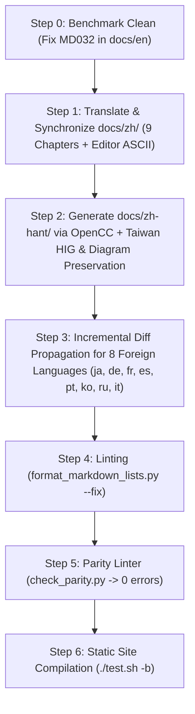

# Design Spec: Multilingual Documentation Synchronization (v2.4.6 Feature Updates)

**Date:** 2026-11-09  
**Status:** In Review  
**Target Scope:** `docs/zh/`, `docs/zh-hant/`, and 8 foreign languages (`docs/{ja,de,fr,es,pt,ko,ru,it}/`) benchmarked against `docs/en/` (9 chapters)  
**Selected Approach:** Approach 1 (Phased Quality-First: Simplified Chinese Human-Grade Localization ➔ OpenCC Traditional Chinese Alignment ➔ Batch Translation Pipeline for 8 Target Languages ➔ Comprehensive Parity & Build Validation)

---

## 1. Executive Summary & Intent

Recent feature additions in ATBCmder—including Total Commander tab locking modes, adjacent tab spawning, two-finger horizontal trackpad history navigation, arbitrary-boundary Chinese Pinyin search & live Filter mode, file extension masks (`Cmd+F10`/`Cmd+F11`), atomic safe file staging (`.tmp.atbcmder_*` + `os.replace`), F4 code editor vector action toolbar, App Sandbox security-scoped cloud bookmarks, SFTP fingerprint validation, and Lucide vector icons shared singleton cache—have been fully documented in the English documentation (`docs/en/`, 9 chapters).

The goal of this project is to synchronize these new capabilities and structural updates across all 10 non-English localized documentation directories, ensuring:
1. 100% 1:1 structural, header hierarchy (H1, H2, H3), and image reference parity against `docs/en/` benchmark (`scripts/check_parity.py`).
2. High-standard native technical copywriting in Simplified Chinese (`docs/zh/`) conforming to Apple macOS HIG terminology and ATBCmder's established documentation tone.
3. High-fidelity Traditional Chinese localization (`docs/zh-hant/`) via OpenCC (`s2twp`) and Apple Taiwan/HK localization terms.
4. Consistent, protected translation of the 9 chapters across the 8 international languages (`ja`, `de`, `fr`, `es`, `pt`, `ko`, `ru`, `it`).
5. Zero MD032 list spacing errors and 100% clean builds across all Zensical documentation sites (`./test.sh -b`).

---

## 2. Goals, Non-Goals & Anti-Goals

### Goals
- **Benchmark Polish**: Fix the 1 MD032 list spacing violation in `docs/en/navigation_and_tabs.md` to ensure the benchmark is strictly clean.
- **Simplified Chinese (`docs/zh/`) Synchronization**: Manually translate and synchronize the 9 updated files with idiomatic, professional technical Chinese:
  - `navigation_and_tabs.md`: TC tab locking (`cm_SetTabOptionLock`, `cm_SetTabOptionLockWithSubdirs`, `cm_SetTabOptionNormal`, `*` badge), adjacent tab creation (`Cmd+T`), trackpad horizontal swipe history navigation, arbitrary-boundary pinyin quick search, live filter mode (`quick_search.filter_only`), custom file masks (`Cmd+F11` / `Cmd+F10`).
  - `file_operations.md`: Ergonomic directory space calculation (`Alt+Shift+Return` / `⌥⇧⏎` / `cm_CountDirContent`), instant `Esc` cancellation, data integrity & atomic staging (`.tmp.atbcmder_*` + `os.replace`), symlink move protection, Zip-Slip traversal guard.
  - `viewers_and_editors.md`: F4 code editor vector action toolbar (Squircle icons, dual shortcut tooltips), status bar telemetry (encoding selector), atomic save protection, symlink target preservation.
  - `network_and_vfs.md`: App Sandbox security-scoped cloud bookmarks (OneDrive, Google Drive, iCloud), SFTP `~/.ssh/known_hosts` strict fingerprint verification.
  - `preferences_and_customization.md`: Semantic Lucide vector icons and shared singleton cache (60fps performance), trackpad swipe setting (`view.trackpad_swipe_navigation`), pinyin search & live filter configuration.
  - `keyboard_shortcuts.md`: New shortcut rows for `cm_SrcAllFiles` (`⌘F10`), `cm_SrcUserDef` (`⌘F11`), `cm_CountDirContent` (`⌥⇧⏎`), tab locking context commands, trackpad navigation row, and editor toolbar actions.
  - `faq_howtos.md`: Directory space calculation shortcut update, Recipe 6 (TC tab locking), Recipe 7 (custom mask filtering `Cmd+F11`), Recipe 8 (trackpad navigation setup), FAQ Q7 (Chinese pinyin & filter mode mechanics).
  - `getting_started.md` & `index.md`: Landmark navigation updates (Lucide icons, trackpad gestures, sandbox cloud support, adjacent tab spawning, TC tab locking) and chapter overview links.
- **Traditional Chinese (`docs/zh-hant/`) Generation**: Generate 9 chapters via `scripts/batch_translate.py` OpenCC (`s2twp`) pipeline, applying Apple Traditional Chinese terminology (e.g., 快速預覽, 快速鍵, 垃圾桶, 偏好設定, 資料夾, 檔案管理器).
- **8 International Languages Synchronization**: Propagate updates to `ja`, `de`, `fr`, `es`, `pt`, `ko`, `ru`, and `it` using `scripts/batch_translate.py` (preserving code blocks, `<kbd>` tags, command IDs, and image paths).
- **Parity & Validation**: Pass `python scripts/check_parity.py` with 0 errors across all 10 languages and verify static site compilation via `./test.sh -b`.

### Non-Goals
- Modifying untouched chapters (`download.md`, `power_tools.md`, `system_tools.md`, `privacy_policy.md`).
- Generating new screenshots or altering image files in `images/`.
- Changing web landing page assets (`landing/`).

### Anti-Goals
- Do not translate or alter Commander Command IDs (`cm_*`), internal configuration keys (e.g. `quick_search.pinyin_search`, `view.trackpad_swipe_navigation`), or keyboard shortcut symbols (`⌘`, `⌥`, `⇧`, `⌃`).
- Do not introduce broken relative markdown links or missing blank lines before markdown lists (MD032).
- Do not allow English fallback placeholders in `docs/zh/` or `docs/zh-hant/`.

---

## 3. Approaches Considered

### Approach 1: Phased Quality-First Multi-Language Sync with Incremental Diff Propagation (Selected)
- **Workflow**:
  1. Fix the minor benchmark formatting in `docs/en/navigation_and_tabs.md` (MD032 list spacing).
  2. Perform human-grade manual translation and synchronization for `docs/zh/` (9 chapters), updating prose, tables, and the F4 code editor vector toolbar ASCII diagram (`viewers_and_editors.md`).
  3. Transform `docs/zh/` to `docs/zh-hant/` using OpenCC `s2twp` enhanced with Apple Taiwan HIG terminology (`標籤頁` ➔ `分頁`, `默認` ➔ `預設`, `拖拽` ➔ `拖曳`, `快捷鍵` ➔ `快速鍵`) and preserving Traditional Chinese ASCII diagrams.
  4. Perform targeted **incremental diff propagation** for the 8 foreign languages (`ja`, `de`, `fr`, `es`, `pt`, `ko`, `ru`, `it`): only translate and splice the newly added/updated sections and shortcut table rows, thereby strictly preserving existing localized ASCII architecture diagrams and mentor-refined terminology from `mentor_style_guide.py`. Update the F4 editor ASCII toolbar to the vector icon layout in all languages.
  5. Run `python scripts/format_markdown_lists.py --fix` and `python scripts/check_parity.py`.
  6. Verify static compilation with `./test.sh -b`.
- **Pros**: Delivers world-class Chinese and Traditional Chinese documentation while ensuring all 8 foreign languages achieve 100% header, image, and code parity without structural drift or regression to existing localized assets.
- **Cons**: Requires targeted section-level propagation instead of naive full-file overwriting, but ensures zero regression.

### Approach 2: Dual Chinese Sync Only (`zh` and `zh-hant`)
- Only update `docs/zh/` and `docs/zh-hant/`, leaving the other 8 languages untouched.
- **Pros**: Fewer file edits.
- **Cons**: Leaves 40 parity errors failing across `ja`, `de`, `fr`, `es`, `pt`, `ko`, `ru`, `it`. Broken parity breaks repository CI/CD expectations.

### Approach 3: Automated Machine Translation for All 10 Languages Simultaneously
- Run `batch_translate.py` directly for all 10 languages from English without manual Chinese drafting.
- **Pros**: One-command execution.
- **Cons**: Chinese translations would lack the refined technical phrasing, idiomatic macOS terminology, and natural readability required by ATBCmder's user base.

---

## 4. Technical Specifications & File Mapping

### Chapter Update Checklist

| Document Filename | Sections / Content Being Synchronized | Target Header Count |
| :--- | :--- | :---: |
| `navigation_and_tabs.md` | TC tab locking modes (`cm_SetTabOptionLock`, `cm_SetTabOptionLockWithSubdirs`, `cm_SetTabOptionNormal`), adjacent tab creation (`Cmd+T`), trackpad history navigation, pinyin arbitrary character search (`quick_search.pinyin_search`), live Filter mode (`quick_search.filter_only`), file mask filtering (`Cmd+F11`/`Cmd+F10`). | 38 headers (H1:1, H2:7, H3:30) |
| `file_operations.md` | Ergonomic directory space calculation (`Alt+Shift+Return` / `⌥⇧⏎`), background async scanning & `Esc` cancel, Section 6.1 Data Integrity & Safe Transfer Protocols (atomic `.tmp.atbcmder_*` staging + `os.replace`, symlink move protection, Zip-Slip traversal guard). | 38 headers (H1:1, H2:7, H3:30) |
| `viewers_and_editors.md` | Section 4 Modern Vector Action Toolbar (Squircle icons, dual shortcuts), Section 4 Status Bar & Atomic Save Protection (atomic staging, symlink target preservation, encoding selector). | 30 headers (H1:1, H2:8, H3:21) |
| `network_and_vfs.md` | Section 6.3 App Store Sandbox Cloud Storage (OneDrive, Google Drive, iCloud security-scoped bookmarks), Section 10 SFTP SSH host key & fingerprint verification alert. | 32 headers (H1:1, H2:9, H3:22) |
| `preferences_and_customization.md` | Section 4.5 Semantic Lucide File-Type Icons & Shared Singleton Cache, Section 4.6 MacBook Trackpad Horizontal Swipe Navigation (`view.trackpad_swipe_navigation`), Pro Tip 5 Pinyin Quick Search & Live Filtering. | 45 headers (H1:1, H2:8, H3:36) |
| `keyboard_shortcuts.md` | `cm_SrcAllFiles` (`⌘F10`), `cm_SrcUserDef` (`⌘F11`), `cm_CountDirContent` (`⌥⇧⏎`), tab locking commands, trackpad navigation, editor action toolbar shortcuts table. | 24 headers (H1:1, H2:6, H3:17) |
| `faq_howtos.md` | Directory calculation shortcut in decision matrix, Recipe 6 (TC tab locking), Recipe 7 (custom mask filtering `Cmd+F11`), Recipe 8 (trackpad navigation setup), FAQ Q7 (Chinese pinyin & filter mode). | 20 headers (H1:1, H2:4, H3:15) |
| `getting_started.md` | Landmark Section 4 Tab bar (adjacent tabs, TC locking), Section 5 Dual Panels (Lucide icons, trackpad navigation, pinyin & mask filters), Section 7 Status Bar (cloud storage). | 30 headers (H1:1, H2:8, H3:21) |
| `index.md` | Feature overview items 4, 5, 7, and Chapter guide summaries for Chapters 2, 3, 4. | 27 headers (H1:1, H2:5, H3:21) |

---

## 5. Execution Pipeline & Quality Gates

1. **Environment Gate**: Execute all Python operations inside `conda activate ATBCmderDoc`.
2. **Formatting Gate**: Every markdown list must have a preceding blank line (MD032). Run `python scripts/format_markdown_lists.py --check`.
3. **Parity Gate**: Run `python scripts/check_parity.py`. All 10 target languages must report `[PASS]` for all 13 chapters (0 parity errors).
4. **Build Gate**: Run `./test.sh -b` to build static HTML for all languages into `site/` without errors or broken links.

---

## 6. Architectural Decisions Settled & Left to Builder

### Architectural Decisions Settled
1. **Incremental Diff Propagation over Full Overwrite**: In Step 3, the 8 international languages will receive targeted section/table-row updates rather than naive full-file regeneration, preventing destruction of previously localized ASCII diagrams and mentor polish.
2. **Taiwan HIG Terminology Enforcement**: Traditional Chinese generation will apply full Apple Taiwan HIG rules (`標籤頁` ➔ `分頁`, `默認` ➔ `預設`, `拖拽` ➔ `拖曳`) from `mentor_style_guide.py` to prevent terminology regressions.
3. **F4 Vector Action Toolbar Diagram Update**: The ASCII diagram in `viewers_and_editors.md` will be updated to the new vector icon toolbar format across `zh`, `zh-hant`, and adapted for the foreign language editions.

### What's Left to the Builder
- Exact sentence structure for Simplified Chinese translations to ensure optimal readability, elegance, and consistency with existing chapters.
- Scripting the clean insertion/replacement of updated sections into the 8 foreign languages.
- Verifying the final static build artifacts and reporting clean status.
