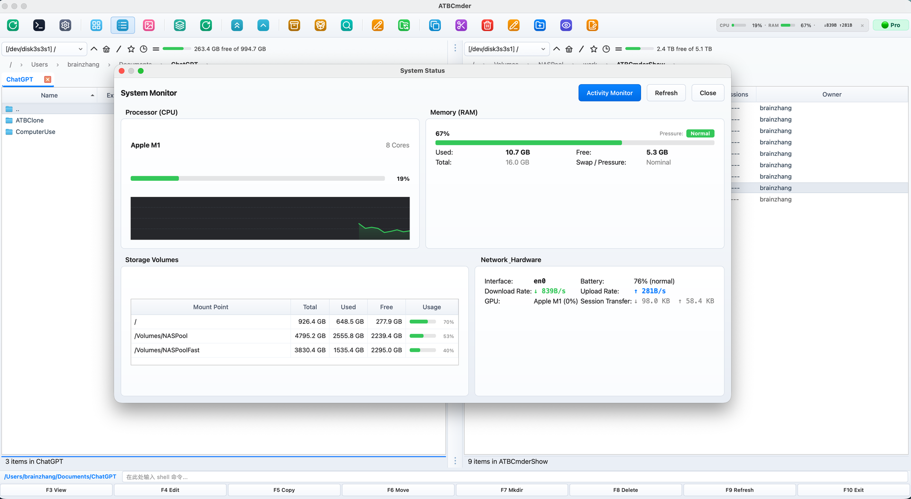
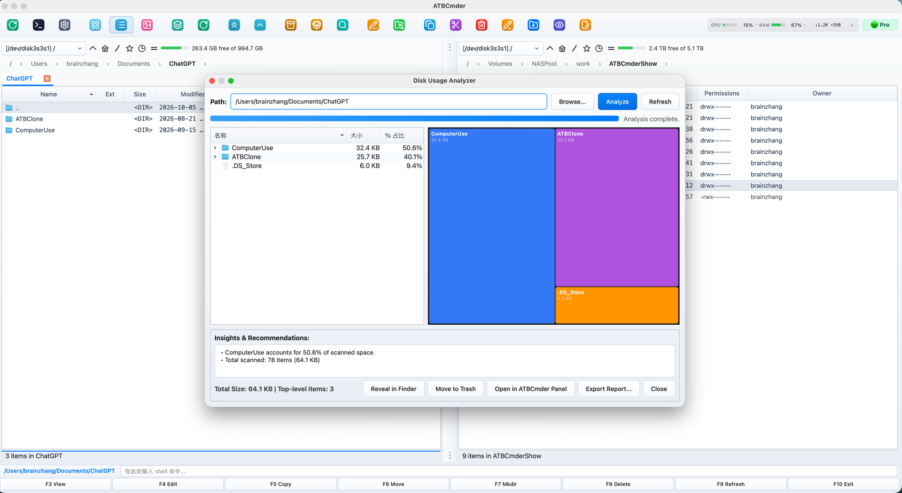
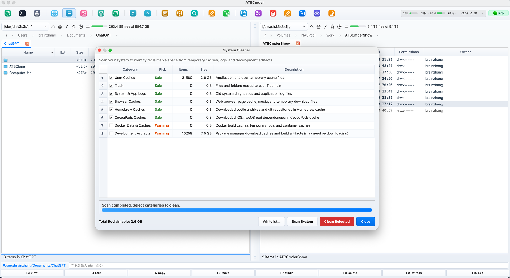
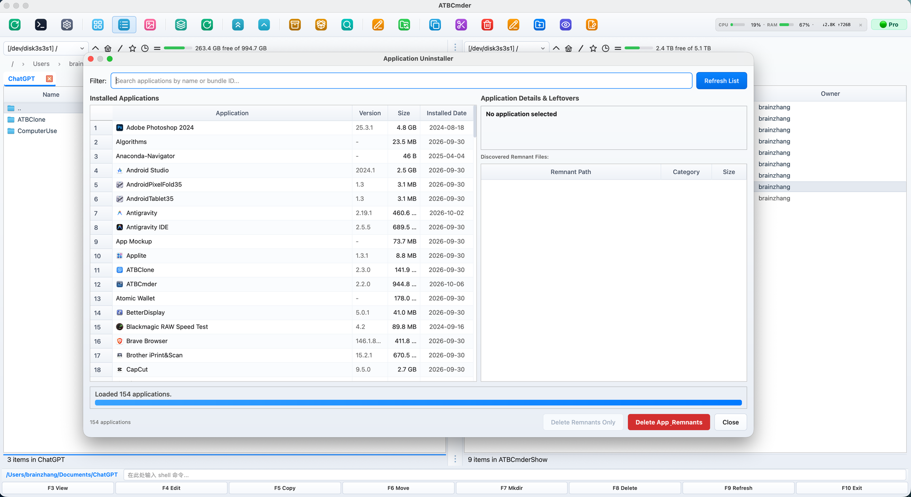

# 第 7 章：系統工具與日常維護

專業的檔案管理器絕非孤立運轉的檔案列表——它是儲存、記憶體與系統底層資源的核心排程中樞。儘管正統雙欄檔案管理在組織、搬遷與同步目錄層級方面表現卓越，但在日常高強度開發、運維及內容創作中，使用者往往需要應對更深層的系統挑戰：找出究竟是哪個隱藏目錄在悄然吞噬數十 GB 磁碟空間、定位失控狂飆 CPU 的後臺程序、一鍵清除數以 GB 計的廢棄開發構建產物與中間快取，以及徹底解除安裝舊版 macOS 應用程式而不殘留任何偏好設定 plist、後臺守護程序 LaunchAgents 或 Application Support 孤兒檔案。

ATBCmder 將五大專業級系統維護與診斷工具直接整合於 **工具 (Tools)** 選單中。依託原生非同步監控守護執行緒，這些工具在後臺高效運轉，既不會凍結雙欄檔案操作介面，也徹底免去了安裝臃腫且充斥廣告的第三方系統清理軟體的煩惱。

---

## 1. 視覺速覽與快速鍵矩陣

ATBCmder 將系統維護細分為五大核心工具套件，並配以主工具欄常駐的狀態監控膠囊：

```
┌────────────────────────────────────────────────────────────────────────────────────────────────────────┐
│                                       ATBCMDER SYSTEM TOOLS SUITE                                      │
├────────────────────────────────────────────────────────────────────────────────────────────────────────┤
│                                                                                                        │
│  [1] Status Capsule HUD & Popover       [2] System Status & Diagnostics (⌘⇧M)                         │
│      • 實時 CPU、記憶體與網路吞吐指標         • 獨立核心利用率柱狀圖與雙分頁沙盒檢視                     │
│      • Top 程序排行 (CPU 與記憶體雙指標)      • Top 程序 (命令列與應用) + 正在執行的應用程式             │
│                                                                                                        │
│  [3] Disk Usage Analyzer                [4] Recent Changes (cm_RecentChanges)                          │
│      • 高併發多執行緒目錄遍歷引擎             • 按體積與修改時間快速鎖定最近變動的檔案與資料夾           │
│      • 互動式矩形樹狀圖 (Treemap)           • 聚焦 (Spotlight) 極速初篩、實時過濾與廢紙簍清理          │
│                                                                                                        │
│  [5] System Cleaner (⌘⇧C)               [6] Application Uninstaller (⌘⇧U)                             │
│      • 兩階段安全清理：先 Dry-run 掃描      • 徹底清除 .app 應用程式包與其關聯的 8 類深層殘留支撐檔案  │
│      • 支援按應用與按類別雙向分組審查       • 深度掃描 Application Support、Preferences、Caches 等     │
│      • 準確保留體積度量與 10 大明確保留原因 • 雙模式執行：完整解除安裝 vs 僅清理遺留殘留                   │
│                                                                                                        │
└────────────────────────────────────────────────────────────────────────────────────────────────────────┘
```

### 雙矩陣系統工具快速鍵一覽

| 工具 / 操作 | macOS 原生快速鍵 | 傳統 Commander 鍵位 | 命令 ID | 選單對應位置 |
| :--- | :--- | :--- | :--- | :--- |
| **系統狀態與診斷控制檯** | `Cmd+Shift+M` / `⌘⇧M` | `Ctrl+Shift+M` | `cm_SystemStatus` | **工具 ➔ 系統狀態...** |
| **磁碟空間佔用分析器** | *(選單項)* | — | `cm_DiskUsageAnalyzer` | **工具 ➔ 磁碟空間佔用分析器...** |
| **最近修改檔案與資料夾** | *(選單項)* | — | `cm_RecentChanges` | **工具 ➔ 檢視最近修改的檔案/資料夾...** |
| **兩階段安全系統清理器** | `Cmd+Shift+C` / `⌘⇧C` | `Ctrl+Shift+C` | `cm_CleanSystem` | **工具 ➔ 系統清理...** |
| **應用程式深度解除安裝器** | `Cmd+Shift+U` / `⌘⇧U` | `Ctrl+Shift+U` | `cm_UninstallApp` | **工具 ➔ 解除安裝應用程式...** |
| **開關狀態膠囊顯示** | 偏好設定 ➔ 常規 | — | *(配置項)* | **配置 ➔ 選項 ➔ 常規** |

---

## 2. 工具欄狀態膠囊 HUD 與實時氣泡卡片

ATBCmder 在主工具欄最右側內建了 **系統狀態膠囊 (System Status Capsule)**。無需頻繁切換至 macOS 活動監視器或額外開啟終端，即可在檔案管理視野余光中隨時掌握系統硬體負載健康狀況。

```
┌────────────────────────────────────────────────────────────────────────────────────────┐
│ [左欄標籤頁]                         [右欄標籤頁]                [ CPU 18% | RAM 44% | ↓1.2M ↑340K ]│
└───────────────────────────────────────────────────────────────────────────┬────────────┘
                                                                            │ 點選狀態膠囊
                                                                            ▼
                                                ┌───────────────────────────────────────┐
                                                │ SYSTEM METRICS SUMMARY                │
                                                ├───────────────────────────────────────┤
                                                │ CPU Usage:     [████░░░░░░░░░░]   18% │
                                                │ Memory:        [████████░░░░░░]   44% │
                                                │ GPU Load:      [██░░░░░░░░░░░░]   12% │
                                                │ Battery:       [████████████░░]   88% │
                                                ├───────────────────────────────────────┤
                                                │ Storage:                              │
                                                │  Macintosh HD:  312.4 GB / 994.6 GB   │
                                                │  External SSD:  842.1 GB / 2.0 TB     │
                                                ├───────────────────────────────────────┤
                                                │ Top Processes:                        │
                                                │  • ATBCmder         PID: 54102  CPU: 2%│
                                                │  • WindowServer     PID: 284    CPU: 8%│
                                                │  • Xcode            PID: 88120  CPU: 4%│
                                                ├───────────────────────────────────────┤
                                                │ [ 開啟完整系統監控控制檯 (⌘⇧M) ➔ ]    │
                                                └───────────────────────────────────────┘
```

### 2.1 膠囊構成與視覺設計規範

寬度固定為 `320px` 的狀態膠囊包含三大實時硬體遙測指標，預設每秒重新整理一次：

1. **CPU 利用率**：全處理器綜合負載百分比，具備動態警戒色彩指示：
   - **正常區間 (< 75%)**：主題高亮藍 / 正常文字色。
   - **升高區間 (75% – 90%)**：警示橙黃色。
   - **臨界高負載 (> 90%)**：警報鮮紅色。
2. **記憶體使用率 (RAM)**：實體記憶體中活躍與聯動 (Wired) 記憶體佔總容量的百分比。
3. **網路吞吐率**：當前所有活躍網絡卡的瞬時上行與下行總吞吐速率，緊湊格式顯示（例如 `↓2.4 MB/s ↑512 KB/s`）。

### 2.2 互動式氣泡卡片 (`StatusPopup`)

用滑鼠左鍵單擊工具欄狀態膠囊，即可調出非模態浮動 **系統指標摘要卡片**：

- **多維硬體遙測**：彙總展示 CPU、RAM、GPU 負載百分比與電池健康狀態（當前電量及充放電狀態）。
- **檔案系統掛載卷**：列出所有已掛載的 APFS 本地容器與外部移動磁碟，配備可用空間條與總容量標識。
- **Top 5 高資源消耗程序**：實時抓取當前佔用 CPU 與記憶體最高的 5 個程序列表。在 Mac App Store 沙盒版本中，系統會自動顯示“當前使用者程序”範圍指示器，聚焦當前使用者旗下的前臺軟體與後臺任務。
- **深入控制檯跳轉**：點選卡片底部的 **“開啟完整系統監控控制檯”** 按鈕（或按下 `⌘⇧M`），即可無縫進入全功能系統診斷介面。

### 2.3 配置狀態膠囊的顯示開關

如果您偏好極簡、無干擾的檔案管理工具欄介面，可隨時關閉狀態膠囊：

1. 開啟 **偏好設定**（快速鍵 `⌘,`，或透過選單欄 **配置 ➔ 選項...**）。
2. 在左側導航欄中選擇 **常規 (General)**。
3. 在 **介面佈局與顯示** 分組下，找到以下勾選項：
   `[X] 在主工具欄右側顯示系統狀態膠囊 (Show system status capsule)`
4. 點選 **應用** 或 **確定**，膠囊即刻從工具欄顯示或隱藏。

---

## 3. 系統狀態與診斷控制檯 (`cm_SystemStatus` / `⌘⇧M`)

按下快速鍵 **`⌘⇧M`**（或 **`Ctrl+Shift+M`**），即可調出全功能的 **系統狀態與診斷面板**。該模組專為軟體工程師、系統管理員及效能診斷專家設計，充當嵌入檔案管理器的極速工作管理員。

```
┌────────────────────────────────────────────────────────────────────────────────────────┐
│                             SYSTEM STATUS & DIAGNOSTICS                                │
├────────────────────────────────────────────────────────────────────────────────────────┤
│ CPU USAGE: Apple M3 Max (14 Cores)                                                     │
│ Core 01: [██████░░░░] 60%    Core 05: [██░░░░░░░░] 20%    Core 09: [███░░░░░░░] 30%    │
│ Core 02: [████░░░░░░] 40%    Core 06: [████░░░░░░] 42%    Core 10: [█░░░░░░░░░] 10%    │
│ Core 03: [████████░░] 80%    Core 07: [█░░░░░░░░░] 12%    Core 11: [░░░░░░░░░░]  5%    │
│ Core 04: [███░░░░░░░] 30%    Core 08: [██░░░░░░░░] 18%    Core 12: [░░░░░░░░░░]  4%    │
├────────────────────────────────────────────────────────────────────────────────────────┤
│ MEMORY: Total 36.0 GB  |  Used: 16.2 GB (45%)  |  App: 9.4 GB  |  Wired: 4.1 GB       │
│ SWAP:   Total 2.0 GB   |  Used: 0 MB (0%)                                              │
├────────────────────────────────────────────────────────────────────────────────────────┤
│ PROCESS LIST                                 Filter: [ node                     ] [x]  │
│ PID      Name             User           CPU %       Memory      Threads    Action     │
│ ────────────────────────────────────────────────────────────────────────────────────── │
│ 72841    node (dev-srv)   brain          48.2%       612.4 MB    28         [ Kill ✕ ] │
│ 72910    node (esbuild)   brain          12.1%       184.2 MB    14         [ Kill ✕ ] │
│ 73104    node (lsp)       brain           1.4%        98.5 MB     8         [ Kill ✕ ] │
├────────────────────────────────────────────────────────────────────────────────────────┤
│ Update Interval: [ 1.0s ▼ ]       [ Pause Monitoring ]              [ Close (Esc) ]    │
└────────────────────────────────────────────────────────────────────────────────────────┘
```

  
*圖 7.1：實時系統狀態與診斷控制檯，監控 CPU、記憶體、磁碟 I/O 與高負載程序。*

### 3.1 診斷特性與核心指標分割槽

1. **多核處理器獨立監視區**：
   - 完整展示 Apple Silicon 架構下的效能核心 (P-Cores) 與能效核心 (E-Cores) 負載。
   - 每個核心配有獨立利用率進度指示條，在多執行緒編譯、音影片渲染或批處理指令碼執行時代核心飽和度一目瞭然。
2. **記憶體細分與 Swap 虛擬記憶體壓力**：
   - 將實體記憶體精細劃分為：應用程式記憶體 (App Memory)、聯動記憶體 (Wired)、壓縮記憶體 (Compressed) 與系統檔案快取。
   - 嚴密監控虛擬記憶體 Swap 換頁佔用，便於第一時間排查引起磁碟劇烈抖動的記憶體洩漏隱患。
3. **儲存掛載卷容量總覽**：
   - 實時監測各掛載分割槽的剩餘容量比例，以及底層讀寫 I/O 速率。
4. **互動式全功能程序管理器**：
   - 實時可排序資料表格，彙總系統中所有執行的使用者態與系統態任務。
   - **即時搜尋與過濾**：在過濾框中鍵入任何程序名稱或 PID，毫秒級定位目標任務。
   - **靈活終止程序**：
     - 單擊操作列的 **Kill** 按鈕，或選中行後直接按下 `Delete` 鍵。
     - 彈出確認對話方塊，支援優雅退出 **Terminate (`SIGTERM`)** 或強行終止 **Force Kill (`SIGKILL`)**（僅在非沙盒直裝版中直接傳送 POSIX 訊號）。

---

### 3.2 Mac App Store 沙盒模式 (Top 程序 + 正在執行的應用程式)

在受限的 Mac App Store 沙盒環境中，Apple 沙盒安全準則禁止呼叫全系統程序遍歷 API（如 `task_for_pid()` 或私有 Mach 核心監視），ATBCmder 採用 Darwin 原生程序自省機制 (`sysctl KERN_PROC_UID` 與 `proc_pidinfo`) 深度檢視當前使用者擁有的所有活躍任務：

- **監控範圍標識**：沙盒模式下，面板標題欄會清晰呈現 `當前使用者程序（App 沙盒）`，明確提示您正在監視使用者賬戶下啟動的應用程式、後臺常駐守護程式、語言伺服器 (LSP) 與命令列工具。
- **底部雙分頁排布**：
  - **Top 程序分頁 (預設)**：開箱即用地按 CPU 佔用率與記憶體佔用雙重排序，方便您一眼揪出失控狂飆的後臺程序（如失控的 Node/Python 指令碼、懸掛的構建程序或 LSP 服務）。
  - **正在執行的應用程式分頁**：專為日常 GUI 軟體打造的獨立標籤，直接從主執行緒快取高畫質應用圖示，並智慧過濾掉後臺小元件、XPC 輔助服務及系統擴充套件等雜音干擾。
- **沙盒合規的程序互動操作**：右鍵點選任意程序條目，即可使用一套安全且完全符合 macOS 沙盒準則的管理指令：
  - **退出 (Quit)** 與 **強制退出 (Force Quit)**：基於標準 macOS 規範安全請求應用優雅退出或強制終止。
  - **前置視窗 (Bring to Front)**：將目標應用的視窗直接切換並置頂到螢幕最前臺。
  - **在訪達中顯示 (Reveal in Finder)**：在訪達中直接定位並高亮其對應的 `.app` 應用程式包。
  - **在活動監視器中檢視…**：開啟系統自帶的“活動監視器”並預先過濾定位到該 PID，方便深入探查核心呼叫棧。

---

## 4. 磁碟空間佔用分析器 (`cm_DiskUsageAnalyzer`)

隨著 SSD 固態硬碟可用空間逐步告急，手動在複雜巢狀的資料夾中排查吞噬空間的“元兇”極為繁瑣低效。Finder 預設不自動統計子目錄總體大小，逐層開啟目錄耗時耗力。

**磁碟空間佔用分析器**（命令 ID `cm_DiskUsageAnalyzer`，可透過選單欄 **工具 ➔ 磁碟空間佔用分析器...** 撥出）採用多執行緒併發掃描技術，能在數秒內遍歷大型目錄樹，並透過傳統的層級樹狀列表與極具視覺衝擊力的互動式 **矩形樹狀圖 (Squarified Treemap)** 進行雙向聯動呈現。

```
┌────────────────────────────────────────────────────────────────────────────────────────┐
│ DISK USAGE ANALYZER: /Users/brainzhang                                                 │
├────────────────────────────────────────────────────────────────────────────────────────┤
│ Path: /Users/brainzhang ➔ Developer ➔ Projects                                        │
├──────────────────────────────────────┬─────────────────────────────────────────────────┤
│ DIRECTORY HIERARCHY                  │ INTERACTIVE SQUARIFIED TREEMAP                  │
│ Folder Name      Size       Percent  │ ┌───────────────────────────┬─────────────────┐ │
│ ──────────────────────────────────── │ │                           │ node_modules    │ │
│ ▼ Developer      142.6 GB   58.2%    │ │ target/debug              │ 28.4 GB         │ │
│   ► Projects     118.2 GB   48.2%    │ │ 64.2 GB                   │ (Rust build)    │ │
│   ► Caches        24.4 GB   10.0%    │ │                           ├─────────────────┤ │
│ ▼ Library         64.2 GB   26.2%    │ │                           │ DerivedData     │ │
│   ► Caches        38.1 GB   15.5%    │ │                           │ 18.2 GB         │ │
│   ► App Support   22.4 GB    9.1%    │ ├───────────────────────────┴─────────────────┤ │
│ ► Downloads       24.1 GB    9.8%    │ │ Video Footage (4K Prores)                   │ │
│ ► Pictures        14.2 GB    5.8%    │ │ 31.8 GB                                     │ │
├──────────────────────────────────────┴─┴───────────────────────────────────────────────┤
│ [ Zoom Out (..) ]  [ Reveal in Dual Panel ]  [ Move to Trash (⌘⌫) ]  [ Export CSV... ]  │
└────────────────────────────────────────────────────────────────────────────────────────┘
```

  
*圖 7.2：磁碟空間佔用分析器快速掃描本地卷，提供分類容量明細與矩形樹圖視覺化。*

### 4.1 核心架構與技術亮點

- **非同步多執行緒掃描引擎**：遍歷 APFS 容器中的數萬乃至數十萬檔案，掃描過程完全置於後臺工作執行緒，主介面保持絲滑響應；底部狀態列實時顯示每秒掃描的目錄數量與已發現容量。
- **互動式矩形樹狀圖 (Squarified Treemap)**：
  - 目錄與檔案被轉化為緊湊巢狀的幾何矩形塊，每個色塊的二維表面積嚴格等比於其佔用的磁碟空間。
  - 色塊明暗與色系自動隨目錄深度漸變，超大體積檔案或目錄在視覺上一目瞭然。
- **左右檢視雙向無縫聯動**：
  - 在左側目錄樹中單擊任意行，右側 Treemap 同步高亮其對應的矩形塊邊界。
  - 在右側 Treemap 中單擊任意色塊，左側目錄樹自動展開定位到該條目，並浮動提示完整絕對路徑及精確位元組大小。

### 4.2 互動導航與日常工作流

1. **下鑽縮放 (Drill Down)**：雙擊目錄樹中的某項或雙擊 Treemap 中的色塊，即可將檢視聚焦至該子目錄，以全新基準重新計算各佔比。
2. **返回上一層 (Zoom Out)**：點選工具欄的 **返回上一層** 按鈕（或點選頂部麵包屑導航條中的任意父路徑），快速退出當前區域性檢視。
3. **定位至雙欄主介面**：點選 **在雙欄中定位 (Reveal in Dual Panel)**，當前活躍的檔案面板立刻切換並進入該目錄。
4. **即刻移入廢紙簍**：選中任意無用的大型檔案或舊專案目錄，按下 **`⌘⌫`**（或點選 **移入廢紙簍**），檔案安全送入 Trash，空間統計樹自動區域性重算。
5. **匯出磁碟審計報告**：支援將分析結果一鍵匯出為結構化的 CSV 或純文字 TXT 報表，便於團隊儲存審計或容量規劃。

---

## 5. 最近修改檔案與資料夾 (`cm_RecentChanges`)

當構建工具突然產生巨量臨時檔案、安裝器散落快取，或者您急需盤點過去 1 小時或最近一週磁碟上究竟發生了哪些變動時，**最近修改檔案與資料夾**（選單：**工具 ➔ 檢視最近修改的檔案/資料夾...**，命令 ID `cm_RecentChanges`）可幫您按體積與修改時間瞬間排查最近建立或變動的專案。

```
┌────────────────────────────────────────────────────────────────────────────────────────┐
│                                     RECENT CHANGES                                     │
├────────────────────────────────────────────────────────────────────────────────────────┤
│ 目標路徑: [ /Users/brainzhang                                    ]  [ 瀏覽... ]        │
│ [X] 檔案    [X] 資料夾    時間範圍: [ 最近 1 天              ▼ ]                       │
│ [X] 忽略小於此體積的檔案: [ 1 MB ▼ ]   (預設: 1 KB / 1 MB / 10 MB / 自定義)            │
├────────────────────────────────────────────────────────────────────────────────────────┤
│ [ 按名稱或路徑實時過濾...                                                        ] [x] │
│ 名稱              型別     佔用空間       匹配修改時間戳               路徑    掃描狀態│
│ ────────────────────────────────────────────────────────────────────────────────────── │
│ derived_cache     資料夾      1.84 GB     2026-11-22 19:42             ~/Lib…  掃描完成│
│ dataset_v3.tar    檔案      642.0 MB      2026-11-22 18:15             ~/Dow…  掃描完成│
│ build_logs        資料夾    ≥ 128.4 MB    2026-11-22 17:04             ~/Wor…  部分統計│
├────────────────────────────────────────────────────────────────────────────────────────┤
│           [ 在訪達中顯示 ]  [ 移到廢紙簍 ]  [ 在 ATBCmder 面板中開啟 ]  [ 開始搜尋 ]   │
└────────────────────────────────────────────────────────────────────────────────────────┘
```

### 5.1 檢索範圍、時間預設與最小大小過濾

- **目標根目錄與條目型別**：透過 **瀏覽...** 任意選擇掃描起點根路徑（預設定位至使用者家目錄），並可獨立勾選匹配 **檔案** 與 **資料夾**。資料夾不僅能根據自身修改時間命中，還會根據內部包含的已修改檔案自動上卷彙總整棵資料夾的遞迴物理空間。
- **時間跨度預設**：提供 **最近 1 小時**、**最近 1 天**、**最近 1 周** 或帶有視覺化起止時間選擇器的 **自定義時間範圍**。
- **最小檔案體積過濾**：勾選 **忽略小於此體積的檔案** 並選擇 **`1 KB`**、**`1 MB`**、**`10 MB`** 或 **自定義大小**（支援自由切換 `B`、`KB`、`MB`、`GB` 單位），徹底過濾微小檔案的頻繁抖動，保留清晰的真實大檔案賬單。

### 5.2 聚焦初篩與即時操作動作

- **基於 macOS 聚焦 (Spotlight) 後設資料極速預篩**：新發起的搜尋預先從系統 Spotlight 後設資料快速載入候選集，實現毫秒級響應；後臺執行緒併發計算各資料夾的實際物理磁碟佔用 (`佔用空間`)。當資料夾內部遇到無讀取許可權的深層子路徑時，容量會以 `≥` 字首如實標明部分下限。
- **搜尋結果實時過濾**：在過濾輸入框中鍵入任意子字串（如 `.zip`、`Downloads` 或 `build`），列表無需重新掃描即可瞬時收窄高亮匹配行。
- **即時操作動作**：
  - **在訪達中顯示**（或雙擊任意結果行）：在 macOS Finder 視窗中直接揭示定位該專案。
  - **在 ATBCmder 面板中開啟**：將當前啟用的 ATBCmder 檔案面板直接跳轉至該檔案所在目錄並精準高亮該項。
  - **移到廢紙簍**：直接將確認無需保留的近期垃圾檔案或資料夾安全移入 macOS 廢紙簍，並自動更新父級資料夾統計。

---

## 6. 系統清理工具 (`cm_CleanSystem` / `⌘⇧C`)

在日常長期使用下，macOS 系統各角落會悄然堆積鉅額臨時檔案：過期的應用程式快取、Xcode 中間派生資料與索引、包管理器殘留、無用的診斷日誌以及瀏覽器快取。雖然部分快取有助於短期效能，但陳舊冗餘資料極度消耗高昂的固態硬碟空間。

**系統清理工具**（命令 ID `cm_CleanSystem`，快速鍵 **`⌘⇧C`** / **`Ctrl+Shift+C`**）提供具備企業級安全保障的確定性兩階段清理架構，支援按應用程式樹狀分組、提供真實的保留體積透明度度量與明確的排除保留原因。

```
┌────────────────────────────────────────────────────────────────────────────────────────┐
│                              SYSTEM CLEANER: DRY RUN AUDIT                             │
├────────────────────────────────────────────────────────────────────────────────────────┤
│ 分組模式: [ 按應用程式分組       ▼ ]   [ 搜尋過濾...                                 ] │
├────────────────────────────────────────────────────────────────────────────────────────┤
│ 分類 / 應用程式                    大小         狀態                    路徑           │
│ ────────────────────────────────────────────────────────────────────────────────────── │
│ ▼ [X] 使用者快取                     855.2 MB     +≥ 3.1 GB 已保留                       │
│   ├─ [X] 飛書                      191.7 MB                                            │
│   ├─ [~] 微信                       44.2 MB     +165.0 MB 已保留                       │
│   │   ├─ [X] multitab/Cache         44.2 MB     就緒                    .../Cache      │
│   │   └─ [ ] WMPF                  165.0 MB     包含資料庫              .../WMPF       │
│   ├─ [ ] Gemini                    217.5 MB     應用程式正在執行                       │
│   └─ [ ] Microsoft Edge (cache)   ≥ 487.2 MB    檔案數量過多            .../Edge       │
├────────────────────────────────────────────────────────────────────────────────────────┤
│ 掃描完成 (1 項未能完全驗證)。請勾選要清理的專案。                                      │
│ 可回收總計: 855.2 MB                                                                   │
├────────────────────────────────────────────────────────────────────────────────────────┤
│ [ 白名單... ] [ 在訪達中顯示 ] [ 在 ATBCmder 面板中開啟 ] [ 掃描系統 ] [ 清理選中項 ] │
└────────────────────────────────────────────────────────────────────────────────────────┘
```

  
*圖 7.3：系統清理器安全掃描介面，展示應用快取、系統日誌與臨時廢棄檔案預估。*

### 6.1 兩階段安全架構規範

與部分“一鍵式黑盒清理工具”直接在後臺靜默刪除不同，ATBCmder 嚴格推行 **兩階段安全準則**：

1. **第 1 階段：只讀預檢掃描 (Dry-Run Audit)**：
   - 清理器對標準化系統路徑與各應用程式私有快取/日誌容器（如編輯器、即時通訊工具、多配置瀏覽器及開發工具鏈）執行只讀勘測。
   - 統計檔案總數、佔用空間並計算可回收容量，期間絕對不修改或刪除任何一個位元組。
   - 重新校驗具有不可變雜湊特徵的執行方案 (`--plan-id`)，確保最終刪除動作嚴格限定在已審查且未發生外部篡改的目標路徑。
2. **第 2 階段：人工複核與選擇性清除 (User-Reviewed Deletion)**：
   - 使用者藉助三態核取方塊逐類或逐個應用複核待清理列表，自由勾選或排除特定子條目。
   - 只有顯式點選 **“清理選中項”** 並二次確認後，清理引擎才執行刪除。
   - 所有的刪除細節均原子性地寫入操作審計日誌：`~/Library/Preferences/atbcmder/operations.log`。

### 6.2 分組檢視、保留體積與保留原因透明度

- **按應用與按類別雙向樹狀分組**：可在 **按應用程式分組** 與 **按類別分組** 之間無縫切換，或在 **搜尋...** 框中鍵入關鍵詞即時過濾，切換期間完好保留已勾選的選定狀態。
- **真實保留體積度量與階梯式排序**：
  - 保護或跳過的已保留條目（呈置灰保護狀態且不可被誤勾選）依然呈現其實際只讀度量的物理磁碟佔用，而非模稜兩可的 `未知`。當深層許可權限制阻礙完整掃描時，下限容量以 `≥` 醒目標識（例如 `≥ 487.2 MB`）。
  - 混合分組在 `大小` 列僅呈現**可清理位元組**（與底部的 **可回收總計** 嚴格對應），同時在 `狀態` 列明確提示已保留體積（如 `+165.0 MB 已保留`）。
  - 按 `大小` 排序採用階梯排序演算法，確保可清理條目與分組始終排在純保留或未知條目之前。
- **精準本地化排除保留原因**：每個被跳過的保留條目都會明確告知為何被保護排除：
  - `應用程式正在執行` / `應用程式狀態未知`
  - `包含資料庫`（自動保護 SQLite / `Cache.db` 與使用者登入會話狀態）
  - `被程序佔用` / `無法驗證是否被佔用`
  - `包含符號連結` / `檔案數量過多` / `許可權不足`
  - `白名單排除` / `受保護資料`
- **掃描完整度與快速直接定位**：若存在任何未完全穿透遍歷的專案，底部狀態列會清晰彙報具體受阻項數（*“掃描完成 (1 項未能完全驗證)。請勾選要清理的專案。”*）。雙擊任意結果行或點選 **在訪達中顯示** / **在 ATBCmder 面板中開啟**，即可瞬間定位並直觀檢查目標物理目錄。

### 6.3 六大核心清理領域

| 清理分類 | 典型系統路徑 | 風險等級 | 說明與建議 |
| :--- | :--- | :---: | :--- |
| **應用程式快取** | `~/Library/Caches/` | **安全 (Safe)** | 桌面應用程式生成的臨時快取檔案，缺失後會在下次啟動時按需重建。 |
| **系統與使用者日誌** | `~/Library/Logs/`, `/var/log/` | **安全 (Safe)** | 陳舊的軟體崩潰轉儲、診斷日誌與安裝日誌，對日常使用無任何不良影響。 |
| **瀏覽器快取** | Safari, Chrome, Edge, Firefox | **安全 (Safe)** | 主流瀏覽器快取的網頁靜態資源、流媒體分片及指令碼，清除可有效回收空間。 |
| **Xcode 派生資料** | `~/Library/Developer/Xcode/DerivedData` | **警告 (Warning)** | 蘋果開發編譯產生的中間產物與符號索引，清除後下次編譯該工程需全量重建。 |
| **包管理器快取** | Homebrew, CocoaPods, NPM, Yarn | **警告 (Warning)** | 下載的公式原始碼包、全域性依賴 tar 包，清除後下次安裝時需重新聯網下載。 |
| **廢紙簍容器** | `~/.Trash`, `.Trashes` | **危險 (Danger)** | 之前被丟入廢紙簍但尚未徹底傾倒的檔案，需要使用者二次確認永久抹除。 |

### 6.4 風險等級劃分與白名單保護

- 🟢 **安全 (Safe)**：純臨時無害資料，清除後絕不破壞使用者配置與日常工作流。
- 🟡 **警告 (Warning)**：開發產物與包管理器快取，清除安全，但下次重新編譯或拉取時需耗費聯網與計算時間。
- 🔴 **危險 (Danger)**：包含不可逆清空的專案（如徹底清空廢紙簍），需要顯式確認。
- **自定義白名單保護機制**：
  - 點選 **白名單...** 按鈕，自由新增絕對禁止 ATBCmder 清理的私有目錄路徑（持久化於 `~/.config/atbsys/whitelist`）。
  - 內建保護規則嚴密守衛 macOS 核心系統元件、鑰匙串鑰匙庫、SQLite 核心資料庫及主流雲盤的本地離線同步卷。

---

## 7. 應用程式深度解除安裝器 (`cm_UninstallApp` / `⌘⇧U`)

在 macOS 平臺，將應用程式圖示從 `/Applications` 拖進廢紙簍僅僅刪除了 `.app` 應用程式包自身。現代化應用往往在系統各深層目錄中分散著數百個輔助檔案：首選項 plist 檔案、Application Support 核心資料庫、開機啟動 LaunchAgents、沙盒容器 Containers 以及大型媒體快取。長年累月下來，這些被遺棄的“孤兒殘留”不僅白白霸佔寶貴空間，某些後臺守護任務甚至仍會在使用者開機登入時被動啟動。

**應用程式深度解除安裝器**（命令 ID `cm_UninstallApp`，快速鍵 **`⌘⇧U`** / **`Ctrl+Shift+U`**）基於 Bundle Identifier 精確匹配，全面掃描並連根拔除目標軟體及其所有的隱蔽殘留。

```
┌────────────────────────────────────────────────────────────────────────────────────────┐
│                             APPLICATION DEEP UNINSTALLER                               │
├────────────────────────────────────────────────────────────────────────────────────────┤
│ [ 過濾: Docker                       ]  發現: 142 個應用程式 (總計: 48.2 GB)           │
├──────────────────────────────────────┬─────────────────────────────────────────────────┤
│ 已安裝應用程式                       │ 關聯殘留與支撐元件                              │
│ 應用名稱          版本       大小    │ 檔案路徑 / 元件                     大小        │
│ ──────────────────────────────────── │ ─────────────────────────────────────────────── │
│ [X] Docker.app    4.28.0     1.8 GB  │ [X] /Applications/Docker.app        1.8 GB (.app│
│ [ ] Figma.app     116.15     240 MB  │ [X] ~/Library/Application Support/Docker 14.2 GB│
│ [ ] Slack.app     4.36.0     310 MB  │ [X] ~/Library/Caches/com.docker.docker   2.1 GB │
│ [ ] Visual Studio 1.87.0     450 MB  │ [X] ~/Library/Preferences/com.docker...  12 KB  │
│ [ ] Xcode.app     15.3      12.4 GB  │ [X] ~/Library/LaunchAgents/com.docker...  4 KB  │
│                                      │ [X] ~/Library/Containers/com.docker...  380 MB  │
├──────────────────────────────────────┴─────────────────────────────────────────────────┤
│ 解除安裝模式: (•) 完整解除安裝 (.app + 殘留)               ( ) 僅清理殘留 (清理孤兒殘留)       │
│ 已選定移除項: 共 6 項，合計 18.48 GB                                                   │
├────────────────────────────────────────────────────────────────────────────────────────┤
│ [ 重新整理應用程式列表 ]           [ 取消 ]                [ 解除安裝應用程式並清理 (18.5G) ]  │
└────────────────────────────────────────────────────────────────────────────────────────┘
```

  
*圖 7.4：應用程式解除安裝器深度檢索 Application Support、Caches 與 Preferences 等殘留配置。*

### 7.1 殘留檔案深度勘測目錄群

在掃描應用程式依賴時，ATBCmder 會基於精準提取的 Bundle Identifier 遞迴檢索以下 8 大標準子系統路徑：

1. **主程式安裝包**：`/Applications/<Name>.app` 以及 `~/Applications/<Name>.app`。
2. **應用支援資料**：`~/Library/Application Support/<Name>` 與 `<BundleID>`。
3. **應用執行時快取**：`~/Library/Caches/<BundleID>`。
4. **偏好設定檔案**：`~/Library/Preferences/<BundleID>.plist`。
5. **儲存的應用狀態**：`~/Library/Saved Application State/<BundleID>.savedState`。
6. **啟動守護配置項**：`~/Library/LaunchAgents/<BundleID>.plist`。
7. **沙盒隔離容器**：`~/Library/Containers/<BundleID>/` 與 `~/Library/Group Containers/`。
8. **應用獨立日誌**：`~/Library/Logs/<Name>/`。

### 7.2 兩種核心工作模式

- **完整解除安裝模式 (Complete Uninstall - 預設)**：
  - 針對當前電腦中完好安裝的應用程式。
  - 一鍵原子性清除 `/Applications` 下的可執行 `.app` 包及其分散在 `~/Library/` 下的所有支撐檔案。
- **僅清理殘留模式 (Remnants Only)**：
  - 針對過去透過 Finder 或其他方式直接刪除了 `.app`、但殘留孤兒檔案仍遺留在 `~/Library/` 中的軟體。
  - 自動對比已安裝應用列表，揪出母體 `.app` 已不存在的棄置配置與資料目錄，進行徹底掃除。

### 7.3 Apple 系統完整性保護與安全紅線

為確保系統絕對穩定性與使用者資料安全：

- **系統核心應用只讀防護**：macOS 內建核心元件（Safari、Finder、預覽、音樂、系統設定等）受系統完整性保護 (SIP) 保護，在列表中強制顯示只讀鎖圖示，禁止解除安裝。
- **活動程序佔用攔截**：如果待解除安裝應用或其後臺 Helper 守護程序當前正在執行，ATBCmder 會彈出友好提示要求您先退出該程式，避免在程序讀寫過程中造成檔案損壞。
- **廢紙簍過渡協議 (Trash-First)**：預設情況下，解除安裝檔案均優先移至系統的廢紙簍，而非強制不可逆地執行 `unlink`，以便在發生誤操作時提供百分之百的後悔恢復機會。

---

## 8. 系統工具操作警示與專家提示

> [!NOTE]
> **極低的系統資源佔用**  
> 後臺監控守護執行緒基於原生編譯底層介面打造，以 1.0 秒間隔輕量輪詢。在常規雙欄檔案瀏覽期間，其 CPU 佔用率始終低於 0.1%，並在 ATBCmder 最小化或視窗隱藏時自動休眠暫停輪詢。

> [!TIP]
> **將磁碟空間分析器與雙欄扁平分支檢視聯動**  
> 當磁碟空間分析器揪出某個子目錄下堆積了數千個分散的零碎臨時檔案時，選中該目錄後點選 **在雙欄中定位 (Reveal in Dual Panel)**。隨後在雙欄中按下 **`Cmd+B`** (`cm_DirBranch`) 開啟扁平分支檢視，整個深層子樹瞬間平鋪為單一檔案列表，即可透過鍵盤批次排序、篩選並清除。

> [!IMPORTANT]
> **執行清理前務必審查勾選清單**  
> 雖然系統清理器將開發快取歸類為 **安全 (Safe)** 或 **警告 (Warning)**，但某些開發工具快取（如大型 Xcode DerivedData 或本地 Docker 構建映象）在下次啟動專案時需要一定時間重新下載或全量編譯。請確認短期內不再活躍開發該專案後再行清除。

> [!CAUTION]
> **謹慎對系統程序傳送強制強殺訊號 (`SIGKILL`)**  
> 在系統狀態的程序管理器中，傳送 `SIGKILL` (Force Kill) 訊號會立刻剝奪程序排程並不允許其刷寫未儲存的開啟檔案緩衝區。在日常運維中，請務必優先嚐試優雅退出 `SIGTERM` 訊號。

> [!WARNING]
> **應用沙盒容器清除需確認本地重要文件**  
> 解除安裝來自 Mac App Store 的沙盒應用時，儲存於 `~/Library/Containers/<BundleID>` 下的檔案往往包含該應用私有的沙盒文件資料庫。在確認解除安裝前，請務必確認是否已將其中重要的專案文件另存匯出。

---

## 9. 系統工具終極雙矩陣快速鍵速查表

| 分類 | 操作說明 | macOS 原生快速鍵 | 傳統 Commander 鍵位 | 命令 ID |
| :--- | :--- | :--- | :--- | :--- |
| **系統監控** | 開啟完整系統狀態與診斷面板 | `Cmd+Shift+M` / `⌘⇧M` | `Ctrl+Shift+M` | `cm_SystemStatus` |
| **系統監控** | 展開狀態監控摘要氣泡卡片 | 單擊工具欄右側膠囊 | — | *(介面互動)* |
| **系統監控** | 快速聚焦程序過濾輸入框 | `Cmd+F` (面板內) | `F7` | — |
| **系統監控** | 終止選中程序 (`SIGTERM`, 直裝版) | `Delete` / `⌫` | `Delete` | — |
| **系統監控** | 強制強殺選中程序 (`SIGKILL`, 直裝版) | `Shift+Delete` / `⇧⌫`| `Shift+Delete` | — |
| **磁碟分析** | 開啟磁碟空間佔用分析器 | *(選單: 工具 ➔ 磁碟空間佔用分析器...)* | — | `cm_DiskUsageAnalyzer` |
| **磁碟分析** | 雙擊下鑽進入所選資料夾 | `Enter` / `Return` | `Enter` | — |
| **磁碟分析** | 返回上一層父級目錄 | `Backspace` / `⌫` | `Backspace` | — |
| **磁碟分析** | 將選中專案直接移入廢紙簍 | `Cmd+Delete` / `⌘⌫` | `F8` / `Delete` | — |
| **磁碟分析** | 在雙欄檔案面板中定位選中項 | `Cmd+Return` / `⌘⏎` | `Ctrl+Enter` | — |
| **最近變動** | 開啟最近修改檔案/資料夾工具 | *(選單: 工具 ➔ 檢視最近修改的檔案/資料夾...)* | — | `cm_RecentChanges` |
| **最近變動** | 在訪達中定位匹配結果 | 雙擊 / *操作按鈕* | — | — |
| **最近變動** | 在面板中開啟 / 移入廢紙簍 | *操作按鈕* | — | — |
| **系統清理** | 開啟兩階段安全系統清理器 | `Cmd+Shift+C` / `⌘⇧C` | `Ctrl+Shift+C` | `cm_CleanSystem` |
| **系統清理** | 執行只讀預檢掃描 (Dry Run) | `Cmd+R` / `⌘R` | `Ctrl+R` | — |
| **系統清理** | 切換分組方式 (按應用程式 / 按分類) | *分組下拉選單* | — | — |
| **系統清理** | 在訪達中顯示 / 在面板中開啟 | 雙擊 / *操作按鈕* | — | — |
| **系統清理** | 快速切換選中項勾選狀態 | `Space` 空格鍵 | `Space` 空格鍵 | — |
| **應用解除安裝** | 開啟應用程式深度解除安裝器 | `Cmd+Shift+U` / `⌘⇧U` | `Ctrl+Shift+U` | `cm_UninstallApp` |
| **應用解除安裝** | 切換至“僅清理殘留”模式 | `Cmd+2` / `⌘2` | `Alt+2` | — |
| **偏好設定** | 開關主工具欄狀態膠囊 HUD | 偏好設定 ➔ 常規 | — | *(配置項)* |

---

<div align="center">
  <p>準備好定製快速鍵、面板檢視與應用行為了嗎？</p>
  <p><strong><a href="preferences_and_customization.md">前往第 8 章：偏好設定與深度個性化定製 &rarr;</a></strong></p>
</div>
