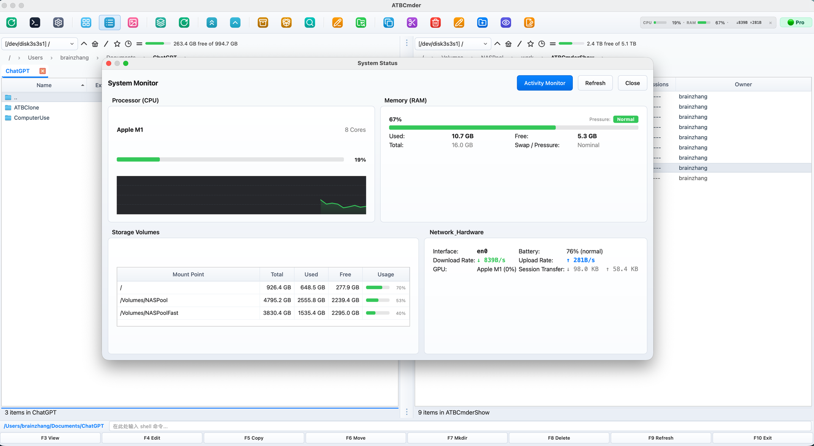
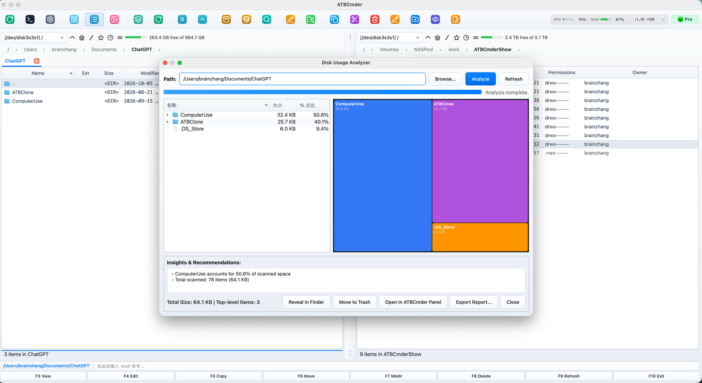
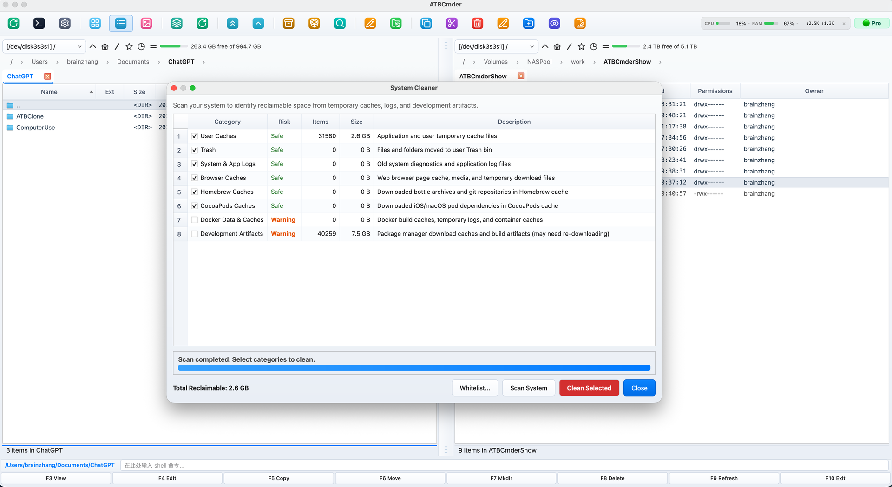
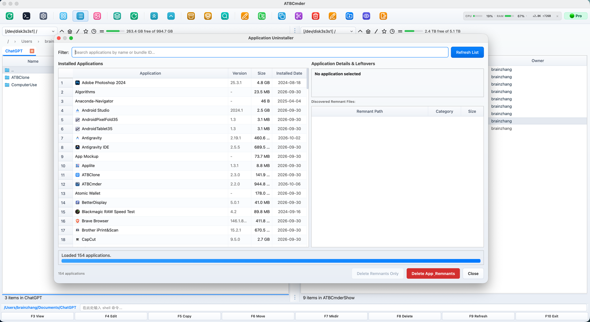

# 第 7 章：系统工具与日常维护

专业的文件管理器绝非孤立运转的文件列表——它是存储、内存与系统底层资源的核心调度中枢。尽管正统双栏文件管理在组织、搬迁与同步目录层级方面表现卓越，但在日常高强度开发、运维及内容创作中，用户往往需要应对更深层的系统挑战：找出究竟是哪个隐藏目录在悄然吞噬数十 GB 磁盘空间、定位失控狂飙 CPU 的后台进程、一键清除数以 GB 计的废弃开发构建产物与中间缓存，以及彻底卸载旧版 macOS 应用程序而不残留任何偏好设置 plist、后台守护进程 LaunchAgents 或 Application Support 孤儿文件。

ATBCmder 将五大专业级系统维护与诊断工具直接集成于 **工具 (Tools)** 菜单中。依托原生异步监控守护线程，这些工具在后台高效运转，既不会冻结双栏文件操作界面，也彻底免去了安装臃肿且充斥广告的第三方系统清理软件的烦恼。

---

## 1. 视觉速览与快捷键矩阵

ATBCmder 将系统维护细分为五大核心工具套件，并配以主工具栏常驻的状态监控胶囊：

```
┌────────────────────────────────────────────────────────────────────────────────────────────────────────┐
│                                       ATBCMDER SYSTEM TOOLS SUITE                                      │
├────────────────────────────────────────────────────────────────────────────────────────────────────────┤
│                                                                                                        │
│  [1] Status Capsule HUD & Popover       [2] System Status & Diagnostics (⌘⇧M)                         │
│      • 实时 CPU、内存与网络吞吐指标         • 独立核心利用率柱状图与双分页沙盒视图                     │
│      • Top 进程排行 (CPU 与内存双指标)      • Top 进程 (命令行与应用) + 正在运行的应用程序             │
│                                                                                                        │
│  [3] Disk Usage Analyzer                [4] Recent Changes (cm_RecentChanges)                          │
│      • 高并发多线程目录遍历引擎             • 按体积与修改时间快速锁定最近变动的文件与文件夹           │
│      • 交互式矩形树状图 (Treemap)           • 聚焦 (Spotlight) 极速初筛、实时过滤与废纸篓清理          │
│                                                                                                        │
│  [5] System Cleaner (⌘⇧C)               [6] Application Uninstaller (⌘⇧U)                             │
│      • 两阶段安全清理：先 Dry-run 扫描      • 彻底清除 .app 应用程序包与其关联的 8 类深层残留支撑文件  │
│      • 支持按应用与按类别双向分组审查       • 深度扫描 Application Support、Preferences、Caches 等     │
│      • 准确保留体积度量与 10 大明确保留原因 • 双模式运行：完整卸载 vs 仅清理遗留残留                   │
│                                                                                                        │
└────────────────────────────────────────────────────────────────────────────────────────────────────────┘
```

### 双矩阵系统工具快捷键一览

| 工具 / 操作 | macOS 原生快捷键 | 传统 Commander 键位 | 命令 ID | 菜单对应位置 |
| :--- | :--- | :--- | :--- | :--- |
| **系统状态与诊断控制台** | `Cmd+Shift+M` / `⌘⇧M` | `Ctrl+Shift+M` | `cm_SystemStatus` | **工具 ➔ 系统状态...** |
| **磁盘空间占用分析器** | *(菜单项)* | — | `cm_DiskUsageAnalyzer` | **工具 ➔ 磁盘空间占用分析器...** |
| **最近修改文件与文件夹** | *(菜单项)* | — | `cm_RecentChanges` | **工具 ➔ 查看最近修改的文件/文件夹...** |
| **两阶段安全系统清理器** | `Cmd+Shift+C` / `⌘⇧C` | `Ctrl+Shift+C` | `cm_CleanSystem` | **工具 ➔ 系统清理...** |
| **应用程序深度卸载器** | `Cmd+Shift+U` / `⌘⇧U` | `Ctrl+Shift+U` | `cm_UninstallApp` | **工具 ➔ 卸载应用程序...** |
| **开关状态胶囊显示** | 偏好设置 ➔ 常规 | — | *(配置项)* | **配置 ➔ 选项 ➔ 常规** |

---

## 2. 工具栏状态胶囊 HUD 与实时气泡卡片

ATBCmder 在主工具栏最右侧内置了 **系统状态胶囊 (System Status Capsule)**。无需频繁切换至 macOS 活动监视器或额外开启终端，即可在文件管理视野余光中随时掌握系统硬件负载健康状况。

```
┌────────────────────────────────────────────────────────────────────────────────────────┐
│ [左栏标签页]                         [右栏标签页]                [ CPU 18% | RAM 44% | ↓1.2M ↑340K ]│
└───────────────────────────────────────────────────────────────────────────┬────────────┘
                                                                            │ 点击状态胶囊
                                                                            ▼
                                                ┌───────────────────────────────────────┐
                                                │ SYSTEM METRICS SUMMARY                │
                                                ├───────────────────────────────────────┤
                                                │ CPU Usage:     [████░░░░░░░░░░]   18% │
                                                │ Memory:        [████████░░░░░░]   44% │
                                                │ GPU Load:      [██░░░░░░░░░░░░]   12% │
                                                │ Battery:       [████████████░░]   88% │
                                                ├───────────────────────────────────────┤
                                                │ Storage:                              │
                                                │  Macintosh HD:  312.4 GB / 994.6 GB   │
                                                │  External SSD:  842.1 GB / 2.0 TB     │
                                                ├───────────────────────────────────────┤
                                                │ Top Processes:                        │
                                                │  • ATBCmder         PID: 54102  CPU: 2%│
                                                │  • WindowServer     PID: 284    CPU: 8%│
                                                │  • Xcode            PID: 88120  CPU: 4%│
                                                ├───────────────────────────────────────┤
                                                │ [ 打开完整系统监控控制台 (⌘⇧M) ➔ ]    │
                                                └───────────────────────────────────────┘
```

### 2.1 胶囊构成与视觉设计规范

宽度固定为 `320px` 的状态胶囊包含三大实时硬件遥测指标，默认每秒刷新一次：

1. **CPU 利用率**：全处理器综合负载百分比，具备动态警戒色彩指示：
   - **正常区间 (< 75%)**：主题高亮蓝 / 正常文本色。
   - **升高区间 (75% – 90%)**：警示橙黄色。
   - **临界高负载 (> 90%)**：警报鲜红色。
2. **内存使用率 (RAM)**：物理内存中活跃与联动 (Wired) 内存占总容量的百分比。
3. **网络吞吐率**：当前所有活跃网卡的瞬时上行与下行总吞吐速率，紧凑格式显示（例如 `↓2.4 MB/s ↑512 KB/s`）。

### 2.2 交互式气泡卡片 (`StatusPopup`)

用鼠标左键单击工具栏状态胶囊，即可调出非模态浮动 **系统指标摘要卡片**：

- **多维硬件遥测**：汇总展示 CPU、RAM、GPU 负载百分比与电池健康状态（当前电量及充放电状态）。
- **文件系统挂载卷**：列出所有已挂载的 APFS 本地容器与外部移动磁盘，配备可用空间条与总容量标识。
- **Top 5 高资源消耗进程**：实时抓取当前占用 CPU 与内存最高的 5 个进程列表。在 Mac App Store 沙盒版本中，系统会自动显示“当前用户进程”范围指示器，聚焦当前用户旗下的前台软件与后台任务。
- **深入控制台跳转**：点击卡片底部的 **“打开完整系统监控控制台”** 按钮（或按下 `⌘⇧M`），即可无缝进入全功能系统诊断界面。

### 2.3 配置状态胶囊的显示开关

如果您偏好极简、无干扰的文件管理工具栏界面，可随时关闭状态胶囊：

1. 打开 **偏好设置**（快捷键 `⌘,`，或通过菜单栏 **配置 ➔ 选项...**）。
2. 在左侧导航栏中选择 **常规 (General)**。
3. 在 **界面布局与显示** 分组下，找到以下勾选项：
   `[X] 在主工具栏右侧显示系统状态胶囊 (Show system status capsule)`
4. 点击 **应用** 或 **确定**，胶囊即刻从工具栏显示或隐藏。

---

## 3. 系统状态与诊断控制台 (`cm_SystemStatus` / `⌘⇧M`)

按下快捷键 **`⌘⇧M`**（或 **`Ctrl+Shift+M`**），即可调出全功能的 **系统状态与诊断面板**。该模块专为软件工程师、系统管理员及性能诊断专家设计，充当嵌入文件管理器的极速任务管理器。

```
┌────────────────────────────────────────────────────────────────────────────────────────┐
│                             SYSTEM STATUS & DIAGNOSTICS                                │
├────────────────────────────────────────────────────────────────────────────────────────┤
│ CPU USAGE: Apple M3 Max (14 Cores)                                                     │
│ Core 01: [██████░░░░] 60%    Core 05: [██░░░░░░░░] 20%    Core 09: [███░░░░░░░] 30%    │
│ Core 02: [████░░░░░░] 40%    Core 06: [████░░░░░░] 42%    Core 10: [█░░░░░░░░░] 10%    │
│ Core 03: [████████░░] 80%    Core 07: [█░░░░░░░░░] 12%    Core 11: [░░░░░░░░░░]  5%    │
│ Core 04: [███░░░░░░░] 30%    Core 08: [██░░░░░░░░] 18%    Core 12: [░░░░░░░░░░]  4%    │
├────────────────────────────────────────────────────────────────────────────────────────┤
│ MEMORY: Total 36.0 GB  |  Used: 16.2 GB (45%)  |  App: 9.4 GB  |  Wired: 4.1 GB       │
│ SWAP:   Total 2.0 GB   |  Used: 0 MB (0%)                                              │
├────────────────────────────────────────────────────────────────────────────────────────┤
│ PROCESS LIST                                 Filter: [ node                     ] [x]  │
│ PID      Name             User           CPU %       Memory      Threads    Action     │
│ ────────────────────────────────────────────────────────────────────────────────────── │
│ 72841    node (dev-srv)   brain          48.2%       612.4 MB    28         [ Kill ✕ ] │
│ 72910    node (esbuild)   brain          12.1%       184.2 MB    14         [ Kill ✕ ] │
│ 73104    node (lsp)       brain           1.4%        98.5 MB     8         [ Kill ✕ ] │
├────────────────────────────────────────────────────────────────────────────────────────┤
│ Update Interval: [ 1.0s ▼ ]       [ Pause Monitoring ]              [ Close (Esc) ]    │
└────────────────────────────────────────────────────────────────────────────────────────┘
```

  
*图 7.1：实时系统状态与诊断控制台，监控 CPU、内存、磁盘 I/O 与高负载进程。*

### 3.1 诊断特性与核心指标分区

1. **多核处理器独立监视区**：
   - 完整展示 Apple Silicon 架构下的性能核心 (P-Cores) 与能效核心 (E-Cores) 负载。
   - 每个核心配有独立利用率进度指示条，在多线程编译、音视频渲染或批处理脚本运行时代核心饱和度一目了然。
2. **内存细分与 Swap 虚拟内存压力**：
   - 将物理内存精细划分为：应用程序内存 (App Memory)、联动内存 (Wired)、压缩内存 (Compressed) 与系统文件缓存。
   - 严密监控虚拟内存 Swap 换页占用，便于第一时间排查引起磁盘剧烈抖动的内存泄漏隐患。
3. **存储挂载卷容量总览**：
   - 实时监测各挂载分区的剩余容量比例，以及底层读写 I/O 速率。
4. **交互式全功能进程管理器**：
   - 实时可排序数据表格，汇总系统中所有运行的用户态与系统态任务。
   - **即时搜索与过滤**：在过滤框中键入任何进程名称或 PID，毫秒级定位目标任务。
   - **灵活终止进程**：
     - 单击操作列的 **Kill** 按钮，或选中行后直接按下 `Delete` 键。
     - 弹出确认对话框，支持优雅退出 **Terminate (`SIGTERM`)** 或强行终止 **Force Kill (`SIGKILL`)**（仅在非沙盒直装版中直接发送 POSIX 信号）。

---

### 3.2 Mac App Store 沙盒模式 (Top 进程 + 正在运行的应用程序)

在受限的 Mac App Store 沙盒环境中，Apple 沙盒安全准则禁止调用全系统进程遍历 API（如 `task_for_pid()` 或私有 Mach 内核监视），ATBCmder 采用 Darwin 原生进程自省机制 (`sysctl KERN_PROC_UID` 与 `proc_pidinfo`) 深度检视当前用户拥有的所有活跃任务：

- **监控范围标识**：沙盒模式下，面板标题栏会清晰呈现 `当前用户进程（App 沙盒）`，明确提示您正在监视用户账户下启动的应用程序、后台常驻守护程序、语言服务器 (LSP) 与命令行工具。
- **底部双分页排布**：
  - **Top 进程分页 (默认)**：开箱即用地按 CPU 占用率与内存占用双重排序，方便您一眼揪出失控狂飙的后台进程（如失控的 Node/Python 脚本、悬挂的构建进程或 LSP 服务）。
  - **正在运行的应用程序分页**：专为日常 GUI 软件打造的独立标签，直接从主线程缓存高清应用图标，并智能过滤掉后台小组件、XPC 辅助服务及系统扩展等杂音干扰。
- **沙盒合规的进程交互操作**：右键点击任意进程条目，即可使用一套安全且完全符合 macOS 沙盒准则的管理指令：
  - **退出 (Quit)** 与 **强制退出 (Force Quit)**：基于标准 macOS 规范安全请求应用优雅退出或强制终止。
  - **前置窗口 (Bring to Front)**：将目标应用的窗口直接切换并置顶到屏幕最前台。
  - **在访达中显示 (Reveal in Finder)**：在访达中直接定位并高亮其对应的 `.app` 应用程序包。
  - **在活动监视器中查看…**：打开系统自带的“活动监视器”并预先过滤定位到该 PID，方便深入探查内核调用栈。

---

## 4. 磁盘空间占用分析器 (`cm_DiskUsageAnalyzer`)

随着 SSD 固态硬盘可用空间逐步告急，手动在复杂嵌套的文件夹中排查吞噬空间的“元凶”极为繁琐低效。Finder 默认不自动统计子目录总体大小，逐层打开目录耗时耗力。

**磁盘空间占用分析器**（命令 ID `cm_DiskUsageAnalyzer`，可通过菜单栏 **工具 ➔ 磁盘空间占用分析器...** 呼出）采用多线程并发扫描技术，能在数秒内遍历大型目录树，并通过传统的层级树状列表与极具视觉冲击力的交互式 **矩形树状图 (Squarified Treemap)** 进行双向联动呈现。

```
┌────────────────────────────────────────────────────────────────────────────────────────┐
│ DISK USAGE ANALYZER: /Users/brainzhang                                                 │
├────────────────────────────────────────────────────────────────────────────────────────┤
│ Path: /Users/brainzhang ➔ Developer ➔ Projects                                        │
├──────────────────────────────────────┬─────────────────────────────────────────────────┤
│ DIRECTORY HIERARCHY                  │ INTERACTIVE SQUARIFIED TREEMAP                  │
│ Folder Name      Size       Percent  │ ┌───────────────────────────┬─────────────────┐ │
│ ──────────────────────────────────── │ │                           │ node_modules    │ │
│ ▼ Developer      142.6 GB   58.2%    │ │ target/debug              │ 28.4 GB         │ │
│   ► Projects     118.2 GB   48.2%    │ │ 64.2 GB                   │ (Rust build)    │ │
│   ► Caches        24.4 GB   10.0%    │ │                           ├─────────────────┤ │
│ ▼ Library         64.2 GB   26.2%    │ │                           │ DerivedData     │ │
│   ► Caches        38.1 GB   15.5%    │ │                           │ 18.2 GB         │ │
│   ► App Support   22.4 GB    9.1%    │ ├───────────────────────────┴─────────────────┤ │
│ ► Downloads       24.1 GB    9.8%    │ │ Video Footage (4K Prores)                   │ │
│ ► Pictures        14.2 GB    5.8%    │ │ 31.8 GB                                     │ │
├──────────────────────────────────────┴─┴───────────────────────────────────────────────┤
│ [ Zoom Out (..) ]  [ Reveal in Dual Panel ]  [ Move to Trash (⌘⌫) ]  [ Export CSV... ]  │
└────────────────────────────────────────────────────────────────────────────────────────┘
```

  
*图 7.2：磁盘空间占用分析器快速扫描本地卷，提供分类容量明细与矩形树图可视化。*

### 4.1 核心架构与技术亮点

- **异步多线程扫描引擎**：遍历 APFS 容器中的数万乃至数十万文件，扫描过程完全置于后台工作线程，主界面保持丝滑响应；底部状态栏实时显示每秒扫描的目录数量与已发现容量。
- **交互式矩形树状图 (Squarified Treemap)**：
  - 目录与文件被转化为紧凑嵌套的几何矩形块，每个色块的二维表面积严格等比于其占用的磁盘空间。
  - 色块明暗与色系自动随目录深度渐变，超大体积文件或目录在视觉上一目了然。
- **左右视图双向无缝联动**：
  - 在左侧目录树中单击任意行，右侧 Treemap 同步高亮其对应的矩形块边界。
  - 在右侧 Treemap 中单击任意色块，左侧目录树自动展开定位到该条目，并浮动提示完整绝对路径及精确字节大小。

### 4.2 交互导航与日常工作流

1. **下钻缩放 (Drill Down)**：双击目录树中的某项或双击 Treemap 中的色块，即可将视图聚焦至该子目录，以全新基准重新计算各占比。
2. **返回上一层 (Zoom Out)**：点击工具栏的 **返回上一层** 按钮（或点击顶部面包屑导航条中的任意父路径），快速退出当前局部视图。
3. **定位至双栏主界面**：点击 **在双栏中定位 (Reveal in Dual Panel)**，当前活跃的文件面板立刻切换并进入该目录。
4. **即刻移入废纸篓**：选中任意无用的大型文件或旧项目目录，按下 **`⌘⌫`**（或点击 **移入废纸篓**），文件安全送入 Trash，空间统计树自动局部重算。
5. **导出磁盘审计报告**：支持将分析结果一键导出为结构化的 CSV 或纯文本 TXT 报表，便于团队存储审计或容量规划。

---

## 5. 最近修改文件与文件夹 (`cm_RecentChanges`)

当构建工具突然产生巨量临时文件、安装器散落缓存，或者您急需盘点过去 1 小时或最近一周磁盘上究竟发生了哪些变动时，**最近修改文件与文件夹**（菜单：**工具 ➔ 查看最近修改的文件/文件夹...**，命令 ID `cm_RecentChanges`）可帮您按体积与修改时间瞬间排查最近创建或变动的项目。

```
┌────────────────────────────────────────────────────────────────────────────────────────┐
│                                     RECENT CHANGES                                     │
├────────────────────────────────────────────────────────────────────────────────────────┤
│ 目标路径: [ /Users/brainzhang                                    ]  [ 浏览... ]        │
│ [X] 文件    [X] 文件夹    时间范围: [ 最近 1 天              ▼ ]                       │
│ [X] 忽略小于此体积的文件: [ 1 MB ▼ ]   (预设: 1 KB / 1 MB / 10 MB / 自定义)            │
├────────────────────────────────────────────────────────────────────────────────────────┤
│ [ 按名称或路径实时过滤...                                                        ] [x] │
│ 名称              类型     占用空间       匹配修改时间戳               路径    扫描状态│
│ ────────────────────────────────────────────────────────────────────────────────────── │
│ derived_cache     文件夹      1.84 GB     2026-11-22 19:42             ~/Lib…  扫描完成│
│ dataset_v3.tar    文件      642.0 MB      2026-11-22 18:15             ~/Dow…  扫描完成│
│ build_logs        文件夹    ≥ 128.4 MB    2026-11-22 17:04             ~/Wor…  部分统计│
├────────────────────────────────────────────────────────────────────────────────────────┤
│           [ 在访达中显示 ]  [ 移到废纸篓 ]  [ 在 ATBCmder 面板中打开 ]  [ 开始搜索 ]   │
└────────────────────────────────────────────────────────────────────────────────────────┘
```

### 5.1 检索范围、时间预设与最小大小过滤

- **目标根目录与条目类型**：通过 **浏览...** 任意选择扫描起点根路径（默认定位至用户家目录），并可独立勾选匹配 **文件** 与 **文件夹**。文件夹不仅能根据自身修改时间命中，还会根据内部包含的已修改文件自动上卷汇总整棵文件夹的递归物理空间。
- **时间跨度预设**：提供 **最近 1 小时**、**最近 1 天**、**最近 1 周** 或带有可视化起止时间选择器的 **自定义时间范围**。
- **最小文件体积过滤**：勾选 **忽略小于此体积的文件** 并选择 **`1 KB`**、**`1 MB`**、**`10 MB`** 或 **自定义大小**（支持自由切换 `B`、`KB`、`MB`、`GB` 单位），彻底过滤微小文件的频繁抖动，保留清晰的真实大文件账单。

### 5.2 聚焦初筛与即时操作动作

- **基于 macOS 聚焦 (Spotlight) 元数据极速预筛**：新发起的搜索预先从系统 Spotlight 元数据快速加载候选集，实现毫秒级响应；后台线程并发计算各文件夹的实际物理磁盘占用 (`占用空间`)。当文件夹内部遇到无读取权限的深层子路径时，容量会以 `≥` 前缀如实标明部分下限。
- **搜索结果实时过滤**：在过滤输入框中键入任意子字符串（如 `.zip`、`Downloads` 或 `build`），列表无需重新扫描即可瞬时收窄高亮匹配行。
- **即时操作动作**：
  - **在访达中显示**（或双击任意结果行）：在 macOS Finder 窗口中直接揭示定位该项目。
  - **在 ATBCmder 面板中打开**：将当前激活的 ATBCmder 文件面板直接跳转至该文件所在目录并精准高亮该项。
  - **移到废纸篓**：直接将确认无需保留的近期垃圾文件或文件夹安全移入 macOS 废纸篓，并自动更新父级文件夹统计。

---

## 6. 系统清理工具 (`cm_CleanSystem` / `⌘⇧C`)

在日常长期使用下，macOS 系统各角落会悄然堆积巨额临时文件：过期的应用程序缓存、Xcode 中间派生数据与索引、包管理器残留、无用的诊断日志以及浏览器缓存。虽然部分缓存有助于短期性能，但陈旧冗余数据极度消耗高昂的固态硬盘空间。

**系统清理工具**（命令 ID `cm_CleanSystem`，快捷键 **`⌘⇧C`** / **`Ctrl+Shift+C`**）提供具备企业级安全保障的确定性两阶段清理架构，支持按应用程序树状分组、提供真实的保留体积透明度度量与明确的排除保留原因。

```
┌────────────────────────────────────────────────────────────────────────────────────────┐
│                              SYSTEM CLEANER: DRY RUN AUDIT                             │
├────────────────────────────────────────────────────────────────────────────────────────┤
│ 分组模式: [ 按应用程序分组       ▼ ]   [ 搜索过滤...                                 ] │
├────────────────────────────────────────────────────────────────────────────────────────┤
│ 分类 / 应用程序                    大小         状态                    路径           │
│ ────────────────────────────────────────────────────────────────────────────────────── │
│ ▼ [X] 用户缓存                     855.2 MB     +≥ 3.1 GB 已保留                       │
│   ├─ [X] 飞书                      191.7 MB                                            │
│   ├─ [~] 微信                       44.2 MB     +165.0 MB 已保留                       │
│   │   ├─ [X] multitab/Cache         44.2 MB     就绪                    .../Cache      │
│   │   └─ [ ] WMPF                  165.0 MB     包含数据库              .../WMPF       │
│   ├─ [ ] Gemini                    217.5 MB     应用程序正在运行                       │
│   └─ [ ] Microsoft Edge (cache)   ≥ 487.2 MB    文件数量过多            .../Edge       │
├────────────────────────────────────────────────────────────────────────────────────────┤
│ 扫描完成 (1 项未能完全验证)。请勾选要清理的项目。                                      │
│ 可回收总计: 855.2 MB                                                                   │
├────────────────────────────────────────────────────────────────────────────────────────┤
│ [ 白名单... ] [ 在访达中显示 ] [ 在 ATBCmder 面板中打开 ] [ 扫描系统 ] [ 清理选中项 ] │
└────────────────────────────────────────────────────────────────────────────────────────┘
```

  
*图 7.3：系统清理器安全扫描界面，展示应用缓存、系统日志与临时废弃文件预估。*

### 6.1 两阶段安全架构规范

与部分“一键式黑盒清理工具”直接在后台静默删除不同，ATBCmder 严格推行 **两阶段安全准则**：

1. **第 1 阶段：只读预检扫描 (Dry-Run Audit)**：
   - 清理器对标准化系统路径与各应用程序私有缓存/日志容器（如编辑器、即时通讯工具、多配置浏览器及开发工具链）执行只读勘测。
   - 统计文件总数、占用空间并计算可回收容量，期间绝对不修改或删除任何一个字节。
   - 重新校验具有不可变哈希特征的执行方案 (`--plan-id`)，确保最终删除动作严格限定在已审查且未发生外部篡改的目标路径。
2. **第 2 阶段：人工复核与选择性清除 (User-Reviewed Deletion)**：
   - 用户借助三态复选框逐类或逐个应用复核待清理列表，自由勾选或排除特定子条目。
   - 只有显式点击 **“清理选中项”** 并二次确认后，清理引擎才执行删除。
   - 所有的删除细节均原子性地写入操作审计日志：`~/Library/Preferences/atbcmder/operations.log`。

### 6.2 分组视图、保留体积与保留原因透明度

- **按应用与按类别双向树状分组**：可在 **按应用程序分组** 与 **按类别分组** 之间无缝切换，或在 **搜索...** 框中键入关键词即时过滤，切换期间完好保留已勾选的选定状态。
- **真实保留体积度量与阶梯式排序**：
  - 保护或跳过的已保留条目（呈置灰保护状态且不可被误勾选）依然呈现其实际只读度量的物理磁盘占用，而非模棱两可的 `未知`。当深层权限限制阻碍完整扫描时，下限容量以 `≥` 醒目标识（例如 `≥ 487.2 MB`）。
  - 混合分组在 `大小` 列仅呈现**可清理字节**（与底部的 **可回收总计** 严格对应），同时在 `状态` 列明确提示已保留体积（如 `+165.0 MB 已保留`）。
  - 按 `大小` 排序采用阶梯排序算法，确保可清理条目与分组始终排在纯保留或未知条目之前。
- **精准本地化排除保留原因**：每个被跳过的保留条目都会明确告知为何被保护排除：
  - `应用程序正在运行` / `应用程序状态未知`
  - `包含数据库`（自动保护 SQLite / `Cache.db` 与用户登录会话状态）
  - `被进程占用` / `无法验证是否被占用`
  - `包含符号链接` / `文件数量过多` / `权限不足`
  - `白名单排除` / `受保护数据`
- **扫描完整度与快速直接定位**：若存在任何未完全穿透遍历的项目，底部状态栏会清晰汇报具体受阻项数（*“扫描完成 (1 项未能完全验证)。请勾选要清理的项目。”*）。双击任意结果行或点击 **在访达中显示** / **在 ATBCmder 面板中打开**，即可瞬间定位并直观检查目标物理目录。

### 6.3 六大核心清理领域

| 清理分类 | 典型系统路径 | 风险等级 | 说明与建议 |
| :--- | :--- | :---: | :--- |
| **应用程序缓存** | `~/Library/Caches/` | **安全 (Safe)** | 桌面应用程序生成的临时缓存文件，缺失后会在下次启动时按需重建。 |
| **系统与用户日志** | `~/Library/Logs/`, `/var/log/` | **安全 (Safe)** | 陈旧的软件崩溃转储、诊断日志与安装日志，对日常使用无任何不良影响。 |
| **浏览器缓存** | Safari, Chrome, Edge, Firefox | **安全 (Safe)** | 主流浏览器缓存的网页静态资源、流媒体分片及脚本，清除可有效回收空间。 |
| **Xcode 派生数据** | `~/Library/Developer/Xcode/DerivedData` | **警告 (Warning)** | 苹果开发编译产生的中间产物与符号索引，清除后下次编译该工程需全量重建。 |
| **包管理器缓存** | Homebrew, CocoaPods, NPM, Yarn | **警告 (Warning)** | 下载的公式源码包、全局依赖 tar 包，清除后下次安装时需重新联网下载。 |
| **废纸篓容器** | `~/.Trash`, `.Trashes` | **危险 (Danger)** | 之前被丢入废纸篓但尚未彻底倾倒的文件，需要用户二次确认永久抹除。 |

### 6.4 风险等级划分与白名单保护

- 🟢 **安全 (Safe)**：纯临时无害数据，清除后绝不破坏用户配置与日常工作流。
- 🟡 **警告 (Warning)**：开发产物与包管理器缓存，清除安全，但下次重新编译或拉取时需耗费联网与计算时间。
- 🔴 **危险 (Danger)**：包含不可逆清空的项目（如彻底清空废纸篓），需要显式确认。
- **自定义白名单保护机制**：
  - 点击 **白名单...** 按钮，自由添加绝对禁止 ATBCmder 清理的私有目录路径（持久化于 `~/.config/atbsys/whitelist`）。
  - 内置保护规则严密守卫 macOS 核心系统组件、钥匙串钥匙库、SQLite 核心数据库及主流云盘的本地离线同步卷。

---

## 7. 应用程序深度卸载器 (`cm_UninstallApp` / `⌘⇧U`)

在 macOS 平台，将应用程序图标从 `/Applications` 拖进废纸篓仅仅删除了 `.app` 应用程序包自身。现代化应用往往在系统各深层目录中分散着数百个辅助文件：首选项 plist 文件、Application Support 核心数据库、开机启动 LaunchAgents、沙盒容器 Containers 以及大型媒体缓存。长年累月下来，这些被遗弃的“孤儿残留”不仅白白霸占宝贵空间，某些后台守护任务甚至仍会在用户开机登录时被动启动。

**应用程序深度卸载器**（命令 ID `cm_UninstallApp`，快捷键 **`⌘⇧U`** / **`Ctrl+Shift+U`**）基于 Bundle Identifier 精确匹配，全面扫描并连根拔除目标软件及其所有的隐蔽残留。

```
┌────────────────────────────────────────────────────────────────────────────────────────┐
│                             APPLICATION DEEP UNINSTALLER                               │
├────────────────────────────────────────────────────────────────────────────────────────┤
│ [ 过滤: Docker                       ]  发现: 142 个应用程序 (总计: 48.2 GB)           │
├──────────────────────────────────────┬─────────────────────────────────────────────────┤
│ 已安装应用程序                       │ 关联残留与支撑组件                              │
│ 应用名称          版本       大小    │ 文件路径 / 组件                     大小        │
│ ──────────────────────────────────── │ ─────────────────────────────────────────────── │
│ [X] Docker.app    4.28.0     1.8 GB  │ [X] /Applications/Docker.app        1.8 GB (.app│
│ [ ] Figma.app     116.15     240 MB  │ [X] ~/Library/Application Support/Docker 14.2 GB│
│ [ ] Slack.app     4.36.0     310 MB  │ [X] ~/Library/Caches/com.docker.docker   2.1 GB │
│ [ ] Visual Studio 1.87.0     450 MB  │ [X] ~/Library/Preferences/com.docker...  12 KB  │
│ [ ] Xcode.app     15.3      12.4 GB  │ [X] ~/Library/LaunchAgents/com.docker...  4 KB  │
│                                      │ [X] ~/Library/Containers/com.docker...  380 MB  │
├──────────────────────────────────────┴─────────────────────────────────────────────────┤
│ 卸载模式: (•) 完整卸载 (.app + 残留)               ( ) 仅清理残留 (清理孤儿残留)       │
│ 已选定移除项: 共 6 项，合计 18.48 GB                                                   │
├────────────────────────────────────────────────────────────────────────────────────────┤
│ [ 刷新应用程序列表 ]           [ 取消 ]                [ 卸载应用程序并清理 (18.5G) ]  │
└────────────────────────────────────────────────────────────────────────────────────────┘
```

  
*图 7.4：应用程序卸载器深度检索 Application Support、Caches 与 Preferences 等残留配置。*

### 7.1 残留文件深度勘测目录群

在扫描应用程序依赖时，ATBCmder 会基于精准提取的 Bundle Identifier 递归检索以下 8 大标准子系统路径：

1. **主程序安装包**：`/Applications/<Name>.app` 以及 `~/Applications/<Name>.app`。
2. **应用支持数据**：`~/Library/Application Support/<Name>` 与 `<BundleID>`。
3. **应用运行时缓存**：`~/Library/Caches/<BundleID>`。
4. **偏好设置文件**：`~/Library/Preferences/<BundleID>.plist`。
5. **保存的应用状态**：`~/Library/Saved Application State/<BundleID>.savedState`。
6. **启动守护配置项**：`~/Library/LaunchAgents/<BundleID>.plist`。
7. **沙盒隔离容器**：`~/Library/Containers/<BundleID>/` 与 `~/Library/Group Containers/`。
8. **应用独立日志**：`~/Library/Logs/<Name>/`。

### 7.2 两种核心工作模式

- **完整卸载模式 (Complete Uninstall - 默认)**：
  - 针对当前电脑中完好安装的应用程序。
  - 一键原子性清除 `/Applications` 下的可执行 `.app` 包及其分散在 `~/Library/` 下的所有支撑文件。
- **仅清理残留模式 (Remnants Only)**：
  - 针对过去通过 Finder 或其他方式直接删除了 `.app`、但残留孤儿文件仍遗留在 `~/Library/` 中的软件。
  - 自动对比已安装应用列表，揪出母体 `.app` 已不存在的弃置配置与数据目录，进行彻底扫除。

### 7.3 Apple 系统完整性保护与安全红线

为确保系统绝对稳定性与用户数据安全：

- **系统核心应用只读防护**：macOS 内置核心组件（Safari、Finder、预览、音乐、系统设置等）受系统完整性保护 (SIP) 保护，在列表中强制显示只读锁图标，禁止卸载。
- **活动进程占用拦截**：如果待卸载应用或其后台 Helper 守护进程当前正在运行，ATBCmder 会弹出友好提示要求您先退出该程序，避免在进程读写过程中造成文件损坏。
- **废纸篓过渡协议 (Trash-First)**：默认情况下，卸载文件均优先移至系统的废纸篓，而非强制不可逆地执行 `unlink`，以便在发生误操作时提供百分之百的后悔恢复机会。

---

## 8. 系统工具操作警示与专家提示

> [!NOTE]
> **极低的系统资源占用**  
> 后台监控守护线程基于原生编译底层接口打造，以 1.0 秒间隔轻量轮询。在常规双栏文件浏览期间，其 CPU 占用率始终低于 0.1%，并在 ATBCmder 最小化或窗口隐藏时自动休眠暂停轮询。

> [!TIP]
> **将磁盘空间分析器与双栏扁平分支视图联动**  
> 当磁盘空间分析器揪出某个子目录下堆积了数千个分散的零碎临时文件时，选中该目录后点击 **在双栏中定位 (Reveal in Dual Panel)**。随后在双栏中按下 **`Cmd+B`** (`cm_DirBranch`) 开启扁平分支视图，整个深层子树瞬间平铺为单一文件列表，即可通过键盘批量排序、筛选并清除。

> [!IMPORTANT]
> **执行清理前务必审查勾选清单**  
> 虽然系统清理器将开发缓存归类为 **安全 (Safe)** 或 **警告 (Warning)**，但某些开发工具缓存（如大型 Xcode DerivedData 或本地 Docker 构建镜像）在下次启动项目时需要一定时间重新下载或全量编译。请确认短期内不再活跃开发该项目后再行清除。

> [!CAUTION]
> **谨慎对系统进程发送强制强杀信号 (`SIGKILL`)**  
> 在系统状态的进程管理器中，发送 `SIGKILL` (Force Kill) 信号会立刻剥夺进程调度并不允许其刷写未保存的打开文件缓冲区。在日常运维中，请务必优先尝试优雅退出 `SIGTERM` 信号。

> [!WARNING]
> **应用沙盒容器清除需确认本地重要文档**  
> 卸载来自 Mac App Store 的沙盒应用时，存储于 `~/Library/Containers/<BundleID>` 下的文件往往包含该应用私有的沙盒文档数据库。在确认卸载前，请务必确认是否已将其中重要的项目文档另存导出。

---

## 9. 系统工具终极双矩阵快捷键速查表

| 分类 | 操作说明 | macOS 原生快捷键 | 传统 Commander 键位 | 命令 ID |
| :--- | :--- | :--- | :--- | :--- |
| **系统监控** | 打开完整系统状态与诊断面板 | `Cmd+Shift+M` / `⌘⇧M` | `Ctrl+Shift+M` | `cm_SystemStatus` |
| **系统监控** | 展开状态监控摘要气泡卡片 | 单击工具栏右侧胶囊 | — | *(界面交互)* |
| **系统监控** | 快速聚焦进程过滤输入框 | `Cmd+F` (面板内) | `F7` | — |
| **系统监控** | 终止选中进程 (`SIGTERM`, 直装版) | `Delete` / `⌫` | `Delete` | — |
| **系统监控** | 强制强杀选中进程 (`SIGKILL`, 直装版) | `Shift+Delete` / `⇧⌫`| `Shift+Delete` | — |
| **磁盘分析** | 打开磁盘空间占用分析器 | *(菜单: 工具 ➔ 磁盘空间占用分析器...)* | — | `cm_DiskUsageAnalyzer` |
| **磁盘分析** | 双击下钻进入所选文件夹 | `Enter` / `Return` | `Enter` | — |
| **磁盘分析** | 返回上一层父级目录 | `Backspace` / `⌫` | `Backspace` | — |
| **磁盘分析** | 将选中项目直接移入废纸篓 | `Cmd+Delete` / `⌘⌫` | `F8` / `Delete` | — |
| **磁盘分析** | 在双栏文件面板中定位选中项 | `Cmd+Return` / `⌘⏎` | `Ctrl+Enter` | — |
| **最近变动** | 打开最近修改文件/文件夹工具 | *(菜单: 工具 ➔ 查看最近修改的文件/文件夹...)* | — | `cm_RecentChanges` |
| **最近变动** | 在访达中定位匹配结果 | 双击 / *操作按钮* | — | — |
| **最近变动** | 在面板中打开 / 移入废纸篓 | *操作按钮* | — | — |
| **系统清理** | 打开两阶段安全系统清理器 | `Cmd+Shift+C` / `⌘⇧C` | `Ctrl+Shift+C` | `cm_CleanSystem` |
| **系统清理** | 执行只读预检扫描 (Dry Run) | `Cmd+R` / `⌘R` | `Ctrl+R` | — |
| **系统清理** | 切换分组方式 (按应用程序 / 按分类) | *分组下拉菜单* | — | — |
| **系统清理** | 在访达中显示 / 在面板中打开 | 双击 / *操作按钮* | — | — |
| **系统清理** | 快速切换选中项勾选状态 | `Space` 空格键 | `Space` 空格键 | — |
| **应用卸载** | 打开应用程序深度卸载器 | `Cmd+Shift+U` / `⌘⇧U` | `Ctrl+Shift+U` | `cm_UninstallApp` |
| **应用卸载** | 切换至“仅清理残留”模式 | `Cmd+2` / `⌘2` | `Alt+2` | — |
| **偏好设置** | 开关主工具栏状态胶囊 HUD | 偏好设置 ➔ 常规 | — | *(配置项)* |

---

<div align="center">
  <p>准备好定制快捷键、面板视图与应用行为了吗？</p>
  <p><strong><a href="preferences_and_customization.md">前往第 8 章：偏好设置与深度个性化定制 &rarr;</a></strong></p>
</div>
